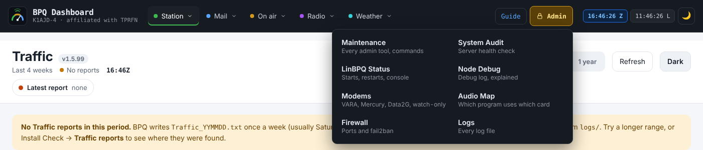
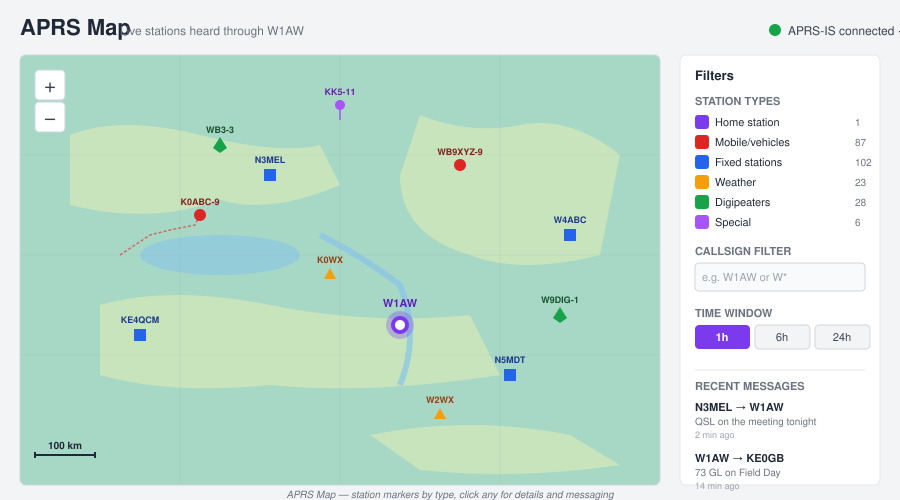
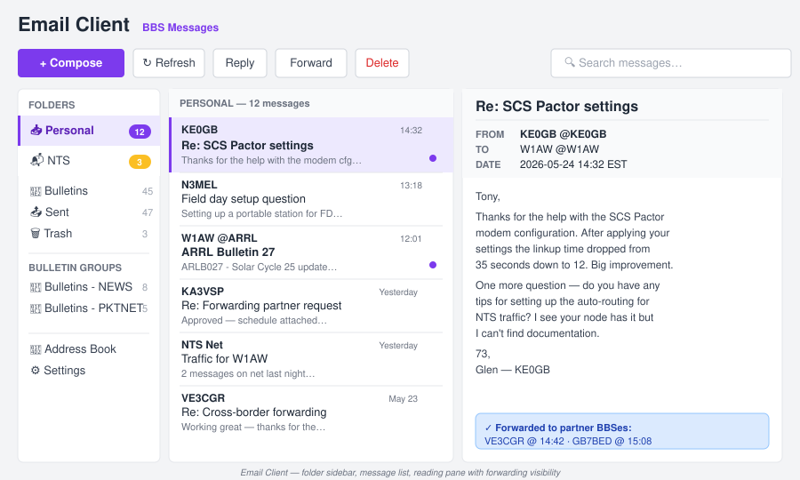
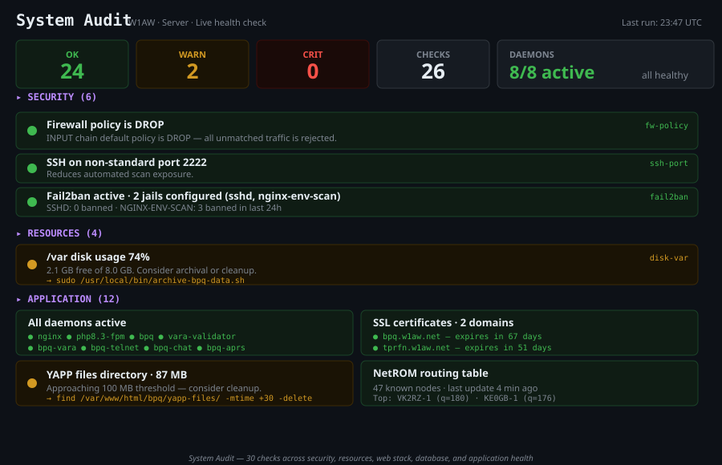

# BPQ Dashboard

**Version 1.5.94**
**User Guide**
*How to use every page of the dashboard*

| | |
|---|---|
| Companion document | See *User Manual & Installation Guide* (`USER-MANUAL.md`) for setup and troubleshooting |
| Audience | Sysops, operators, visitors |
| Updated | October 2026 |
| Repository | https://github.com/bpq-dashboard/bpq-dashboard |

---

## About this guide

This guide is for **using** the dashboard. Installing and repairing it are in the *User Manual & Installation Guide*. Each page gets a section: what you see, how to use it, where its data comes from, and what to check when it looks wrong. Part 6 collects the things a sysop needs across pages: which background services each page depends on, where settings are kept, what the common messages mean, and the known limitations of this release.

### Who this is for

Callouts mark content for specific readers:

> 👤 **For visitors** — someone looking at a public dashboard (maps, logs, weather, propagation: the read-only views).

> 📡 **For sysops** — the operator running the station (RF data, the BBS, VARA HF).

> 🔧 **For admins** — whoever maintains the server (Maintenance, Firewall Status, audits — all behind the admin login).

Most sysops are all three. Read everything that applies to you.

---

## Table of Contents

**Part 1 — Getting Started**
1. What the dashboard does for you
2. The navigation bar
3. Day/night theme
4. Clocks: UTC and local time

**Part 2 — Communicating with Other Stations**
5. Chat Client
6. Telnet Client
7. VARA HF Terminal
8. APRS Map

**Part 3 — Messages & Files**
9. Email Client
10. YAPP File Transfer
11. Messages

**Part 4 — Operations & Monitoring**
12. RF Connections
13. Traffic Report
14. System Logs
15. Connect Log
16. Rig Status
17. RF Power Monitor
18. NWS Weather Alerts

**Part 5 — Admin (behind the admin login)**
19. Maintenance
20. Firewall Status
21. Log Viewer
22. System Audit
23. Install Check and Health Check

**Part 6 — Sysop Reference**
24. What runs behind the pages
25. Where your settings are kept
26. Common messages and what they mean
27. Known limitations in v1.5.25
28. Keyboard shortcuts
29. Page URL reference
30. Getting help

---

# Part 1 — Getting Started

## 1. What the dashboard does for you

BPQ Dashboard is a web interface for a LinBPQ packet node and BBS. It reads the node's logs, talks to the BBS and chat server over the node's telnet port, and talks to the radio through flrig. From any browser — phone, tablet or desktop — you can read and send BBS mail, chat, open a terminal on the node, make VARA HF keyboard sessions, watch APRS, see what your forwarding partners are doing and check the radio.

### What you can do at a glance

> 👤 **For visitors:** see who connects to the node, RF propagation and forwarding history, the APRS map, NWS weather alerts, traffic and log statistics, and the radio's frequency.

> 📡 **For sysops:** everything above, plus: read and send BBS mail (including NTS), chat as the station, open a node terminal and transfer files by YAPP, make VARA HF connections, send APRS messages and beacon the BBS to APRS-IS, post NWS alerts as bulletins, change TX power and switch the radio's power outlet.

> 🔧 **For admins:** everything above, plus: check the server's health, firewall, logs and installation from the browser.

### Closing the browser

Most pages only display what the node and the background services are doing, so closing a tab changes nothing on the station. Three exceptions: closing the **Telnet Client** ends that telnet session; closing the **VARA HF Terminal** during a session asks the server to restore your scan schedule (Section 7); and the **Chat** page's connection is shared, so closing it doesn't take the station out of chat.

### Which pages ask for a login

Anything that **acts as your station** — sends, posts, transmits, or reads your mail — asks for a login. Everything else is public and read-only.

| You want to… | What it asks for |
|---|---|
| View RF Connections, maps, logs, traffic, weather, rig status | Nothing (public) |
| Use the Email Client (and its NTS Report), Chat, the admin pages, Install Check or Health Check | The **admin login** (your browser's login box) |
| Post an NWS bulletin, send an APRS message, save the BBS station info on the APRS Map, save station locations or forwarding partners on RF Connections, clear the callsign-lookup cache | The **admin login**, when you press the button |
| Open the VARA HF Terminal | The **admin login**, then the page's own login |
| Change frequency in the VARA HF Terminal; change TX power, the radio's settings (v1.5.60) or switch the power outlet on Rig Status | The page's own login: the **BBS password** (`bbs.pass` in `config.php`) |
| Open the Telnet Client, then log in to the node | The **admin login** (installer setup; the two-site template limits it to your home network instead), then your **BPQ user name and password** (BPQ asks) |
| Download a file the Telnet Client received by YAPP | The **admin login** (on a two-site setup: the same access as the Telnet Client) |
| Use the Maintenance page's forwarding-partners editor | The admin login, then the **BBS password** |

The admin login is the one you chose during installation. Your browser remembers it until you close it, so you normally see the box once per visit. If a button that used to work now shows a login box, that's this protection, not a fault. If a page says it "needs the dashboard admin login, and the web server didn't ask for it", your web-server config is older than the dashboard files: re-run the installer or compare it with the templates; Install Check shows which part is missing.

> 🔧 Send the admin login only over HTTPS. The installer sets up plain HTTP on port 80, which is fine on your home network. Before the dashboard is reachable from the internet, add a certificate (*Installation Manual* §11, "HTTPS and the firewall").

---

## 2. The navigation bar

Every page loads the same bar at the top.



- **📡 BPQ Dashboard** — returns to the home page, RF Connections.
- **Page links** — RF, Traffic, System, Connects, Messages, Email, Weather, Chat, APRS, VARA, Telnet, Rig, RF Power. The page you're on is highlighted. **Email** opens BBS Mail, the Thunderbird-style page, where the BBS mail store is set up (v1.5.71), otherwise the Email Client (Section 9).
- **📖 Guide** — opens this guide as a PDF in a new tab.
- **Admin ▼** — Maintenance, Firewall, Logs (the Log Viewer), Audit, Audio Map (v1.5.57), LinBPQ Status (v1.5.94). These ask for the admin login.
- **Clocks** — UTC (purple, "Z") and your browser's local time ("L"), updated every second.
- **Theme button** — 🌙 / ☀️ (Section 3).
- **⚙** — on the admin pages only: *Dashboard Settings* for the forwarding tools (Section 19).

On a phone (narrower than about 770 pixels) the links fold behind the **☰** button; the admin pages are listed under an *Admin* heading at the bottom of that menu.

**Optional pages** (v1.5.19): Telnet, Chat, APRS, VARA, Rig and RF Power appear only if your station uses them. The installer asks page by page (step 9); a page switched off is hidden from the menu, its helper service isn't installed, and its files stay, so it can be switched on later (Admin → Maintenance → *Optional pages*; the switches are `'pages'` and `'radio' => 'enabled'` in `config.php`). Opened by its address anyway, a hidden page still works and says it is switched off. Install Check and Health Check aren't in the menu; open them by address (Section 29).

> 🔧 After an update, press **Ctrl+Shift+R** (⌘+Shift+R on a Mac) once on any page. The menu is cached by the browser and only refreshes when its version number changes.

---

## 3. Day/night theme

The 🌙 / ☀️ button switches between dark and light.

Until you press it, each page follows your device's own light/dark setting. Once you choose, the choice is saved in that browser (each browser and device remembers its own). The Chat and APRS pages keep their own setting, so you may need to set them once separately.

Some areas stay dark in both themes on purpose: the terminal areas of the **Telnet Client** and **VARA HF Terminal** (green-on-black, like a terminal), the **RF Power Monitor** meter, and the navigation bar itself.

---

## 4. Clocks: UTC and local time

The two clocks in the bar show UTC and your browser's local time. Log files, BBS messages, BPQ scan schedules and most charts on the dashboard use **UTC**; the chart titles say "(UTC)". Use the local clock to translate: if the propagation report says 40 m opens at 22:00 UTC and the clocks show 18:23 Z / 14:23 L, that's 6 PM local.

---

# Part 2 — Communicating with Other Stations

## 5. Chat Client

**Page:** `/bpq-chat.html` (menu: **Chat**)

> 📡 **For sysops** — behind the admin login, because everything typed goes out as your station.

The Chat Client is a browser window onto your BPQ chat server. It doesn't log in by itself: the **bpq-chat** service holds one permanent connection to the chat server as the station, and the page sends and receives through it.

### What you see

- **Toolbar** — 🔌 Connect, ⏹ Disconnect, 📢 Join Room, 👥 Users, 📋 Topics, 🔊 (sound on/off), 💾 Export (saves this session's text as a `.txt` file), 👥 Who Panel (show/hide the right-hand panel), and the connection status.
- **🌐 Chat Server pane (top)** — everything the chat server sends: replies to commands, joins and leaves. Type server commands in its input line; the **⌘** button lists them as buttons.
- **💬 Chat Rooms pane (bottom)** — one tab per room (topic) you've joined, each with its own input line. Drag the divider between the panes to resize them.
- **👥 Online panel (right)** — who is in chat, refreshed every 30 seconds; **⟳** refreshes it now.

### How to use it

1. Open the page and give the admin login.
2. A box asks for **Your Callsign**. Type it and press **🔌 Connect**. (The callsign is used for the page only; messages always go out through the station's own chat login.) The box and the status bar show your station's callsign and node from `config.php` `station`; entering the station callsign itself gives the sysop view. *Request access from the sysop* has the server e-mail your request to `station.email` (one request every 10 minutes; the page says if the server couldn't send it).
3. Use **📢 Join Room** or type `/T roomname` to join a topic; a tab opens for it.
4. Type in the room's input line and press Enter.
5. Useful commands: `/U` users, `/T` topics, `/T name` join a topic, `/P` ports and links, `/K` known nodes, `/S CALL text` private message, `/N name` and `/Q qth` set your name and location, `/History nn` recent lines, `/H` help, `/B` leave chat. The ⌘ list has the rest.

**Guest (read-only)** in the opening box shows the chat traffic without letting you send. It is meant for someone you've given the admin login to only to watch.

### Things worth knowing

- **Only what arrives after you connect is shown.** The page doesn't fetch earlier conversation; use `/History` to ask the chat server for recent lines.
- **Use one Chat tab per browser.** Tabs in the same browser share one place in the message stream, so two open tabs split the incoming lines between them.
- **⏹ Disconnect** stops this page receiving; the station stays in chat.
- BPQ drops a chat user that sends no real chat line for 2 hours. The service notices and rejoins chat by itself.

### When it doesn't work

- Red status, or *"Chat daemon not connected"*: `sudo systemctl status bpq-chat`, then `sudo systemctl restart bpq-chat`. The service restarts itself after a crash (every 10 seconds) and starts after LinBPQ.
- The **Online** panel says *"No reply to /U from the chat server"*: the service is connected to the node but not inside the chat server. It usually recovers by itself; if the message stays, restart `bpq-chat`.
- The service logs only to the system journal: `sudo journalctl -u bpq-chat -n 50`.

---

## 6. Telnet Client

**Page:** `/bpq-telnet.html` (menu: **Telnet**)

A terminal on your BPQ node in the browser: connect to the node, BBS or chat, run sysop commands, connect onward to other nodes, and transfer files by YAPP.

### What you see

- **Top bar** — connection status, 🗑 Clear, 📋 Copy (copies the whole session text), ⏹ Disconnect.
- **Left sidebar:**
  - **Local** quick-connect buttons — *BPQ Node*, *BPQ BBS* and *BPQ Chat* (all on this server's BPQ telnet port: `bbs.port` in `config.php`, 8010 by default; the button shows the number) and *WL2K CMS* (Winlink's server, port 8772).
  - **NetROM Nodes** — the node's current NetROM table, refreshed every 30 seconds (↻ refreshes now).
  - **Custom** — host and port (filled in with your BPQ telnet port). Only this server, your home network and Winlink's CMS servers are allowed, on ports 23, 8008, 8010, 8011, 8772 and your own BPQ telnet, FBB and web ports (from `config.php` and `bpq32.cfg`); the service refuses anything else so it can't be used as a relay.
  - **Session Log** — your recent connections in this browser.
  - **BPQ Commands** — click a command to paste it into the input line (node commands such as `NODES`, `ROUTES`, `PORTS`, `MHEARD`, BBS commands such as `L`, `R #`, `S CALL`, `K #`).
- **Terminal (centre, stays dark)** and, under it, the input line with two buttons: **📁 Files** (YAPP file transfer) and **Send ↵**. Both stay greyed out until you're connected to the node.

### How to use it

> 📡 **For sysops** — the web server controls who may open the connection (your home network and/or the admin login), and the node asks for its own login.

1. Click **BPQ Node** (or *BPQ BBS* / *BPQ Chat*) in the sidebar.
2. Log in at BPQ's `user:` and `password:` prompts with your BPQ user name and password. What you type at `password:` shows as `********`.
3. With *BPQ BBS* or *BPQ Chat*, the page types `BBS` or `CHAT` for you after the login.
4. Type commands and press Enter. ↑ / ↓ recall earlier commands.
5. Click ⏹ Disconnect or type `BYE` when done. Closing the tab also ends the session. Each tab is its own session.

### YAPP file transfer

Section 10. There is no separate YAPP button: **📁 Files**, next to **Send ↵** under the terminal, opens the file-transfer panel once you're connected; one click there switches to file-transfer mode, enters the BBS and lists its files.

### When it doesn't work

- Nothing happens when you click a target, or the status says it can't reach the service: check `sudo systemctl status bpq-telnet`. The page connects through the web server's `/ws/telnet` (over HTTP or HTTPS); a site file from before 2026-10-25 doesn't have it — re-run the installer or add it from the template (*Installation Manual* Part A, Step 9).
- The NetROM Nodes list stays empty or shows an error: `bpq-nodes-api.php` logs in with `bbs.user` / `bbs.pass` from `config.php` and needs `station.node` (your node call-SSID). The error under the list says which part failed.
- *Connecting to 127.0.0.1:… WebSocket error — is the telnet daemon running?*: the bpq-telnet service isn't running (`sudo systemctl enable --now bpq-telnet`).
- The buttons show the wrong port: the page takes it from `bbs.port` in `config.php`; fix it there and reload. If a port is refused, restart bpq-telnet after changing `config.php` (it reads the allowed ports when it starts; its log lists them).
- The service's log is in the Log Viewer under *Dashboard services → bpq-telnet* (passwords are blanked out).

---

## 7. VARA HF Terminal

**Page:** `/bpq-vara.html` (menu: **VARA**)

> 📡 **For sysops** — the page has its own login (the BBS password from `config.php`), since it changes your radio's frequency. The live VARA connection behind it has no login of its own, so the web server keeps it behind the admin login (the installer's site file does this; *Installation Manual* Part A, Step 9).

Keyboard-to-keyboard HF sessions over your BPQ VARA HF port. Your radio transmits; the browser is the keyboard and screen.

### Before you start

You need:

- VARA HF running and a VARA HF port in `bpq32.cfg`
- flrig running and connected to the radio
- an FLRIG **`RADIO 2`** block in `bpq32.cfg` (Section 27: the dashboard currently retunes only `RADIO 2`)
- the **bpq-vara** service running. It logs in with `bbs.user` / `bbs.pass` from `config.php` and finds your VARA HF port in `bpq32.cfg` by itself; set `vara.bpq_port` if it picks the wrong one (*Installation Manual* §9)

### What you see

- **Login box** — shows your node (`station.node`) and asks for the sysop password. *Request access from sysop* has the server e-mail the request to `station.email` in `config.php`; the address isn't shown on the page. It needs a working mail setup on the server — if sending fails, or no address is set, the page says so — and takes one request per address every 10 minutes.
- **Top bar** — status (IDLE, LOGGING IN, ATTACHED, CONNECTED, BUSY, INCOMING), the remote call, bandwidth, S/N and frequency chips, session timer, Clear, Copy, **Logout**.
- **Quick** frequency buttons — 80 m 3.596, 40 m 7.103, 30 m 10.148, 20 m 14.103 and 20 m 14.106 MHz (fixed in this release; Section 27).
- **Frequency (MHz)**, **Remote Callsign**, **Bandwidth** (BW500 default, BW2300, BW2750), **⚡ Connect**, **⏹ Disconnect**.
- **Terminal (stays dark)** and the input line with **Send ↵**, **D** and **End Session**.

### Making a connection

1. Log in with the sysop password.
2. Choose a frequency: click a **Quick** button (the radio is retuned right away and the page says it will move within about 7 seconds), or type one. The hint under the box shows the band, or warns when the frequency isn't in an ITU Region 2 HF data band; the page refuses those.
3. Type the remote callsign and choose the bandwidth: BW500 for weak signals and busy bands, BW2300 standard, BW2750 for the fastest rate on good paths.
4. Click **⚡ Connect**. The page attaches to the BPQ VARA port, sets the frequency you typed, sends the bandwidth and then `C CALL`.
5. When the status shows **CONNECTED**, type and press Enter; each line goes over the air.
6. **End Session** when you're done.

### Ending a session

- **D** drops the radio link only. The VARA port stays attached, so you can type `C CALL` to try another station.
- **End Session** and **⏹ Disconnect** do the same thing: drop the link, release the BPQ port and **restore your scan schedule** (the `RADIO 2` scan list in `bpq32.cfg` that the session replaced).
- If you close or hide the tab during a session, the page asks the server to restore the schedule as it goes. If that didn't happen (crash, lost network), open the page, log in and click **End Session**.

### Tips

- If the remote doesn't answer, the page says *"Connect failed — … did not respond"* and stays attached; type `C CALL` to retry or End Session.
- *"Channel busy — VARA waiting for clear channel"* means VARA heard activity and is holding off.
- *"VARA HF port is in use"* means another session (often a forwarding connect) has the port. Try again shortly.
- *"BPQ login or VARA attach failed"*: `sudo journalctl -u bpq-vara -n 30` shows the login and the `ATT` reply. The service logs in as `bbs.user`; use a BPQ user whose default application is the BBS (a user that lands straight at the node may not be allowed to `ATT`), or give the VARA terminal its own login in `config.php` (`'vara' => ['user' => …, 'pass' => …]`). When the service starts, it logs which BPQ port it uses for VARA HF and where that number came from. After a BBS login the service waits up to 10 seconds for the BBS prompt (any line ending in `>`, after "Connected to BBS" and the BBS's SID), then sends `NODE`; the log line *BBS login OK* shows the prompt it saw. *ATT failed … Output aborted* means the `ATT` reached the BBS instead of the node.
- You can't change bandwidth during a session; disconnect, change it and reconnect.
- The login lasts an hour and is extended while you use it; after a long break, log in again.
- Once connected to another node, its BBS commands work as usual.

---

## 8. APRS Map

**Page:** `/bpq-aprs.html` (menu: **APRS**)

The APRS Map shows stations heard by the dashboard's APRS-IS connection, around your station, on a live map.



### What you see

- **Toolbar** — station-type buttons (**All**, 🚗 **Mobile**, 🌡 **WX**, 📡 **Fixed**), ⟳ **Refresh**, ⊡ **Reset View**, 🛤 **Tracks** (on by default), ⭕ **PHG** (range circles), **Heard** (show stations heard in the last 1–12 hours, 2 hours by default), a callsign filter, 📋 **Browse**, 🏠 **BBS Info** and ✉ **Message** (with a count of unread messages).
- **Map** — station icons (standard APRS symbols), your BBS as a large orange ✉ marker, and a 50-mile circle around it.
- **📡 Stations** and **💬 APRS Messages** lists on the right; click a station to centre it.
- **Detail panel** (bottom left) — opens when you click a station.

Click a marker for its popup: last heard, comment and position; speed and altitude for moving stations; temperature, wind, humidity and distance/bearing from your BBS for weather stations.

**📋 Browse** opens a station list by category (Mobile, WX, Fixed, Digi, iGate, Object) with search, *Show on map* and *Message* buttons.

The map refreshes every 30 seconds and the tracks every 5 minutes. **Reset View** returns to your station; the map doesn't remember where you last panned.

### Sending an APRS message

> 📡 **For sysops** — needs the admin login.

1. Click ✉ **Message** (or *Message* in a station's detail panel or in Browse).
2. **Compose:** the recipient (`CALL-SSID`) and up to 67 characters.
3. Click 📤 **Send** (the browser asks for the admin login the first time). The message goes to APRS-IS under your APRS login callsign.
4. Replies to your callsign appear under 📥 **Inbox**.

Sending uses the APRS-IS login in `config.php` (`'aprs' => ['callsign' => …, 'passcode' => …]`), the same one the `bpq-aprs` service uses. If the callsign is missing, or the passcode is `-1` (receive-only) or doesn't belong to that callsign, Send is greyed out and the compose box says why. APRS delivery isn't guaranteed: if no reply arrives within a few minutes, assume it didn't get through.

> 👤 **For visitors:** the map and station details are open to everyone. Sending is limited to the sysop because every message goes out under the station's callsign.

### Your BBS on the map — station info

The large orange ✉ marker is your BBS. Click it (or **🏠 BBS Info**) for its station info: a short popup on the marker and the full details in the panel at the bottom left.

**Adding or changing the info** (📡 sysops — needs the admin login):
1. Click **🏠 BBS Info**, then **✏ Edit station info** (or **✏ Edit** in the marker's popup).
2. Fill in what visitors should see — every field is optional:
   - **Name** (default: *callsign* BBS), **BBS callsign** (e.g. the node or BBS SSID people connect to)
   - **Location**, **Sysop**, **Hours**, **Website** (full `https://…` address)
   - **Ports / frequencies** — one per line, e.g. `VARA HF 7.101 MHz` or `1200 bd 145.010 MHz`
   - **Services** — e.g. `BBS · Chat · NTS · Winlink RMS`
   - **Notes** — how to connect, who may use it, net times
   - **Marker position** — leave empty to use the centre of your grid square (`station.grid` in `config.php`), type a latitude/longitude, or press **📍 Pick on map** and click the spot (`Esc` cancels). **↺ Grid centre** clears it.
3. Click **💾 Save** (the browser asks for the admin login the first time).

The map, the 50-mile circle and the distances shown for weather stations are measured from the marker position.

> ⚠️ Everything you enter is **public** — anyone who opens the APRS Map sees it, including the exact position if you set one. Leave a field empty to hide it.

**Putting your BBS on aprs.fi** (📡 sysops):

At the bottom of the same form, tick **📡 Beacon this BBS to APRS-IS**. The `bpq-aprs` service then sends your BBS to the APRS-IS network, so it appears on aprs.fi and other APRS maps. You don't need BPQ32's own APRS settings for this.

- **Send as** — *Object* puts a pin with its own name (up to 9 characters, e.g. `TPRFN BBS`); *This station's position* puts the pin under the APRS login callsign (`'aprs' => 'callsign'` in `config.php`, e.g. YOURCALL-1).
- **Beacon comment** — the text aprs.fi shows next to the pin, up to 43 plain characters (no accents or symbols such as the middle dot). **↧ From info** fills it from your first port/frequency, BBS callsign and hours.
- **Every** — 10 to 60 minutes; 30 minutes is normal for a fixed station.
- The beacon uses the **Marker position** above, so one has to be set, with the APRS BBS icon.
- **Packet preview** shows exactly what will be sent; the line under it shows whether the service is beaconing (last sent, next one), or why not.

After **💾 Save** the first beacon goes out within about 2 minutes, and aprs.fi shows it a minute or so later — the **APRS** line in the BBS panel links straight to it. Untick the box (or rename the object) and the dashboard sends one "delete" packet so the old pin disappears from aprs.fi.

Beaconing needs a real APRS-IS passcode in `config.php` (`-1` is receive-only) and the `bpq-aprs` service running.

On a two-site setup (public site + sysop site) saving works only on the sysop site; the public site shows the info but refuses changes, and the editor says so. The info is stored on the server in `data/stations/bbs-info.json`.

### Map tiles

The map uses CARTO's tiles, which now need a free key: `'map' => ['carto_key' => '…']` in `config.php` (*Installation Manual* Step 10). Without one the map still works but CARTO stamps "API KEY REQUIRED" across it, and the attribution line says what to set.

### What's happening under the hood

The `bpq-aprs` service keeps a connection to APRS-IS, filtered to your area (`aprs.filter` in `config.php`; by default 80 km around your station), and stores what it hears where the map reads it. Outgoing messages are sent by the dashboard when you press Send. The BBS beacon goes out over the service's own connection; it checks the BBS info every 30 seconds. Its log is in the system journal: `sudo journalctl -u bpq-aprs -n 50` (add `| grep -i beacon` for beacons).

---

# Part 3 — Messages & Files

## 9. Email Client

**Page:** `/bbs-messages.html` (menu: **Email**)

> 📡 **For sysops** — behind the admin login; visitors can't open it.

A webmail-style client for your BBS: Personal mail, NTS traffic and bulletins, with folders, rules, an address book and a database copy of everything.

> **v1.5.75: for stations without the mail store.** Where the mail store is set up (*Reading BBS mail in a mail app*, below), **Email** always opens **BBS Mail** instead, and this page isn't used: it switches there by itself, and the *Classic view* buttons are gone. Without the mail store this page works as before, with a blue note at the top on how to set it up (× hides the note for 30 days in that browser). Its Quick Check-In has moved into BBS Mail too, and the details you saved here are brought over the first time you open it there.



### What you see

**Top bar:** 📨 **Get Mail**, the auto-fetch chip (shows the countdown; click it to change the interval), the search box, ✏ **Compose**, 📄 **NTS Report**, 📻 **PKTNET Forms**, ✅ **Quick Check-In**, and on the right **⚙ Properties ▾** (v1.5.32).

**⚙ Properties** gathers every Email Client option in one menu, like Thunderbird's, so nothing has to be hunted for in the sidebar or Preferences:

- **Mail:** Get Mail now, Compose, Quick Check-In, PKTNET Forms, NTS Report, and the **Auto-fetch** interval (changes at once).
- **View:** **Show messages killed on the BBS** and **Open messages in** Pop-up / Pane (both change at once).
- **Folders:** New folder; Rename / empty the folder you have open (one of My Folders); Clean up Bulletin folders; Run bulletin retention now.
- **Contacts:** Address Book, BBSes Seen, Forwarding Activity.
- **Settings:** Rules, Signature, Muted bulletin groups, Killed-message list (each opens Preferences at that section), All Preferences, Statistics.
- **Help:** this guide.

Click outside the menu or press Esc to close it. The sidebar's Contacts and Settings entries still work as before.

Messages are listed newest first by their date (since v1.5.32; before, a new message could land at the bottom of a 📌 folder), then by when the dashboard first saw them.

**Folder list (left):**

- **Mail**
  - **Personal** — messages to you
  - **NTS** — National Traffic System messages
  - **Bulletins** — every bulletin. Under it (▾ shows/hides them), one **Bulletins - GROUP** folder per distribution group (NEWS, WX, SITREP, …), filled automatically as bulletins arrive. Each group row has 🔔 (mute) and 📌 (keep) icons.
- **Other** — **Archived** (messages you archived in this browser), **Sent**
- **My Folders** — folders you create (**+ New Folder…**) or that a rule creates. A folder named **Trash** works as a real wastebasket (see *Deleting messages*).
- **Contacts** — **Address Book…**, **BBSes Seen…** (BBS callsigns found in the routing of incoming mail, busiest first), **Forwarding Activity…** (what this BBS forwarded to whom, from the BPQ log, for the last 1 hour to 7 days)
- **Settings** — **Rules…**, **Preferences…**, **Statistics…**

**Message list (centre)** — subject, from, date, size. The **Select all** box selects everything visible (respects the search).

**Messages open in a pop-up window** by default; Preferences can switch to a reading pane on the right.

### Getting mail

- **📨 Get Mail** asks the BBS for the newest Personal, NTS and bulletin listings (50 of each by default; Preferences → *Max messages per list*, up to 200).
- **Auto-fetch** repeats this **every 5 minutes** by default. Change it, or turn it off, in Preferences → *Auto-fetch interval*.
- With *Body fetching* on **Eager** (default), the page also reads every new message's text during Get Mail, so clicks open instantly. **Lazy** reads a message's text only when you open it, which makes Get Mail faster.
- The listings take one BBS login. Since v1.5.21 the message texts are read up to 10 per login too (before, every message had its own login, which on a slow or RF-linked BBS added a few seconds each). A message that doesn't come back cleanly in a batch is read again on its own.
- Separately, the server saves the text of new messages to the database every 5 minutes (`message-bodies.timer`), even when no browser is open. Which bulletins it saves is set by `messages.bulletin_text` in `config.php`: `all` (default), `pinned` (only 📌 groups) or `none`. To keep BPQ's BBS log small it lists bulletins with `LL 100` on most runs and the full list once a day (v1.5.40; `messages.bulletin_list_recent` / `bulletin_full_list_hours`).

The dashboard logs in to the BBS with `bbs.user` / `bbs.pass` from `config.php`. It works whether BPQ's `USER=` line lands that login at the node (then it types `bbs`, or `bbs.alias`) or straight in the BBS, and whatever BPQ's greeting looks like (since v1.5.18; before that the greeting had to contain a `}`). If the login fails, the message says which step and shows the last line BPQ sent (Section 26).

Only one session with the BBS runs at a time across the whole dashboard. If the BBS is busy (Get Mail in another browser, the text-saving job, the forwarding-queue check), the request waits; after 40 seconds it gives up with "BBS busy". Try again a moment later.

### Reading

1. Click a folder, then a message. It opens in the pop-up window.

The pop-up has:

- **Top row:** **Compose**, **NTS Report**, **PKTNET Forms** and **Quick Check-In** — so you can answer a net or file a report without closing the message
- **‹ Prev / Next ›** (or `←` / `→`) — step through the list in the order shown
- **A− / A+** — smaller or larger text; remembered
- **⤢** — fill the browser window; again to go back
- **Drag the bottom-right corner** to resize; it opens at that size next time
- **▣ Dock** — switch to the reading pane on the right (⧉ **Pop out** in the pane switches back)
- Below the header: ↩ **Reply**, → **Forward**, **Unread**, 🗂 **Archive**, **Move**, ℹ **Properties**, 🗑 **Kill**
- **Close** with ✕, `Esc`, or a click on the dimmed page around it

Opening a message marks it read **in the dashboard only**. BPQ itself marks a message read when its addressee reads it with `R`; the dashboard doesn't change BPQ's flag.

### Resizing the columns

Drag the thin divider between two columns (the pointer changes to ↔) to widen or narrow the folder list, the message list or the reading pane. Double-click a divider to reset it. The widths are remembered in this browser. On tablets and phones the columns stack and there are no dividers.

### Searching

The search box filters the **folder you're in** by from, to, subject and message text. To search bulletins, open **Bulletins** first.

### Composing

1. Click **✏ Compose** (or Reply / Forward).
2. **To:** a callsign, or a full address such as `CALL@BBS.STATE.USA.NOAM` for forwarded delivery. Matching Address Book entries are suggested as you type (↑ ↓ to pick, Enter to accept).
3. **Type:** **Private (P)**, **Bulletin (B)** — the To field is then the distribution group, e.g. `WX@USA` — or **Traffic (T)** for NTS.
4. **Subject** (BPQ keeps 60 characters) and **Body** (plain text).
5. Click **Send**. The BBS stores the message and forwards it on its normal schedule.

**If the connection drops while sending** (v1.5.76): sending takes a few seconds while the dashboard logs into the BBS. If the connection is lost before the answer comes back (a phone or iPad locking its screen or switching apps, Safari's *Load failed*, or a Wi-Fi drop), the page doesn't call it a failure. The status shows *Connection lost; checking with the server whether it went…*, then *Still sending on the BBS…*, and ends with **Sent** (*it had gone on the first try*), or sends it then if the first try never reached the server. Each message has a one-time id, so pressing Send again for the same text can't post a second copy. Only if the server can't be reached for about 2½ minutes does it say *Couldn't confirm whether it was sent*: check Sent or the BBS list before sending again.

**Signature** (v1.5.19): set one in **Preferences** and it is added to every new message when the Compose window opens, so you can change or delete it before sending. Optionally also on replies (placed above the quoted message) and with the usual `-- ` line in front. It is never added to Quick Check-In, NTS radiograms or PKTNET forms, whose formats are fixed. Plain text, up to 10 lines; it is kept on the server, so every browser and device uses the same one.

**Winlink mail** (v1.5.77): when the BBS collects Winlink mail (*Poll RMS*, Maintenance → *Winlink mail*), it arrives as ordinary personal mail and is marked **Winlink** in the list and the reader. Internet senders show as `RMS:user@domain`; Reply goes back to that address through Winlink. To write to an internet address through Winlink, put `rms:user@domain` in **To** (its case is kept); to a Winlink user, `CALL@winlink.org`.

**Send via SMTP** sends to an internet e-mail address through BPQ's own Internet (ISP) Gateway; the dashboard adds the `smtp:` prefix. Use it only after the gateway is set up and tested in BPQ — on an unconfigured gateway BPQ has hung the whole node on a single message.

### Selecting several messages

- **Select all**, or **Shift**-click a range, or **Ctrl**-click (⌘ on a Mac) to add or remove one without opening it.
- The selection bar then offers **Move**, **Read**, 🗂 **Archive** and 🗑 **Kill**. **Read** also clears messages that exist only in the database copy of a folder, so the folder's red unread number goes down to match (fixed in v1.5.33). The **Bulletins** view lists those database-only bulletins of every unmuted group too, so selecting all there and clicking **Read** clears the Bulletins badge.

### Deleting messages

- **Kill** deletes the message on the BBS. **Bulletins can be killed only after BPQ has forwarded them** (status `BF`). Killing one earlier could take it out of the outbound queue before other BBSes receive it, so the dashboard refuses and says why; a bulk kill skips them and tells you how many.
- **In a 📌 pinned folder, Kill keeps the database copy** — see *Keeping messages after you kill them*.
- **Trash:** create a folder named **Trash** under My Folders and move messages there. *Empty folder* on Trash really deletes (kills on the BBS and removes from the database), with the same `BF` rule for bulletins. *Empty folder* on any other folder only returns its messages to their inbox, unfiled — nothing is destroyed.
- **Archive** only hides a message in this browser (it moves to *Archived*); it doesn't touch the BBS or the database.

### Bulletin retention

Personal mail and NTS traffic are kept **indefinitely**. Bulletins are permanently deleted from the database **14 days** after they arrive, unless:

- their group is **pinned 📌** in the sidebar (see below), or
- you've moved them into **one of your own folders** under My Folders.

This runs automatically once a day (`bulletin-retention.timer`). **Preferences → Run retention cleanup now** runs it on demand. Deleted bulletins can't be recovered, so pin a group *before* its older bulletins age out. Pinned groups are kept for ever, so busy groups such as NEWS or WX keep growing; unpin them when you no longer need the history.

### Keeping messages after you kill them (📌)

Every message is saved in the dashboard's database, text included, so it stays readable after BPQ removes it. A message that arrived and left BPQ before its text was saved shows only its listing, with a note saying so. Killing a message normally removes it from the database too. To keep copies from some folders even after you kill them on the BBS, pin those folders.

Each folder row — the bulletin groups under **Bulletins** and your own **My Folders** — has a 📌 icon: faint means off, bright means on. Click it to toggle. In a pinned folder, **Kill** removes the message from the BBS but keeps the database copy in the folder, marked "⚠ killed on BBS". Since v1.5.31 these kept copies are **hidden** until you tick *Show messages killed on the BBS* in Preferences; the list's count says how many are hidden ("· 3 killed on BBS hidden"), and hidden ones don't count toward the folder's unread badge. For example, pin **TODAY** to keep every TODAY bulletin, and leave **WX** unpinned so killed WX bulletins go away as usual.

- Only messages that are *in* a pinned folder when you kill them are kept. Pinning a folder doesn't bring back messages killed earlier.
- A kept message is already gone from the BBS, so **Kill** is disabled on it. To delete the kept copy, turn on *Show messages killed on the BBS*, move it to **Trash** and empty Trash.
- Trash can't be pinned. Everything in a pinned group is also kept past the 14-day bulletin retention, whether or not it has been killed.
- Muted groups don't appear in the sidebar. To pin one, unmute it first; you can re-mute it afterwards and the pin stays.

### Muting bulletin groups

If you only follow some groups, or the list under **Bulletins** is too long, click the 🔔 next to a group to mute it. Its row **disappears from the list**, and its messages drop out of the umbrella **Bulletins** view and its unread count. Muting is instant and deletes nothing.

To unmute, open **Preferences → Muted bulletin groups**: each muted group is a chip — click ✕ to unmute it, or the group's name to open its folder without unmuting.

**Important:** muting only changes what the dashboard *shows*. BPQ still receives, stores and forwards those bulletins; which groups your BBS accepts is set in BPQ32's own forwarding configuration. Muted groups follow the same 14-day retention as every other unpinned group.

### Rules

**Rules…** files incoming messages automatically: *From / To / Subject contains* text → folder (the folder is created if needed). Rules are checked in order and the first match wins; they run on every Get Mail and are stored on the server, so every browser uses them. Bulletins are filed into their group folders without any rule.

### NTS folder and NTS Report

NTS traffic is filed into **NTS** automatically, with an unread count. **📄 NTS Report** opens a print-ready report of your NTS traffic and the station(s) each message was forwarded to, taken from your BBS's forwarding log, for 7 days to a year. *Save as PDF* uses your browser's print-to-PDF. The report asks for the admin login (it lists who your NTS traffic went to).

### Net check-ins and forms

- **✅ Quick Check-In** — a short form (name, callsign, location, band/mode, where to send it) that builds a check-in message and opens it in Compose. By default it goes as a bulletin (SB) to `PKTNET@USA`; to check in with a net manager instead, put their call in **Send to** and choose **Send as: Personal (SP)** (v1.5.21, e.g. SP N3MEL). Both are remembered with your name and callsign.
- **📻 PKTNET Forms** — opens the TPRFN HTML Forms by N3MEL (ICS, weather, radiogram, check-in and bulletin forms that produce packet-ready text). The installer downloads them into `pktnet-forms/`. To get the author's latest version, use **Admin → Maintenance → Email Client → PKTNET forms → Update forms** (v1.5.19; it shows the installed and latest versions, and **Undo** puts the previous copy back). If the button shows "not found", run `sudo bash scripts/fetch-forms.sh` in the dashboard folder.

### Address book

**Contacts → Address Book…** stores callsigns with notes; ✉ next to a contact starts a message to them. It is stored on the server.

### Preferences

**Settings → Preferences…** holds the auto-fetch interval, *Max messages per list*, *Open messages in*, *Body fetching*, **Show messages killed on the BBS** (v1.5.31, off by default: 📌-kept copies and messages BPQ no longer has are hidden from the lists and unread counts), **Forget killed list** (the dashboard remembers what you killed so BPQ's listing doesn't bring it back until BPQ's housekeeping removes it), **Muted bulletin groups**, **Clean up Bulletin folders** (repairs group folders with damaged names from an old bug), **Run retention cleanup now** and the **Signature** (v1.5.19, see *Composing*). Preferences are kept in this browser, except the signature, which is kept on the server.

### Forwarding details

Open a message and look at the forward-events panel to see which BBSes it was forwarded to and when.

### Reading BBS mail in a mail app (optional, v1.5.67)

The sysop can set up a small mail store on the station that keeps a copy of the BBS mail, so it can be read in Thunderbird, a phone's mail app or any other IMAP mail program, with folders, read marks and search:

| Folder | What's in it |
|---|---|
| **INBOX** | Personal and NTS mail to the station's callsign (or SYSOP) |
| **Sent** | Personal and NTS mail from the station's callsign |
| **Bulletins/WX**, **Bulletins/SITREP** … | Every bulletin, one folder per group, kept 90 days |

- **It's a copy.** The BBS stays the master: filing or deleting in the mail app changes nothing on the BBS or in this Email Client's own folders. Mail passing through for other stations isn't copied.
- **Read marks are shared both ways** (v1.5.68). A message read in the mail app shows as read here, and one read (or marked *Unread*) here shows that way in the mail app, within about 2 minutes. If both sides changed the same message, read wins.
- **New mail arrives within about 7 minutes**: the dashboard saves a message's text every 5 minutes (`message-bodies.timer`) and `bbs-mail-sync.timer` copies it every 2. A message whose text couldn't be saved within 2 days is copied with a note to read it on the BBS (`R <number>`).
- **No sending from the mail app yet.** There's no outgoing mail: reply from this Email Client or the BBS. Senders show as `CALL@bbs.invalid`, an address that can never leave the station.
- **From your own network only**, over encrypted IMAP (port 993). Logins from other addresses are refused even if the port is open.
- **Mail app settings:** server = the name on the station's certificate (or its address on your network), IMAP, port **993**, **SSL/TLS**, normal password; user name = the callsign in lower case; the mail password the sysop chose (not the BBS password). No outgoing server is needed.

Set up with `sudo bash tools/bbs-mail-setup.sh` (Installation Manual §10.19); `--status` shows what's copied and waiting.

**From home, the name must reach the station.** The certificate's name usually points to your internet address, which most routers don't answer from inside. Add a line `<station's address> <name>` to the computer's hosts file (Windows: `C:\Windows\System32\drivers\etc\hosts`, edited as administrator) or to your router's local DNS. In Thunderbird, if *Re-test* or *Done* hangs, click **Advanced config** in the manual setup: it creates the account without testing it.

### BBS Mail: the Thunderbird-style page (v1.5.71)

Where the mail store is set up, **Email** in the menu opens **BBS Mail** (`/admin/bbs-mail.html`), laid out like Thunderbird's *Classic* layout: folders on the left, the message list on the right, the open message under it. It shows the mail store — the same folders, read marks and stars as Thunderbird on your PC.

- **Folder pane:** your callsign as the account, Inbox (with your own folders under it), Sent, Bulletins ▸ groups, Trash; unread counts in bold. ▸/▾ fold a branch. Right-click a folder: *New Folder…*, *Rename…*, *Delete Folder…* (your folders), *Mark Folder Read*, *Empty Trash…* (kills on the BBS).
- **Message list:** columns ★ (star), ● (read), Subject, Correspondents (the recipient in Sent), Date, Size, Type, and BBS # (off by default). Click a heading to sort (again to reverse), drag a heading's edge to resize, right-click the headings to show or hide columns. Click to read; Ctrl-click and Shift-click select several; click ★ or ● on a row to star it or toggle read. More load as you scroll.
- **Right-click a message:** Open Message in New Tab, Reply, Forward, Mark ▸ (read, unread, folder read, starred), Move To ▸, Copy To ▸, Delete.
- **Drag and drop** messages onto a folder to move them (hold Ctrl to copy). Dropping on Trash = Delete.
- **Message pane:** sender, subject, recipient, date (with UTC), BBS number and BID, folder; buttons Reply, Forward, ★, Delete, ⋯ (open in tab, read/unread, move, copy, copy text). Opening a message marks it read everywhere.
- **Tabs** along the top: the folder tab, each message opened in its own tab (double-click or Enter), and each message being written. Ctrl+W closes, Ctrl+Tab moves on.
- **Write / Reply / Forward** open a tab: To (suggestions from the Email Client's address book), Type (Personal SP, Bulletin SB, or — v1.5.74 — NTS traffic ST, addressed `ZIP@NTSst` such as `30301@NTSGA`; the To field's hint changes with the type), Subject and text, with your signature from the Email Client's Preferences. **Send** (Ctrl+Enter) sends it over the BBS as the station; it shows in Sent once the BBS lists it. A dropped connection while sending is handled as in the Email Client (*If the connection drops while sending*, above, v1.5.76): it checks with the server, and the same text to the same address is never posted twice. Reply quotes the message (`> `), Forward puts it under *Forwarded Message*.
- **Search all folders** (the box in the toolbar, Ctrl+K; Enter to search, Esc to go back) searches every folder but Trash. **Quick Filter** (Ctrl+Shift+K) filters the open folder: Unread, Starred, and text in Sender / Recipients / Subject / Body.
- **Delete** moves to Trash; in Trash it deletes for good and kills the message on the BBS (as described below). Shift+Delete outside Trash also only moves to Trash.
- **Get Messages** (F5) re-reads the mail store; it also does so every 2 minutes. New BBS mail reaches it within about 7 minutes (see above).
- **Toolbar:** NTS Report, PKTNET Forms, **✅ Check-In**, ≡ (more, keyboard shortcuts). Until v1.5.74 there was also a *Classic view* button for the older Email Client; from v1.5.75 BBS Mail is the only Email page where the mail store is set up.
- **✅ Check-In** (v1.5.75, also ≡ → *Quick Check-In…*; moved here from the older Email Client): a short form (where to send it, SB bulletin or SP personal, your name, callsign, town, state, grid, check-in type, band, mode, the station you came in through, comments) that fills in a net check-in and opens it in a Write tab, without a signature. Nothing is sent until you press **Send** there. The details (all but the comments) are kept on the station, so every browser and PC fills in the same ones; the first time, they're taken from the older Email Client's copy in that browser if there is one.
- Pane sizes, columns, sort order, open branches and the Quick Filter bar are remembered in this browser. Light and dark follow the dashboard's 🌙/☀ button.
- **Print** (Ctrl+P) and **Save As Text** (Ctrl+S) are under ⋯ in the message pane.
- **Winlink mail** (v1.5.77): mail the BBS collected from Winlink (*Poll RMS*, Maintenance → *Winlink mail*) or sent through it has a **Winlink** label in the Type column and the message pane, and ✉ before the sender. Internet senders show by their address (`jane@example.net`; Thunderbird shows `jane@example.net (Winlink)`), and **Reply** goes back through Winlink (`rms:jane@example.net`). In **To** you can write `rms:user@domain` for any internet address, or `CALL@winlink.org` for a Winlink user.
- **Forwarded to** (v1.5.79): under the message's details, *↗ Forwarded to K7EK 20 Nov 05:29, N4SD …*: the BBSes your BBS passed this message on to and when, matched by its BID in LinBPQ's BBS log (the last 7 days of logs). Nothing shows for a message that wasn't forwarded on, or when LinBPQ's logging is off.
- **iPad and phones** (v1.5.79): every toolbar button stays on screen (on narrower screens the less-used ones show only their icon, and on a phone NTS Report, Forms and Check-In move into ≡). Touch and hold a message, folder or contact for half a second to get the menu a right-click gives; tapping a ▸ menu item opens its submenu.
- **Drafts** (v1.5.78): a message being written is saved to the mail store's **Drafts** folder every 20 seconds while it changes, when the page is hidden (an iPad switching apps, a reload) and when you close its tab with ✕ (*Kept in Drafts*). The bar shows *Draft saved HH:MM*. Open a draft from Drafts (double-click or Enter) to carry on; it's removed from Drafts once sent. **Cancel** discards the message, and its draft, after asking. Thunderbird shows the same Drafts.
- **Plain characters check** (v1.5.78): before sending, Write looks for characters other BBSes and packet may garble: curly quotes, long dashes, accents, symbols, emoji, odd spaces (common in text pasted from Word or a web page). It lists them with their plain replacements (“ → ", – → -, é → e, … → ...) and offers **Use plain characters and send**, **Send as written** or **Go back**.
- **Tools** (v1.5.78, ≡ → Tools; moved here from the older Email Client, and shared by every browser because they read the server):
  - **Forwarding Activity**: messages your BBS forwarded on, by time, BBS, type, from, to, subject, BID and size, for the last 6 hours to 7 days. Read from LinBPQ's BBS log, so empty if LinBPQ's logging is off.
  - **BBSes Seen**: the BBSes in senders' full addresses over the last 180 days, with the longest route seen (to address mail as CALL@route), counts and the busiest senders through each.
  - **Statistics**: messages the dashboard has seen by type (last day, 7 and 30 days, with text), what's in the mail store now, the busiest senders and bulletin groups over 30 days.
  - **Killed on the BBS**: messages that left the mail store's Trash and were (or are waiting to be) killed on the BBS, with how and the result; and messages kept in the archive after a kill.
- **Other accounts** (v1.5.77, ≡ → Settings): other BBS users whose mail you also read here, for example a club or tactical call the BBS collects Winlink mail for (up to 10). Each gets its own folder, Inbox ▸ *CALL*, made at once; what they send goes in Sent. Mail already on the BBS for them is copied within a few minutes. Filters apply to them as to the Inbox.
- **Settings** (≡ → *Settings…*): how often to check for new mail (1–10 minutes, or only with Get Messages), a **desktop notification** for new Inbox mail (the browser asks once; it needs the page open in a tab, and https or the station itself), fixed-width or ordinary font for message text, names next to callsigns, and the **signature** (shared with the Email Client). The browser tab shows the number of unread Inbox messages, like *(3) BBS Mail*.

#### Message Filters and marking folders read (v1.5.73)

**≡ → Message Filters…** works like Thunderbird's. A filter has a name, *Match all* or *Match any* of its conditions, and actions:

- **Conditions:** From (callsign), To, Subject, Body, Type (Personal, NTS, Bulletin) or Bulletin group (e.g. `WX`), with *contains*, *doesn't contain*, *is*, *isn't*, *begins with*, *ends with*. *From is N3MEL* also matches N3MEL-1. ＋ / － add and remove conditions.
- **Actions:** move to a folder (any folder, or *New folder in Inbox…*), mark as read, star, and *stop filter processing*. A move ends filtering for that message.
- **When:** ticked *to new mail as it arrives*, filters run as new BBS mail is copied into the mail store, so a message lands straight in its folder (within about 2 minutes of the dashboard saving it). Because they act on the mail store, Thunderbird sees the same result. Ticked *when run by hand*, **Run All** includes it.
- The list: tick to enable or disable, ▲/▼ to set the order (top runs first), Edit / Delete, the number of messages each has acted on, and **Run Now** (the selected filter) or **Run All** on a folder you choose. Right-click a folder → *Run Filters on Folder* does Run All there.
- **Right-click a message → Create Filter From Message…** starts one with its sender (or, for a bulletin, its group) filled in; after saving it offers to run it on the open folder.
- Filters never touch the BBS. Sent mail isn't filtered.

**Mark as read:** right-click a folder → *Mark Folder Read* (Shift+C); right-click **Bulletins** → *Mark All Bulletins Read* (every group at once); right-click Inbox (or one of your folders with folders under it) → *Mark … and Its Folders Read*. **≡ → Mark All Read ▸** offers Inbox, Inbox and its folders, All Bulletins, or Inbox and all Bulletins. Read marks reach Thunderbird and the Email Client as usual.

#### Retention: cleaning out old bulletins (v1.5.74)

Like Thunderbird's *Retention Policy*. **≡ → Settings → Bulletin retention:** *Delete bulletins more than N days old* (the default comes from `config.php` `bbs_mail.bulletin_days`, 90 if unset) or *Don't delete bulletins*, and *Always keep starred messages*. That applies to every **Bulletins ▸ group** that has no setting of its own. **Right-click any folder → Properties…** gives it its own: use the default, don't delete any messages, or delete messages more than N days old — so you can keep `Bulletins ▸ ARRL` for a year, clear `Bulletins ▸ WX` after 3 days, or tidy one of your own folders. Your own folders, Inbox and Sent are never cleaned unless you give them a number.

The clean-up runs once a day (`bbs-mail-sync.py`, after 04:00) by the message's own date, and on demand with **Run retention cleanup now** (Settings, or ≡ → *Run Retention Cleanup Now…*). It removes the mail-store copies (here and in Thunderbird); it never kills anything on the BBS, and it isn't the Email Client's own 14-day database clean-up, which carries on separately. Trash is still emptied after 30 days (and what leaves Trash *is* killed on the BBS, see above).

#### Address Book (v1.5.72)

📇 **Address Book** in the toolbar (Ctrl+Shift+B) opens it in its own tab, laid out like Thunderbird's:

- **Left:** All Address Books, **Personal Address Book** (with your **lists** under it), **Collected Addresses** (everyone you write to from BBS Mail who isn't in your Personal book is added here, as Thunderbird does) and Starred.
- **Middle:** the contacts as cards (initials, name, callsign and BBS address), a search box (name, callsign, address, email, phone, location, notes), sort by name, callsign or last written to. Click, Ctrl-click and Shift-click select; ↑ ↓ move, Enter edits, Delete deletes. Right-click: Write, Edit, Add to List ▸, Move to Personal, Star, Export as vCard, Delete. Drag contacts onto a list to add them.
- **Right:** the contact: name, callsign, BBS address, email, phone, grid, location, a QRZ.com link, notes, the lists they're in, and their **recent messages** in the mail store (click one to open it). Buttons Write, Edit, Messages (search all folders for them), Delete.
- **＋ Contact:** callsign (required), first and last name (they fill the display name), display name, nickname, **BBS address** (where mail to them goes: `CALL@BBS.#REGION.ST.USA.NOAM`; blank = the callsign, which the BBS routes itself), email, phone, grid, location, notes, starred.
- **👥 List:** a name, a description and members (tick them). Writing to a list sends one BBS message to each member.
- **⋯:** import the older Email Client's address book, import everyone who has written to you, import a vCard (.vcf) or CSV file (Thunderbird's exports work), export all as vCard or CSV.

The address book also works in the rest of BBS Mail: names show next to callsigns in the message list and pane (Settings can turn that off); click the sender's name for *Add to Address Book* / *Edit Contact*, *Write*, *Search Messages*, *Copy Callsign*. In **Write**, the To field suggests contacts and lists as you type (↑ ↓ and Enter or Tab to pick). Since v1.5.89 callsigns that start with what you type come first, then names that start with it; the routing part of an address (`.#REGION.ST.USA.NOAM`) no longer matches single letters; clicking into an empty To box (or after a comma) lists your most used and starred contacts; several recipients go comma-separated (`Glenn <N3MEL@…>, Net members, K7EK`), and each gets its own BBS message (asks first, at most 25). A bulletin goes to one address.

### 📬 Mail store in this Email Client (v1.5.68)

Once the mail store is set up, a **📬 Mail store** section appears in the folder pane, below My Folders: **Inbox**, **Sent**, **Bulletins ▸** (each group with its unread count; click *Bulletins* to fold the groups away), any folder made in the mail app, and **Trash**. It is read live from the mail store, so it shows exactly what the mail app shows.

- **Opening a message** marks it read in the mail store (and in the mail app), and in this Email Client's own lists at once.
- **↩ Reply** and **→ Forward** go over the BBS as usual. **Unread** marks it unread everywhere. **Move to…** files it in another mail store folder. **🗑 Trash** moves it to the mail store's Trash.
- **Trash kills on the BBS** (v1.5.70). Nothing in Trash is killed yet, so a message moved there by mistake can be moved back. Once it **leaves** Trash it is **killed on the BBS** too, within about 5 minutes: when you **empty Trash** (right-click *Trash* → *Empty Trash*, or ⋯ next to it), **✖ Delete for good + kill on BBS** in Trash, emptying Trash in Thunderbird, or Trash's own clean-up after 30 days. Before killing, the dashboard reads the message number on the BBS and kills it only if it still holds the same message (BPQ reuses numbers). Each kill is listed in Log Viewer → *Message text job*. Moving a message out of Trash into another folder doesn't kill it.
- **Your own folders** (v1.5.70): right-click **Inbox** (or click its ⋯) → *New folder in Inbox…*; your folders show under Inbox with 📁, and right-click on one offers *New folder in …*, *Rename…* and *Delete folder…* (its messages go to Trash). Thunderbird shows the same folders; folders made there show here too.
- **Selecting several** (v1.5.69): tick the boxes (or *Select all*; Ctrl-click a row adds it, Shift-click picks a range) and use the bar above the list: **Read**, **Unread**, **Move to…**, **🗑 Trash**. In **Trash** the bar offers **✖ Delete for good + kill on BBS** instead (asks first). A message trashed or deleted here isn't copied in again.
- **The search box** searches the whole open folder (sender, subject and text) in the mail store. *Show more* loads the next 50.
- Your own folders, rules, 📌 keep and muted groups work as before; the Mail store view is beside them, not instead of them.

---

## 10. YAPP File Transfer

**Page:** Telnet Client (`/bpq-telnet.html`) → the **📁 Files** button next to **Send ↵** (active once you're connected to the node)

> 📡 **For sysops** — needs a BPQ login with BBS access.

YAPP (Yet Another Packet Protocol) moves binary files — documents, pictures, software — between stations and BBSes over packet.

### What you can do

- **Download** a file from a BBS to your computer
- **Upload** a file from your computer to a BBS
- **Browse** the files a BBS offers

### File-transfer mode

YAPP is a binary protocol, and normal telnet changes certain bytes, which breaks it. Files therefore go over BPQ's **FBB port** (`FBBPORT=` in `bpq32.cfg`, 8011 by default; set `bbs.fbb_port` in `config.php` if the dashboard can't read `bpq32.cfg`), which passes bytes through untouched. The panel calls this **file-transfer mode**.

You don't have to set it up yourself. Log in on the Telnet Client as usual, then open **📁 Files** and click **⚡ Switch to file-transfer mode**. The dashboard:

1. reconnects to your node on the FBB port, using the user name and password you typed at BPQ's prompts in this tab;
2. types `BBS` for you;
3. lists the BBS's files as soon as its prompt appears.

The login is kept only in that browser tab's memory, never saved. If you haven't logged in yet, or want a different login, the panel asks for the user name and password instead. If BPQ refuses the login, the panel says so and asks again.

Switching closes your current terminal session. A connection you made from the node to another station (`C CALL`) is not carried over.

### How to download a file

1. Open **📁 Files** and switch to file-transfer mode (above). The **⬇ Download from BBS** tab shows the BBS's files with their sizes. Type in the filter box to narrow a long list.
2. **Click a file.** The dashboard gets ready to receive and types `YAPP filename` for you.
3. Watch the progress bar, speed and **time left**.
4. When it finishes, click **⬇ Save filename**. The file also stays under **Received recently** in the panel, so you can save it again later from the same browser.

If the BBS answers *"File … not found"*, or you're at the node prompt instead of the BBS, the panel shows that message at once instead of waiting.

**Other BBS software:** if the file list doesn't work there, open *Other BBS software (manual receive)*, click **🛰 Arm Receiver**, then type that BBS's own download command in the terminal.

### How to upload a file

1. In file-transfer mode, at the BBS prompt, open the **⬆ Upload to BBS** tab.
2. **Drop a file** on the box, or click it to choose one (10 MB limit). The panel shows the name the BBS will store it under: anything except letters, digits, `.`, `_` and `-` becomes `_`. It also gives a rough time on air.
3. Click **⬆ Send to BBS**.

There's **no command to type first**. A BPQ BBS recognises an incoming YAPP upload by itself and saves it in its `Files` folder. Other BBS software may need its own upload command typed first.

Before sending, the panel checks the BBS's file list. BPQ refuses to overwrite a file that already exists, so if the name is taken, the panel warns you and won't send until you rename the file. If the BBS still refuses (for example because the file is over its size limit), the panel shows BPQ's own message, such as *"YAPP File x size 150000 larger than limit 100000"*.

**Why an upload keeps going after the bar fills:** YAPP sends the whole file without per-block replies. Your node takes the whole file at once, then sends it on over the link. During that stage the panel shows a moving bar and *"Sending to the BBS…"* with the time waited, and the BBS confirms only when it has every byte. That takes seconds on a local BBS and can take minutes over a radio or AXIP link. If the BBS answers with text instead (it has dropped out of YAPP), the panel shows that text and stops.

### Where files end up

**Received files** land in the `yapp-files/` folder of the dashboard's web root (`/var/www/bpq-dashboard/yapp-files/` with the installer's defaults). They keep the **real filename from the YAPP header**, with a timestamp prefix to avoid collisions: `20260524-191234-update-bpq.zip`.

Because these files come from another station, the dashboard treats them as untrusted. The folder asks for the login, and the **Save** link always downloads the file rather than opening it in the browser. A file whose name could be run by the web server or opened as a page (for example `.php`, `.html`, `.svg`, `.js`) is stored with its dots replaced and `.bin` added (`report.html` → `report_html.bin`). The Save link still saves it under its original name.

**Uploaded files** go into the BBS's own `Files` folder (under your BPQ directory).

> 🔧 **For admins** — clean up old received files now and then (adjust the path if your web root differs):
> ```bash
> find /var/www/bpq-dashboard/yapp-files/ -mtime +30 -type f -delete
> ```

### Tips

- **Packet is slow** — a 50 KB file can take 1–2 minutes over RF; 1 MB, 20–40 minutes. The speed and time-left readout tells you how it's going.
- **Long transfers are fine** — a transfer stops only if nothing at all arrives for 2 minutes (a dropped link). When uploading, it also allows for the file's time on air while it waits for the BBS to confirm.
- **Filenames with spaces work** for downloads.
- **You can close the panel during a transfer** — it keeps going; reopen 📁 Files to check on it.
- **Abort Transfer** stops cleanly: before a download has started nothing is sent to the BBS; during a download the dashboard ignores the blocks the BBS had already queued until it confirms the stop, then shows *Stopped*; during an upload it stops handing data to the node at the next block. If the node already had the whole file (the bar said *waiting for the BBS to confirm*), the BBS may still save it — the panel says so and refreshes the list. Wait for *Stopped* before starting another transfer.
- **Remote BBSes** — once in file-transfer mode you can `C` to another BBS from the node prompt in the terminal; the file list and downloads then work on that BBS.

---

## 11. Messages

**Page:** `/bpq-email-monitor.html` (menu: **Messages**)

Is mail moving, and with whom? A read-only summary worked out from BPQ's daily BBS logs (`log_YYMMDD_BBS.txt`), laid out like RF Connections (v1.5.86).

### What you see

- **Header** — Today, 7 days (default) or 30 days, Refresh and Dark. Below it a **status strip**: the BBS log's last line, how many partners are moving mail, the forwarding queue, and the last message in and out.
- **Headline cards:**
  - **Messages moved** — in and out, with Personal, Bulletin, NTS and B2 chips (click one to list those messages). Messages the other side **already had** are counted apart: the page matches each offer (FA/FB/FC) with its answer (FS), so only messages that really moved count.
  - **Waiting to forward** — the BBS's own forwarding queue (`FWD QUEUE`, asked at most once a minute with the BBS login in `config.php`), with a chip per partner.
  - **Bulletins** — how many came through and the busiest groups (click one to read its latest bulletins from the BBS).
  - **Security events** — from BPQ's mail-server log (`log_YYMMDD_TCP.txt`): wrong passwords and refused relaying, with "new since you looked". That log exists only when mail apps use LinBPQ's own POP3/SMTP.
- **Forwarding partners · mail** — one row per partner (those seen in the logs plus the partners saved on RF Connections): a status dot and a plain note, last mail moved, sent, received, already had, waiting, and 7 day blocks (darker = more mail). Problems come first:
  - red — mail waiting and nothing moved for over a day;
  - amber — mail waiting for over 3 hours, or offers in the last day that got no answer (usually the link dropped mid-session);
  - green — mail moved in the last day; grey — quiet.
  Click a call for that partner's messages.
- **Mail by hour (UTC)** — in above the line, out below. **Busiest senders** — who sent the most mail that came in.
- **Tabs** — Recent messages (filter by In, Out, Already had or type, and search by call, group or BID), Bulletins by group, Forwarding queue, Mail clients (POP3/SMTP/NNTP users) and Security log.

The page refreshes every 5 minutes. The server sends it only the log lines it needs (`mail-log-api.php`, v1.5.87), and the queue card shows "…" until the BBS answers.

### How to use it

- "Is mail moving?" — the status strip and the partner dots.
- "Why is mail stuck for one partner?" — its note says whether nothing is moving or offers go unanswered; then check that partner on RF Connections.
- Click a bulletin group to list its recent bulletins and read them. That reads from the BBS, so it asks for the admin login (and is refused on a public site).

For per-message detail use BBS Mail (reading) or the Forwarded Messages panel on RF Connections (who received what, and how).

---

# Part 4 — Operations & Monitoring

## 12. RF Connections

**Page:** `/bpq-rf-connections.html` (menu: **RF** — also the home page)

The main page: your VARA HF sessions, forwarding partners, forwarded messages and propagation, in one place. Since v1.5.46, stations running the **Mercury** HF modem also see its calls here (see *Mercury calls on this page* below), and since v1.5.56 those running **Data2G** (*Data2G calls on this page*).

**New layout in v1.5.44.** The data and its sources are the same as before, but the page is arranged differently:

- what needs attention is at the top;
- partners are rows rather than tiles, with the modems beside them and conditions across the page below;
- the details sit in tabs at the bottom;
- light and dark themes both work.

The previous layout (*Classic view*) was retired in v1.5.75; update.sh removes `/bpq-rf-connections-classic.html`.

### At the top

- **The GitHub banner**, with the link to the project (github.com/bpq-dashboard/bpq-dashboard). Close it with ×; it stays closed in that browser.
- **The title line:**
  - the version;
  - the period loaded;
  - the live status (how many connections; **"(DB)"** means the fast database path is in use, Section 26);
  - when the data was last updated;
  - a UTC clock.
- **Today / 7 days / 30 days / 90 days** sets the range for everything on the page; Today is the default. Since v1.5.39 the page reads only the lines it needs from each day's BBS log (frequencies, failure reasons, message proposals), filtered and cached on the server in `cache/bbs-lines/`. The first time a day is opened it takes a moment while the server reads that day's log once; after that it's quick.
- **Refresh**.
- **Station report:** a PDF of one station's sessions, by base callsign (all SSIDs), for the last 24 hours up to a year, with all, outgoing or incoming sessions, and for all modems or one (VARA HF, Mercury, Data2G, VHF packet; v1.5.85, VARA only before). With all modems it adds a **By Modem** table and a Modem column; Mercury and VHF sessions record no S/N or speed, so they show "–" there and the S/N and speed averages come from the VARA and Data2G sessions. It lists remote stations only, so your own callsign gives an empty report.
- **Dark / Light** switches the theme (the moon button in the menu bar does the same).
- **The status strip**, one pill per item. Each pill opens its details:
  - **VARA HF**: when the last good session was;
  - **Mercury**: its state and **calls in completed / heard** in 24 h, shown only with Mercury;
  - **Data2G** (v1.5.56): the same for Data2G, shown only with Data2G;
  - **VHF**: modem state and stations heard, shown only with a VHF sound-modem port;
  - **Watchdog**: partners paused, or with a failed attempt;
  - **Kp**: the current K-index;
  - **Last message**: the newest forwarded message, and with whom.
- **A red storm line** appears under the header when NOAA reports a geomagnetic storm.

### Headline numbers

These numbers are **VARA's** (Mercury calls aren't in them unless you switch that on, see *Mercury calls on this page*).

- **Success rate:** good sessions out of all sessions in the range, and the average bitrate.
- **Failed connections:** every failed VARA session in the range.
  - A coloured bar shows good sessions against each kind of failure.
  - The chips split the failures into **Timeout**, **Busy**, **Port in use**, **Incoming**, **No data** and **Other** (Other appears only when a failure had no recognised reason). The chips add up to the total.
  - **Timeout** is a call nobody answered: VARA ran all its tries ("Connecting to … 15/15") and never logged "Connected to". It's usually propagation, or the other station being off the air.
  - **No data** is a link that came up and then carried nothing (0 bytes both ways, no S/N). Before v1.5.30, unanswered calls were counted as No data; update.sh moves them to Timeout.
  - This is the complete RF failure count. System Logs' **Port in Use** counter covers only one of these kinds.
  - **Click a chip**, or the big number for all failures: the **Recent connections** tab opens with just those sessions. Click ✕ on the chip by the table to show everything again.
  - The line below gives the failures by band.
- **Average S/N:** overall, and per band.
- **Stations:** the number of stations connected over RF in the range. Click it for a sortable table of every station, with its sessions and messages.

### Forwarding partners

One row per forwarding partner. Partners that need attention are at the top: paused by the watchdog, then those with failed attempts or no contact for a day or more.

- **The partner's call:** click it for its **7-day history** (below).
  - A coloured dot: green is fine, amber needs a look, red is paused.
  - A short note under the call, e.g. "1 failed attempt · 5 waiting" or "no contact for 3 days".
- **Last good:** how long ago the last good connection was, with its UTC date and time. A good Mercury session counts too and is marked **· Mercury** (v1.5.47), so a partner you forward to over Mercury only isn't shown as silent.
- **Band** of that connection.
- **Waiting:** messages in your BBS's forwarding queue for that partner, from the sysop `FWD QUEUE` command. Click the number to see them under Forwarded messages. The server asks the BBS at most once a minute and shares the answer with every visitor.
- **Sent / rcvd:** messages each way over RF (VARA HF) in the range. NET/ROM, AXIP, AX.25 and Telnet messages don't count here; see Forwarded messages for those.
- **Last 7 days:** one block per UTC day, oldest on the left. VARA and Mercury calls both count (v1.5.46).
  - green: forwarded;
  - amber: good and failed sessions that day;
  - red: failed only;
  - grey: no attempt.

  Hover a block for its counts.
- **Refresh queue**, **+ Add** and **Manage** (edit or remove). Adding and removing partners asks for the admin login. This list is stored on the server in `data/stations/partners.json`. It's separate from the propagation scheduler's list (Section 19).
- **Connect Watchdog** (v1.5.35, optional, *Installation Manual* §10.1):
  - After 2 failed attempts in a row, the watchdog pauses forwarding to that partner for 6 hours; its mail waits in the queue. It then enables it again.
  - v1.5.90: the number of attempts, the pause length, the never-pause list and the BBS messages can be changed in **⚙ Dashboard Settings → Watchdog** (any admin page). Make the pause longer than the partner's forwarding interval: with hourly forwarding, 2–3 hours is plenty.
  - If the partner connects to you during the pause, the pause ends within 5 minutes (v1.5.38).
  - The partner's row shows ⚠ *N failed attempts*, or **Paused until HH:MMZ** in red.
  - Maintenance → *Connect Watchdog* has the status, dry-run and resume commands.
  - **RMS** (the Winlink CMS) is never paused (v1.5.77): the BBS only collects Winlink mail when it forwards to RMS.
  - **Fewer LinBPQ restarts** (v1.5.81): each change restarts LinBPQ for a few seconds, so a pause that's over waits up to 90 minutes for another change to share the restart (a partner that called in again: up to 30 minutes); its tile shows ⏸ *Resuming with the next restart*. When a restart happens, pauses ending within the next 90 minutes end with it, a little early. And a restart is never made while the radio is in use: any BBS session (any station), or a Mercury or Data2G call in progress, puts it off to a later run. (`watchdog.batch_mins`, default 90; 0 = one restart per change as before.)

### 7-day history (click any callsign)

Clicking a callsign opens a panel from the right side; it works from the partner rows, Recent connections and the Stations table. Close it with ×, Close or Esc. It always covers the last 7 days, whatever range is selected. It shows:

- the successful and failed sessions, average S/N and bands used;
- one block per day, as in the partner rows;
- messages waiting for that partner and any watchdog pause or failures;
- band activity and the **most efficient band**, with the best time of day;
- the **connection timeline**: date, UTC time, band, frequency, **modem** (VARA or Mercury, v1.5.46), status, S/N, modem rate and effective throughput (v1.5.64). Hover a Mercury status for its link mode and how the call ended. The successful/failed counts and the day blocks include Mercury calls; the most efficient band is worked out from VARA sessions only;
- shortcuts: **Show on map**, **In propagation report**, **Messages with this station** (Forwarded messages filtered to it) and **Look up callsign** (QRZ.com).

### Modems

A full-width card under the forwarding partners, one modem per column side by side (v1.5.48; they stack on a phone).

- **VARA HF:**
  - **Active** when there was a good session in the last 24 hours, otherwise **Quiet**;
  - the last good session and the last attempt, with how long ago;
  - today's good sessions out of all (UTC day).
- **Mercury HF** (v1.5.43, only on stations running the **Mercury** HF modem as a LinBPQ port, *Installation Manual* §10.17). The states:
  - 🟢 **On air**: Mercury runs and LinBPQ is attached to its TNC.
  - 🟢 **In session**: connected with the station shown.
  - 🟠 **LinBPQ not attached**: check the port's `ADDR 127.0.0.1 8400` line in `bpq32.cfg`, then restart LinBPQ.
  - 🔴 **No audio**: Mercury says the radio's sound card delivers nothing. If the card is shared with VARA, check that VARA still runs.
  - 🔴 **Modem not running**: `systemctl status mercury`.

  Below the state: Mercury's version, its LinBPQ port and callsign, then:
  - the current session (from/to, since when; hover for frames, bytes and the S/N range), or a call in progress;
  - the **last session** (hover for its mode, times, bytes sent and received, and how it ended; ⚠ when nothing came back or it timed out);
  - **Calls (24 h)**: connected / attempts, in and out. It turns amber when some didn't complete. A call heard but *not completed* is usually LinBPQ's frequency scan moving on before the link was set up (*Installation Manual* §10.17, "Scanning");
  - **Last decode**: the S/N of the last frame Mercury decoded, from any station;
  - **Last transmit**;
  - **Listening** on/off. LinBPQ switches it every few seconds while it scans, and while the VARA port on the same radio is busy. Hover for how many partly received frames those scan hops cut in 24 h;
  - errors in the last 24 h (hover for the newest);
  - **Recent activity**, newest first, UTC: calls ↗ ↘, calls not completed ↘✕ (grouped per caller, ×n), connects 🔗, disconnects ✕ (with why), LinBPQ attaching / detaching ⇄ (each LinBPQ restart), audio 🔊, starts and stops.

  The card is read from Mercury's log; the dashboard never connects to Mercury. Since v1.5.46 its calls are also in Recent connections, the partner rows and the activity chart (*Mercury calls on this page*, below). `config.php` `'mercury' => ['enabled' => false]` hides the card and stops the calls being read. For a live waterfall and S/N on the station's own desktop, Mercury's built-in monitor can be switched on with `tools/mercury-monitor.sh` (v1.5.49, *Installation Manual* §10.17); it isn't part of this page.
- **Data2G HF** (v1.5.56, only on stations running the **Data2G** HF modem as a LinBPQ port, *Installation Manual* §10.18). The same states as Mercury's: 🟢 **On air** / **In session**, 🟠 **LinBPQ not attached** (check the port's `ADDR 127.0.0.1 8500` line, then restart LinBPQ), 🔴 **No audio** (Data2G says its sound card input ended: `sudo systemctl restart data2g`), 🔴 **Modem not running** (`systemctl status data2g`).

  Below the state: Data2G's version, its LinBPQ port and callsigns, then:
  - the current session (hover for bursts heard, the waveform and the S/N range), or a call in progress;
  - the **last session** (hover for its waveform, times, bytes each way, S/N range and who hung up; ⚠ when nothing moved);
  - **Calls (24 h)**: connected / attempts, in and out. Data2G **turns a call away** when LinBPQ has its listening off (scanning another frequency, or VARA or Mercury using the radio) or when it's busy with another station; every try counts, so a caller who tried 5 times shows 0/5;
  - **Last heard**: the S/N of the last burst Data2G decoded and its waveform;
  - **Last transmit**, **Listening** on/off;
  - **Monitor page**: its port once `tools/data2g-monitor.sh` has switched it on (⚠ if it isn't kept to this machine);
  - errors in the last 24 h, ⚠ when the service doesn't run in UTC;
  - **Recent activity**, newest first, UTC: calls ↗, callers turned away ↘✕ (grouped, ×n, with why), connects 🔗, disconnects ✕ (we hung up / the other station hung up / ended by LinBPQ), LinBPQ attaching / detaching ⇄, audio 🔊, starts and stops.

  The card is read from Data2G's log `/var/log/data2g/data2g.log` and its service file; the dashboard never connects to Data2G. Its calls are also rows on the page (*Data2G calls on this page*, below). `config.php` `'data2g' => ['enabled' => false]` hides the card and stops the calls being read. Data2G's own **monitor page** (waterfall, constellation, every burst with S/N, decoded packets; with a password) can be switched on with `tools/data2g-monitor.sh` for the station's desktop (*Installation Manual* §10.18); it isn't part of this page.
- **VHF packet** (v1.5.28): one block per LinBPQ port that uses a KISS-over-TCP sound modem (QtSoundModem, Direwolf), named from `bpq32.cfg`. The states:
  - 🟢 **On air**: the modem is running and LinBPQ is connected to it;
  - 🟠 **LinBPQ not connected**: restart LinBPQ;
  - 🔴 **Modem not running**: check the modem's service, e.g. `systemctl status qtsoundmodem`.

  Below the state:
  - the newest station in BPQ's MHeard list for that port;
  - the watched stations on that port (Section 14), with ⚠ when one has been quiet too long;
  - **Heard today**: every station heard on that port in the period, newest first, with its UTC time. With 7, 30 or 90 days it adds the date. 🔗 marks a station BPQ flags as having connected. BPQ keeps each station once, with its last time, so it's a list of stations, not of every contact.

  Setting such a port up: *Installation Manual* §10.13; checks: Maintenance → *Sound modem*.

The Mercury, Data2G and VHF cards update every minute and are hidden on stations that don't have them.

### Conditions (across the page, under the partners)

- **From NOAA SWPC** (left): the current K-index, the daily A-index, solar flux and sunspot number, refreshed every 15 minutes.
- **Best band by time of day** (right, six slots side by side): the best band for each 4-hour UTC slot (00–04Z, 04–08Z, …), with each band's success bars. The slot you're in now is outlined.
  - It comes from your own success history over the last 30 days, blended with current conditions and day/night patterns.
  - It doesn't change with the range buttons.
  - **Show best paths on map** opens the Map tab with the paths drawn.

### Activity by hour (UTC)

Connections (good and failed) and messages sent and received for each UTC hour in the range, with totals and the peak hour underneath. With Mercury, a teal **Mercury** bar shows its calls per hour, and a tile underneath gives **Mercury good / calls** for the range (v1.5.46). Data2G gets an orange **Data2G** bar and a **Data2G good / calls** tile the same way (v1.5.56).

### Tabs

- **Recent connections:** every session in the range, newest first: time, callsign (click it for its 7-day history), type, **modem**, frequency, band, status, S/N, **Modem rate**, **Effective** and TX/RX, with a callsign search and pages. A failure chip (above) narrows it to one kind of failure (VARA sessions only, like the chips). With Mercury, Data2G or VHF packet, a **Modem** menu shows all, or one modem only (v1.5.46; VHF v1.5.51; Data2G v1.5.56).
  - **Frequencies** are shown to 100 Hz (v1.5.54): the dial frequency of the RADIO command for an outgoing call, or LinBPQ's "Freq" for an incoming one. Rows from before v1.5.54 are rounded to the kHz until re-read.
  - **Modem rate and Effective** (v1.5.64): *Modem rate* is each modem's own figure and they measure different things: VARA's is the fastest speed level it reached in the session (the mode's rate, not data delivered); Data2G's is the data it delivered and had acknowledged over its best minute; Mercury logs none. *Effective* is worked out the same way for every modem: bytes both ways × 8 over the seconds connected (VARA's Session Time; for Mercury and Data2G the time the link was up). Compare modems with Effective. It counts turnarounds, acknowledgements and idle time, so a short mail check reads far lower than the link could carry. VARA's statistics elsewhere on the page (Bands and channel quality, path scores, the propagation report) still use VARA's own rate, and Data2G's figure no longer mixes into them.
  - **VHF packet rows** (v1.5.51, indigo **VHF** chip): AX.25 connects on a packet port (QtSoundModem, Direwolf, UZ7HO SoundModem or a hardware TNC). They include your BBS's outgoing connects (for example the Winlink fallback to a VHF gateway), calls into the BBS, calls into the node that were heard on the VHF port, and the scheduled **test connects** (marked *test connect*). Status is ✓ or ✗ *no answer* / *busy*, with the length. There's no S/N, bitrate or byte count, because LinBPQ doesn't log them for AX.25. VHF rows also show in the partners' 7-day blocks and the 7-day history, but never in the headline numbers.
- **Forwarded messages** (the count is on the tab): every message your BBS forwarded to or received from a partner, one row per partner, so a bulletin sent to three hubs shows three times.
  - **Filters:** partner, type (bulletin, personal, traffic), **Via** and **Status**.
  - **Via** is how it travelled: 📡 RF (VARA), 📡 Mercury, 📡 Data2G (v1.5.82), 🔗 NET/ROM, 🛰 AXIP, 🌐 Telnet, 📻 AX.25 or "Port N". *RF only* is the default and includes all three HF modems; the filter can also show one modem. Mercury and Data2G use LinBPQ's VARA driver, so they're told apart by the port's TNC address (the modem's TCP port from `config.php`, `mercury.ini` or Data2G's service file) and, for incoming mail, by the modem's own call log. After updating to 1.5.82 the next parser run re-tags a year of forwarded messages once. Outbound messages are matched to the connect script in `bpq32.cfg`, so the column is right in both directions.
  - **📮 Winlink (CMS)** (v1.5.24) is your BBS's Winlink traffic with the CMS (forwarding partner **RMS**), by either route: 🌐 Telnet over the internet, or 📻 AX.25 / 📡 RF through an RF gateway when the internet route failed (*Installation Manual* §10.14). These rows aren't in *RF only*.
  - **Status:** ✅ delivered (the default), ⛔ rejected (the partner already had it), ⏸ deferred, or all offers. Most rejections are normal: partners refuse duplicates they've already received from someone else.
  - **Received** is when the transfer finished (UTC) and how long after the offer.
  - Counts everywhere on the page are **delivered** messages, not offers.
- **Propagation report:** a 7-day analysis of your forwarding partners, built when you open the tab:
  - failure analysis, an hourly performance heatmap and daily performance;
  - a station × band matrix, band efficiency and time-of-day analysis;
  - recommendations.

  **Rebuild** builds it again; **Print / PDF** prints it.
- **Map:** every station you've connected with, coloured by success rate, plus your own station (🏠). Click a dot for its details; **Best Paths** draws your best paths. The map opens centred on your station (🏠), zoomed out just far enough to show the stations around it (v1.5.52). Since v1.5.53 it also shows **Mercury HF** calls as a teal dashed line and **VHF packet** calls as an indigo dotted line from your station, and since v1.5.56 **Data2G HF** calls as an orange dash-dot line. Each modem keeps its own line also when its calls count in the headline numbers (`in_headlines`; v1.5.59 — before, they were drawn as VARA lines then). A station reached only by one of them gets a teal, orange or indigo dot. Click a line or dot for that modem's calls, how many connected, the bands, the bytes (Mercury, Data2G) and the last call. Lines for calls that never connected are drawn faint. VARA lines and dots are unchanged, coloured by success rate.
  - Locations come from QRZ.com (when `qrz` is set in `config.php`) or callook.info for US calls.
  - Stations without a location are listed as **Unmapped**. Click one, or **+ Add Location**, to place it by hand; **Manage Saved Locations** edits, imports or exports them. Saving or removing locations asks for the admin login.
  - Your own marker comes from the `station` section of `config.php` (callsign and grid square). Public pages show the centre of the grid square, never your exact position.
- **Bands and channel quality:**
  - the hourly band activity grid;
  - **Band Summary**: sessions, success and failures per band;
  - **VARA Channel Quality**, per band: average, median and best bitrate, the modulation tier that bitrate implies (BFSK/BPSK up to 32QAM), average S/N, and whether they're rising or falling.
- **Geomagnetic history:** any storm activity in the last 24 hours, the K-index for the last 3 days and the A-index for the last 30 days, colour-coded from quiet to major storm.
- **Modem performance** (v1.5.63): how VARA HF, Mercury and Data2G have done over the last 7, 14 or 30 days (**Show**), from this station's own connection records and NOAA's daily geomagnetic data.
  - A line per modem (success rate, connections) and how quiet or disturbed the geomagnetic field was, then a card per modem: success rate, passed / attempted, median S/N of the good sessions, bytes moved, stations.
  - **Every connection, by S/N, against the planetary K index:** a dot per connection that passed traffic at its S/N, squares for good sessions with no S/N (Mercury), crosses for failed calls, over shading for the 3-hourly planetary Kp (amber from Kp 2, red from Kp 5). Hover a mark for the station, band, frequency, result, bytes and Kp.
  - **How each modem's calls ended:** passed traffic, connected but nothing passed, no answer or busy, other (turned away, not completed, restart).
  - **Success rate by band**, with passed / attempted (hover for the median S/N).
  - **Day by day:** planetary and Fredericksburg A index (amber from 16, active; red from 30, storm), the highest Kp, and per modem passed / attempted and median S/N.
  - **Effective throughput** (v1.5.64) on each card: the median of the good sessions, and of the *message sessions* (500 bytes or more, so mail checks don't pull it down), bytes × 8 over the time connected, the same sum for every modem.
  - **Head to head: the same station on the same band:** where a station has worked you on one band with more than one modem, each modem's passed / attempted and median effective throughput side by side. The fairest comparison, since the path and the station are the same.
  - **What the numbers say:** worked out from the figures: each modem's best band, how many failures were unanswered calls (schedules rather than link quality) or links that carried nothing, and, once at least 5 calls fall in disturbed periods (Kp 4 or more), success and S/N then against quiet periods.
  - S/N isn't comparable between modems (VARA measures it over a wider bandwidth). Incoming VARA calls only appear once connected. NOAA's file covers 30 days. Notes under the findings say so.
- **VHF paths** (v1.5.50): a propagation history for each watched station (Section 14), one grid per station. It has one row per UTC day, newest at the top, and one column per UTC hour.
  - **Green cells:** how often the station was heard in that hour, from the 5-minute MHeard poll (light: once; mid: 2–3 times; dark: 4 or more; grey: not heard).
  - **✓ / ✗:** a scheduled **test connect** in that hour answered (✓), or got no answer or a busy (✗, red outline). Hover a cell for the times, seconds to connect and the node's answer.
  - The line above each grid gives the last heard time, how many hours it was heard in, and how many test connects answered with their average time.
  - **Show** picks 7, 14, 30 or 90 days. Hearings are kept 90 days (`system_logs.history_days`).
  - Test connects are only made for a watched station with **Test connect** set on Admin → Maintenance → Watched stations (every 1–24 hours, on a port). They **transmit**, so use them only with the other station's sysop's agreement: a Winlink gateway opens a CMS session for every connect.
- **Packet Live NetRom/Node Map** (v1.5.62): the live map of packet nodes and their NetRom links from the UK Packet Radio Network (`https://nodes.ukpacketradio.network/maps/packet`), shown inside the page. It's their data, not this station's, and it's only loaded when you open the tab. **Open in a new tab ↗** shows it full size; use it too if the map stays blank (the site can stop other pages showing it).

The page remembers the last tab you used, except the propagation report, which is only built when you choose it.

### Mercury calls on this page (v1.5.46)

On stations running the Mercury HF modem (*Installation Manual* §10.17), every Mercury call is a row in the same table as the VARA sessions, read from Mercury's own log every 5 minutes by `scripts/parse-mercury-log.py` (Section 24).

- **Where they show:** Recent connections (with **Mercury** in the Modem column), the partners' **Last good** time (v1.5.47) and 7-day blocks, the 7-day history panel and the hourly activity chart.
- **Where they don't (by default):** the headline numbers (success rate, failures and their chips, average S/N, stations), Best band, Bands and channel quality and the propagation report. (The Station report has its own Modem choice since v1.5.85.) Mercury and VARA calls aren't alike (Mercury logs no S/N for the session and no bitrate, and its scan hops leave many short failed calls), so mixing them would change what those numbers mean. To count Mercury there too, set `'in_headlines' => true` in the `mercury` section of `config.php`.
- **What a Mercury row shows:**
  - the frequency and bandwidth from LinBPQ's BBS log ("Incoming Connect … Freq …", or the RADIO line before an outgoing call). A call that never connected usually has no frequency;
  - the bytes each way;
  - the result in plain words: ✓ **ended normally**, ✓ **the other station hung up**, ✓ **we hung up** (LinBPQ ended it once nothing was left, v1.5.55), ⚠ **traffic passed, link lost before sign-off** (v1.5.61: data moved, then the link timed out before the call was closed; counts as a success, but LinBPQ may offer the last message again), ✗ **call not completed** (an incoming call that didn't come up, often LinBPQ's scan moving on), ✗ **no answer** (our call), ✗ **nothing received** (the link came up but carried nothing), ✗ **LinBPQ restarted** or **Mercury restarted** (a call cut off).
  - Hover the status or the Mercury chip for the link mode (e.g. DATAC16) and bandwidth.
- **No S/N and no modem rate** for Mercury rows: Mercury doesn't log them per session. *Effective* (v1.5.64) is worked out from its bytes and the time the link was up. The Mercury card shows the S/N of the last decoded frame.

### Data2G calls on this page (v1.5.56)

On stations running the Data2G HF modem (*Installation Manual* §10.18), every Data2G call is a row in the same table, read from Data2G's log every 5 minutes by `scripts/parse-data2g-log.py` (Section 24). They show and stay out of the same places as Mercury's (above): an orange **Data2G** chip in Recent connections (Winlink users calling your gateway call show band **WL2K**, v1.5.91), the partners' **Last good** (· Data2G) and 7-day blocks, the 7-day history, the activity chart and the Station Map; not in the headline numbers unless `'in_headlines' => true` in the `data2g` section of `config.php`.

- **What a Data2G row shows:** the frequency and bandwidth from LinBPQ's BBS log (as for Mercury), bytes each way from Data2G's session summary, the **S/N** (the average of the bursts heard from the other station) and Data2G's own **rate** (the data delivered over its best minute, shown as *Modem rate*; v1.5.64: not comparable with VARA's, use *Effective*). The time the link was up is stored too (`link_sec`), so Effective doesn't count the connect tries.
- **The result in plain words:** ✓ **we hung up** (LinBPQ ended it: DISCONNECT, or ABORT once it was done), ✓ **the other station hung up**, ⚠ **traffic passed, link lost before sign-off** (v1.5.61: data moved and was acknowledged, then nothing more was heard, LINK_LOST, before the sign-off; counts as a success, but LinBPQ may offer the last message again), ✗ **turned away** (a call to us while we weren't listening or were busy; a caller's tries within 2 minutes are one row — hover for why), ✗ **no answer**, ✗ **busy** / **not listening** (the station we called), ✗ **nothing received** (hover: *nothing heard from the other station* when Data2G gave up waiting, LINK_LOST), ✗ **LinBPQ restarted** / **Data2G restarted**.
- Hover the status or the chip for the data waveform used most (e.g. `qpsk-r1/3`; v1.5.57: the data bursts', not the control bursts'), bandwidth, S/N and how it ended.
- When LinBPQ ends a call with ABORT, Data2G writes no byte totals; the row then counts as good when data went either way (or uses the per-minute figures the service logs with `--stats-interval 60`).

### How to use it

> 👤 **For visitors:** a live picture of HF propagation and of one station's forwarding network.

> 📡 **For sysops:** check it before a VARA session — the status strip, current conditions, the best band for the hour, how a partner has been doing — then open the VARA HF Terminal. The partner rows put a partner that has gone quiet, failed or has mail waiting at the top.

### Where the data comes from

Sessions come from the VARA log: VARA HF sends its session log to the server as syslog (the registered VARA HF's Syslog setting, *Installation Manual* §10.11), `vara-logger` keeps the lines in `logs/<callsign>.vara`, and `parse-vara-log.py` reads them into the database every 5 minutes; messages and frequencies from BPQ's BBS logs; the queue live from the BBS.

**Winlink sessions and their frequency (v1.5.92).** A Winlink user calling your gateway call (K1AJD-10, say) goes to LinBPQ's Winlink gateway, not the BBS, so the BBS log has no line and no frequency for it. On VARA, Data2G and VHF alike, such a call shows band **WL2K** only when LinBPQ's gateway log (`CMSAccess_YYYYMMDD.log`) has that caller connecting to Winlink within a few minutes. Before v1.5.92 VARA marked every incoming call without a BBS line as WL2K. The frequency is the dial frequency the radio transmitted on during the call, from the rig history (`rig-history.jsonl`, read from flrig every 3 seconds while transmitting); it used to be taken from the nearest other call, which on a scanning radio could be another band. VHF calls show the port's frequency, from its WL2KREPORT line in `bpq32.cfg` or `'vhf' => ['freq_mhz' => 145.010]` in `config.php`. If a modem's radio isn't the one flrig reads, set `'rig_history' => false` in that modem's section (`vara` or `data2g`). To correct rows stored before v1.5.92, see Section 24 (`--backfill-freq`). Without the database the page falls back to reading the log files in your browser, which is much slower — see "(DB)" in Section 26. The page reloads its data every 15 minutes.

---

## 13. Traffic Report

**Page:** `/bpq-traffic.html` (menu: **Traffic**)

> 📡 **For sysops**

Per-station traffic from BPQ's own traffic reports: who connects, how many messages and bytes go each way, and how much is rejected. Unlike RF Connections it covers every kind of connection (RF, NET/ROM, AXIP, Telnet). Laid out like RF Connections since v1.5.86.

### What you see

- **Range** — 1 week, 4 weeks (default), 12 weeks or 1 year; Refresh and Dark. The status strip shows the latest report, the parser, how many BBS partners are moving mail, and the busiest station.
- **Headline cards** — Messages moved (in/out, with Personal, Bulletin and NTS chips; NTS is counted since v1.5.86), Rejected (refused here and by others, and the share of offers), Data moved (bytes in/out and the average message size), and Stations (click for the list).
- **BBS partners · traffic** — every station BPQ marks (B): sent, received, bytes, average size, rejected, connects, and one block per report (darker = more messages). A partner rejecting a quarter or more of its offers is amber and listed first. Click a call for its breakdown by type and by report.
- **Messages by report** (in above, out below) and **Message mix** (Personal / Bulletin / NTS).
- **Tabs** — All stations (sortable, searchable, All / BBSes / Users), Rejections (share of offers rejected per station) and Efficiency (average bytes per message).

### Tips

- It reads BPQ's `Traffic_YYMMDD.txt` reports. Many BBSes write one per week; then the newest days appear only after BPQ writes the next report.
- BPQ writes the reports in the LinBPQ folder itself. The parser looks in the dashboard's `logs/` folder and in `paths.linbpq` from `config.php`. To load older reports once: `sudo -u www-data python3 /var/www/bpq-dashboard/scripts/parse-traffic-report.py --backfill`.
- Still empty? The page says why. The parser's log (`/var/log/bpq-dashboard/parse-traffic-report.log`, Admin → Logs → *Traffic parser*) says which folders it searched, and Install Check's **Traffic reports** row shows where reports were found.
- "database" in the status line means the database copy is in use (`parse-traffic-report.py`, every 5 minutes); "report files" means the page read the files itself (last 90 days only).
- A sudden drop for one partner usually means its link or schedule has stopped; check RF Connections and Messages for that call.

---

## 14. System Logs

**Page:** `/bpq-system-logs.html` (menu: **System**)

Statistics and a searchable viewer for BPQ's daily logs, plus BPQ's live MHeard and routing tables.

### What you see

Laid out like RF Connections since v1.5.88.

- **Header** — Today, 7 days (default) or 30 days; Refresh; **Report** (PDF of the log lines matching the Live log search); Dark. The **status strip** below shows the logs, the last error, watched stations not heard lately (amber), the heard list and how many NetRom nodes are fresh; click one to jump to it.
- **Headline cards:**
  - **Node activity** — successful connections and active stations (*All stations* opens the full list, *Most active* the tab).
  - **Messages** — forwarded, received, and rejected by BID check.
  - **Errors** — the total and its share of events (amber at 15% or more), with chips for Port in use, Node lost, Protocol and Other.
  - **Internet links** — Winlink (CMS) sessions and bytes (from `CMSAccess` logs), login failures, and BPQ's mail server: POP3, SMTP, NNTP sessions and authentication failures (TCP logs).
- **Heard on your ports** — stations BPQ has heard, one button per BPQ port, with a dot (green connected, red failed, grey heard), last heard, bytes, and grid, band and frequency where BPQ records them (VARA/ARDOP ports). ★ marks a watched station; watched stations are listed first. The port names come from the `ID=` line of each PORT in `bpq32.cfg` (e.g. "VHF Packet 1200"); a port that has heard stations but isn't in the file shows as "Port N". If the web server can't read `bpq32.cfg`, name them in `config.php` → `'system_logs' => ['port_names' => [4 => 'VHF 1200']]`. The list is live (v1.5.25): every 5 minutes the dashboard logs in to the node with `bbs.user` and reads `MHU` for each port, and merges that with BPQ's `MHSave.txt`. Switch the live reading off on **Admin → Maintenance → Watched stations**, or with `'system_logs' => ['live_mheard' => false]` in `config.php`.
- **Watched stations** (★ chips above the ports): stations you want to know have gone quiet, e.g. a Winlink gateway you use as a backup. Amber = not heard for longer than its limit, or never. Listen only: nothing is transmitted. Set them on **Admin → Maintenance → Watched stations**: callsign with SSID, the port (or any), after how many hours to flag it, and optionally **Test connect** every 1–24 hours (v1.5.50, needs a port; it transmits). RF Connections → **VHF paths** shows them hour by hour.
- **Activity by hour (UTC)** (connections above, messages below) and **Event mix**.
- **Errors** — the breakdown by kind and the most recent errors; click one to find it in the log, or *All errors in the log*.
- **Tabs:** **Live log** (the BBS log lines: search, event type, date range, PDF report), **NetRom nodes** (BPQ's known nodes from `RTKnown.txt`, with Fresh / This week / This month / Stale chips), **Most active** and **Internet** (stations connected over Telnet/AXIP with round-trip time, and Winlink sessions by station).
- Click any callsign for its log lines, where it was heard, and links to RF Connections and Connects.

### How to use it

> 📡 **For sysops** investigating issues:

- "Did K0XYZ connect today?" — Live log, callsign `K0XYZ`, Today (or click the call anywhere on the page).
- "Why did forwarding to GB7BED fail?" — search `GB7BED` for that date.
- "What errors have we had?" — the Errors card, then *All errors in the log*.
- "Who has the node heard recently?" — Heard on your ports.

### Tips

- **Port in Use** counts BBS log lines reading "Error - Port in use" (the radio port was busy with another session). It is one kind of RF failure only; the full count is on RF Connections. The two pages also default to different ranges (System Logs 7 days, RF Connections today), so set both to the same range when comparing.
- The cards, charts, error breakdown, Most Active Stations, RMS/TCP panels and the MHeard/routing tables come from the database (`parse-system-logs.py`, every 5 minutes); "(DB)" in their status lines confirms it. The Live Log Viewer always reads the log files directly.
- Since v1.5.41 the cards load first, straight from the database, and the Live Log Viewer fills in after. The viewer gets the newest 100,000 lines from the server, read from the end of the log files (`system-logs-api.php?action=lines`). It used to download whole daily logs, which on a busy hub are 40–50 MB each. If the oldest lines you need aren't there, use the log files themselves (Admin → Log Viewer, or `logs/` on the server).

---

## 15. Connect Log

**Page:** `/bpq-connect-log.html` (menu: **Connects**)

> 📡 **For sysops**

Who connected to your node, and how, from BPQ's `ConnectLog_YYMMDD.log` files. BPQ records **incoming** connects only; your own outgoing forwarding connects aren't in these logs (see RF Connections and System Logs for those). Laid out like RF Connections since v1.5.86.

### What you see

- **Range** — Today, 7 days (default), 30 days or 90 days. The page loads the last 90 days once, so it can tell first-time callers from regulars.
- **Status strip** — the connect log's last entry, the last caller, today's count and first-time callers.
- **Headline cards** — Connects (with "busier / quieter than usual" against the 90-day average), Stations (with **New this period**), By path (NETROM, VARA, AX.25, TELNET: click one to filter the log) and the Busiest hour (UTC).
- **Regulars** — the stations that connect most: last seen, connects, paths, where they connected to, and 7 day blocks. **New faces** — callers not seen before in the 90 days.
- **When your node is used** — a day by UTC-hour grid (up to 14 days, then the whole period); darker = busier.
- **Tabs** — Log (filter by path or new callers, search), Map (stations by location, coloured by path, with lines to the node they reached), Trends (connects per day by path) and Stations (first and last seen).
- Click any call for its connects, paths and the hours it usually connects.

### Tips

- **Empty page?** BPQ writes `ConnectLog_YYMMDD.log` only with `LogAllConnects=1` in the main section of `bpq32.cfg` (before the first PORT). The page says so, and Install Check has a *LogAllConnects=1* / *ConnectLog files* row. Add the line, restart LinBPQ, and new connections appear.
- Many short connects from one station usually mean a poor link or a script retrying.
- The map looks stations up through `callsign-lookup.php` (QRZ, callook.info), so it needs the internet.

---

## 16. Rig Status

**Page:** `/rig-status.html` (menu: **Rig**)

Your radio as flrig sees it, updated every 3 seconds.

> Rig Status and the RF Power Monitor are installed only when flrig was set up during installation. If they're missing from the menu, flrig was skipped.

### What you see

- **Radio** — the make and model flrig reports.
- **Frequency** — large display in MHz, with band and the Hz digits; **mode** (USB, LSB, DATA-U, …).
- **📶 S-Meter**.
- **🔆 TX Power** — the radio's current power setting. After unlocking (the 🔒 button in Radio Control) you can change it with the slider, number box or presets and **Set**. The range is the radio's own (from flrig), capped by `radio.max_power` and `radio.min_power` in `config.php` if set. Each change is logged with the address it came from.
- **📡 Scan Frequencies** — the channels LinBPQ scans, read from the FLRIG `RADIO` block in `bpq32.cfg` (`radio.bpq_radio` chooses the block). With several time bands, the one running now (UTC) is highlighted; during a VARA keyboard session the card says the scan is paused.
- **⚡ Radio Control** — the PTT indicator (RX / TX), and, if you have a network power switch, the outlet state with ⏻ **Power ON**, ⏻ **Power OFF** and ↺ **Reboot**. The 🔒 button unlocks these with the BBS password. Off and Reboot are refused while the radio is transmitting.

### 🎛️ Radio settings (Yaesu FTdx-3000, v1.5.60)

Below the other cards: the radio's settings that matter to the data modems (VARA HF, Mercury, Data2G), read through flrig, so nothing competes with LinBPQ for the radio's CAT port. The card **only appears when flrig reports an FTdx-3000** (`FTDX3000`), because these commands differ between models; with another radio, or without flrig, the page doesn't show it (v1.5.66). To hide it on an FTdx-3000 station too: `'settings_panel' => false` in the `radio` section of `config.php`.

- **Live transmit meters** — tick **Live** to read ALC, PO, SWR and COMP every 1.5 seconds (the radio's own 0–255 scale). They move only while the radio transmits: watch ALC while a modem sends, and turn the modem's output down if the bar goes orange or red.
- **Receive** — width (the list flrig gives for the current mode; 2400 Hz keeps all of a 2300 Hz modem signal), narrow, IF shift, roofing filter, IPO / AMP 1 / AMP 2, attenuator, AGC.
- **Noise and notch** — noise blanker, noise reduction and its level, auto notch, manual notch and its frequency.
- **Transmit** — RF power (changed in 🔆 TX Power), speech processor and monitor (shown only; set them on the radio).
- Each row has a ✓ or ⚠ hint for data use: the noise blanker, noise reduction, the notches and the processor should be off, the width 2400 Hz.
- **Data menu (check on the radio)** — the FTdx-3000 doesn't answer menu (EX) reads through flrig, so the page lists the data menu items (067 DATA MODE to 079, 103, 104) with what each does, to check on the front panel.
- **Recent changes** — the last 25 changes made from the page, with the radio's reading afterwards.

Changes need the same 🔒 unlock in Radio Control (the BBS password, 1 hour). A change is refused, with the reason, while the radio is transmitting, if it transmitted in the last 45 seconds, or while Mercury or Data2G is in a session: the badge then shows **⏳ Busy**. Each change is read back from the radio and logged with the address it came from (`cache/rig-control-log.jsonl` and the web server's error log, `[rig-control]`).

The power switch is set in `config.php` under `smartplug` (`host`, `user`, `pass`, `outlet`) — written for a Synaccess NP-05B-style switch (*Installation Manual* §10.7). Without one (`host` empty, as in `config.php.example`) the outlet shows **Not set up**, nothing is contacted, and the power buttons answer *No power switch is set up*. "Unknown" means a switch is set but didn't answer.

### How to use it

- Before keying up, confirm the radio is on the expected frequency and mode.
- **Stuck PTT:** if PTT shows TX with no transmission scheduled, look at the radio and the cabling.
- **Scan check:** on a scanning station the frequency should follow the highlighted time band.
- **Data check:** with the radio idle, look down the ✓ / ⚠ hints in Radio settings before a schedule; fix any ⚠ with the control next to it.

### When flrig is offline

The page shows the actual error. Common causes:
- flrig not running (on this machine, or on the computer in `radio.flrig_host`)
- flrig not connected to the radio (its title bar must show the radio model, and it must be reading frequency)
- a firewall blocking flrig's port (12345/tcp) between the server and the flrig computer
- wrong `radio.flrig_host` / `radio.flrig_port` in `config.php`

> 🔧 **For admins** — test the connection from the server:
> ```bash
> nc -zv YOUR_FLRIG_HOST 12345
> ```

---

## 17. RF Power Monitor

**Page:** `/rf-power-monitor.html` (menu: **RF Power**)

> 📡 **For sysops** with flrig connected to a radio

Transmit power and SWR over time, read from the radio through flrig — the same source as Rig Status. No separate wattmeter is needed.

### What you see

- **Range** — Today, 2 Days, or any of the last 7 days from the calendar (the server keeps 30 days of history).
- **Live meter (stays dark)** — forward power with its peak, average, reflected power and SWR, and IDLE/TX state.
- **Summary** — the day's peak, number of TX events, average TX power and duty cycle.
- **Tabs:**
  - 📊 **Power History** — peak, average or reflected power over time, with SWR as an amber line on the right-hand scale. SWR is shown only while transmitting, so the line breaks during receive.
  - 🕐 **Hourly Stats** — TX events and peak power per hour.
  - 🔥 **Activity Heatmap** — when you transmit, by hour and day.
- **Playback** — ▶️ replays the day at 1× to 500× speed. If nothing moves, step back or drag the slider first; playback starts at the end of the data.

### Worth knowing

- The history is written by the **rig-history-poller** service, so it fills in even when no browser is open. It samples about once a minute when idle and every 3 seconds while transmitting — fine for normal transmissions, coarser than a dedicated meter.
- **Reflected power isn't measured** — flrig reports only SWR, so reflected watts are calculated from SWR and forward power.
- The **Watt-hours** figures in Hourly Stats and the heatmap always read 0: flrig doesn't report energy (Section 27).
- An SWR jump during transmit means an antenna or feedline problem; high SWR on one band only means a mismatch on that band.

When the page shows nothing, use §16's "When flrig is offline" — both pages depend on the same connection — and check `sudo systemctl status rig-history-poller`.

---

## 18. NWS Weather Alerts

**Page:** `/nws-dashboard.html` (menu: **Weather**)

National Weather Service alerts from api.weather.gov, with a one-click way to post them to your BBS as bulletins.

### What you see

- ⟳ **Fetch Alerts**, 📡 **Post All to BBS**, 💾 **Export**.
- **Counts** — active alerts, warnings, watches, alerts posted to the BBS.
- **⚙️ Configuration** — *Your Callsign*, *BBS Destination* and *Auto-Refresh* (30 seconds to 15 minutes, or off; 1 minute by default). *Your Callsign* starts as `station.callsign` and *BBS Destination* as the server's default (below); once you change them, this browser remembers your values. A note under the destination says how it will be posted.
- **🗺️ NWS Regions** — ALL, or the NWS regions SR, CR, ER, WR, AK and PAC.
- **⚡ Alert Types** — tornado, severe thunderstorm, flood, hurricane/tropical, winter storm.
- **🌪️ Severe Weather** — *View Severe Weather* opens every active tornado, severe thunderstorm and flash-flood watch and warning in the country (all NWS offices plus SPC). Click an alert to expand its full description and instructions.
- **📋 Activity Log** — what the page has fetched and posted.
- **🚨 Active Alerts** — the list; click one for its headline, issuer, expiry, severity, urgency, affected areas, description, protective actions and a **📻 BBS Message Preview** with 📡 **Post to BBS** and 📋 **Copy Message**.

Alerts are colour-coded by type and severity.

### Posting alerts to your BBS (📡 sysops)

- **Post to BBS** sends the selected alert to the **BBS Destination**. The default is `'nws' => ['post_destination' => …]` in `config.php`; if that's empty, `WX@` plus your automatic-posting state (`nws.auto_post.area`, e.g. `WX@GA`); otherwise `WX@ALLUS`. An address like `WX@GA` or `WX@ALLUS` is sent as a **bulletin (`SB`)** and floods to the BBSs that carry it; an address that starts with a callsign (`K1ABC`, `K1ABC@K1ABC.#GA.USA.NOAM`) gets a **private message (`SP`)**. The answer says which (*Posted as bulletin #…*). It posts with the BBS login from `config.php` `bbs`, as `station.callsign`, and is refused when `features.nws_post` is off or the dashboard is in public mode. The subject is built from the event and first area. It asks for the admin login.
- **Post All to BBS** posts every alert that matches your region and type filters and hasn't been posted yet. The first time, it asks you to choose a "Post All" password. That password is only a safety catch against an accidental click, kept in this browser; the admin login is what actually protects posting. *Reset password* clears it.
- Separately, the sysop can turn on **automatic posting** (the installer asks for your state; `nws-auto-post.timer`, *Installation Manual* §10.4): the first issue of each new Warning or Watch for one state goes out as a bulletin (e.g. to `WX@GA`) within about 5 minutes, without anyone pressing a button. Alerts it has posted are not marked on this page, so don't also post them by hand. (`storm-monitor.py` is a different tool: it reacts to geomagnetic storms by moving HF forwarding to 80 m — *Installation Manual* §10.3.)

> 👤 **For visitors:** viewing needs no login; only posting does.

---

# Part 5 — Admin (behind the admin login)

> 🔧 **Everything in Part 5 sits behind the admin login** you chose during installation (the pages live in `/admin/`, plus `install-check.php` and `health-check.php`). Your browser asks once per visit. Limiting these pages to your home network as well is optional; see the *Installation Manual* §11.

## 19. Maintenance

**Page:** `/admin/bpq-maintenance.html` (Admin → Maintenance)

A reference page for the person who looks after the server. Most of it is ready-to-copy commands, each with a line saying what it tells you and what to do about it. The page doesn't run commands on the server; you paste them into an SSH session.

### Protection check

A box at the top tests, every time the page opens, whether this page, the Partners API, `install-check.php` and `health-check.php` can be opened **without** your login. Green means the server refused them. Red means anyone who finds the address can open the page; fix the web-server config before anything else (the *Admin login* section shows how, with curl tests you can run from any machine). The check covers only the address you opened the page on. If several site names share the same web root, test each one with the curl commands.

### Your install

Commands use the installer's defaults (`/var/www/bpq-dashboard`, database `bpqdash`, LinBPQ in `/opt/linbpq`). Open **Your install** and enter your own web root, LinBPQ folder, database name and user, and every command on the page changes to match. The **Copy** buttons copy what you see. The values are remembered in that browser only.

### What's on the page

- **Health check** — one command that shows every dashboard service (nginx, PHP, MariaDB, LinBPQ, the helper daemons, vara-logger, rig-history-poller), what breaks when each is down, the bulletin clean-up timer, the parser schedule and listening ports.
- **Admin login** — tests that the login is required, **Change admin password** (v1.5.19: current password, new one twice, 12 characters or more; it changes the login you opened the page with, and your browser then asks for the new one), adding or removing admin users over SSH, and a check that private files (`config.php`, `db-config.php`, `scripts/`, `data/`, backups, the journal) never download.
- **Optional pages** (v1.5.19) — which `config.php` switch hides each optional page and the command that installs its helper, to add a page you left out at install time.
- **Firewall setup** (v1.5.19) — why a firewall helps on a packet station, and `tools/setup-firewall.sh`: it asks about each port (home network only or anywhere), always keeps your SSH session open, shows every rule and asks before switching ufw on; `--dry-run` only prints the rules. Undo: `sudo ufw disable` or `sudo ufw reset`. The same commands by hand for sysops who prefer them.
- **LinBPQ in a home folder** (v1.5.19) — the narrow access fix (ACLs) for Ubuntu 21.04+ / Mint 21+, and how to test it as the web server.
- **Database & credentials** — test the database login exactly the way the pages and the parsers use it, file permissions for `db-config.php`, backups (kept outside the web root) and changing the database password.
- **Log parsers** — dry runs and rebuilds for the RF Connections, Traffic and System Logs parsers, and how to tell whether they're keeping up.
- **Backups** (v1.5.34; set-up command v1.5.42) — **optional, recommended.** `sudo bash <web root>/scripts/bpq-backup-setup.sh` sets up a nightly encrypted backup to a separate drive (*Installation Manual* §10.16); the section then shows the station's last backup as the backup reports it: when the last good one finished, whether the last run failed and why, the snapshot, and the backup drive's free space. Green **Up to date**; amber when the last good backup is older than 36 hours or the drive is 90% full; red when the last run failed. The dashboard doesn't make backups itself; setting one up and the small status file it writes: *Installation Manual* §10.16.
- **Connect Watchdog** (v1.5.35) — status, dry run, resume / pause by hand, **test notice** (v1.5.45: sends one test BBS message), schedule and log for the script that pauses a forwarding partner (6 hours by default; ⚙ Dashboard Settings → Watchdog, v1.5.90) after 2 failed attempts in a row.
- **Mercury HF modem** (v1.5.43, optional) — service status and LinBPQ attached, its log without the LISTEN lines, the firewall rule that keeps its ports local, checking the shared sound card, restarting it.
- **Data2G HF modem** (v1.5.56, optional) — service status and LinBPQ attached, reading its log, switching on its monitor page (`tools/data2g-monitor.sh`), restarting it and the transmit level.
- **BBS mail in a mail app** (v1.5.68, optional) — setting up the IMAP mail store (`tools/bbs-mail-setup.sh`), its status, what the next copy would do, a new mail password, Dovecot's login log and removing it.
- **Watched stations** (v1.5.26) — add, change or remove the stations System Logs and RF Connections flag when they go quiet, see when each was last heard, and switch live MHeard on or off. **Test connect** (v1.5.50) sets a scheduled connect every 1–24 hours (off by default; needs a port; it transmits), with the last result under it. Saved in `data/system-logs.json`.
- **Email Client database** — **PKTNET forms**: installed vs the author's latest version, **Update forms** and **Undo** (v1.5.19); the schema check that 📌 pinned folders need, counts of saved message text and kept-after-kill copies, folder sizes, what the "⚠ killed on BBS" label really means, and the NTS and bulletin-folder diagnostics.
- **Bulletin retention** — preview, run or review the daily 14-day clean-up.
- **NTS forwarding report, RF forwarding queue, Rig Status & RF Power Monitor (flrig), VARA HF Terminal, VARA callsign validator, White Pages clean-up, YAPP, LinBPQ sysop commands** — troubleshooting for each feature.
- **Propagation scheduler & storm monitor** — only if you run them.
- **Forwarding partners editor** — edits `data/partners.json`, which the propagation scheduler and storm monitor read. Enter the BBS password from `config.php` and load; every save keeps the previous file in `data/backups/`. Five wrong passwords in 15 minutes lock it for the rest of the 15 minutes. (The forwarding partners on the RF Connections page are a separate list, saved by that page in `data/stations/partners.json`.)
- **Firewall & Audit sudo rules, Chat, APRS map & beacon, callsign lookups** — installing and testing the read-only sudo rules, the chat daemon's status, APRS-IS / beacon status and the CARTO key, and the QRZ login test.
- **Install check, updates & backups** — the installed version and the latest release (⟳ *Check for a new release*), and the three commands that update in place with `update.sh` (v1.5.19; `--dry-run` first, `--rollback` to undo).
- **Web server & PHP, Permissions, updates & backups, disk** — including which nginx file is really live and why `set-permissions.sh` is for first installs only.

### ⚙ Dashboard Settings

On every admin page the menu bar has a **⚙** button. It opens *Dashboard Settings* for the optional forwarding tools, after the BBS password: tabs **Station**, **Partners**, **Prop Sched** (propagation scheduler weights and limits), **Storm Mon** (K-index thresholds) and **Paths** (linmail.cfg, LinBPQ stop/start commands, log and backup folders).

- It saves `data/settings.json`, which **overrides** the partners editor's `data/partners.json` (when it lists partners) and the scripts' own settings. Use one or the other for partners, not both.
- **💾 Save All** writes every tab. Fill in Station and BBS before saving the first time; otherwise the defaults (`N0CALL`) are saved and the scheduler's BBS report can't log in. The Maintenance page has a check command that shows what `settings.json` overrides.
- It changes nothing in the Email Client or the other pages; only `prop-scheduler.py` and `storm-monitor.py` read it.

---

## 20. Firewall Status

**Page:** `/admin/firewall-status.html` (Admin → Firewall)

Shows which ports on the server can be reached, and from where.

### What you see

- **Policy banners** — the IPv4 firewall's default (DROP is what you want), and the IPv6 one. If the server has no public IPv6 address the IPv6 banner says so; if it has one, its firewall matters as much as the IPv4 one.
- **Summary cards** — number of Public, LAN-only, Blocked and Localhost-only ports, and how many addresses fail2ban is banning right now (all jails).
- **Port cards** — every port a program listens on (with the program's name) plus every port a firewall rule opens:
  - **Public** — reachable from the internet over IPv4 or IPv6 (the badge says which).
  - **LAN only** — allowed only from private addresses (10.x, 172.16–31.x, 192.168.x, 100.64.x, IPv6 local).
  - **IP restricted** — allowed only from the addresses listed.
  - **Blocked** — no rule lets the internet in.
  - **Localhost** — the program listens on 127.0.0.1 only, so nothing outside the server can reach it whatever the firewall says.
  - "nothing listening" = a rule opens a port that no program uses.
- **Fail2ban** — one card per jail (banned now, banned since fail2ban started) and the banned addresses.
- **Rules table** — the INPUT rules, plus ufw's own "allow" rules when ufw manages the firewall.

### Tips

- **Needs the read-only sudo rules** (`www-data-tools.sudoers`; `install.sh` offers to install them, or see the Installation Manual §11). Without them the page says what it couldn't read instead of showing zeros.
- **Mercury HF** (v1.5.43) — its ports (8400–8402 on K1AJD's setup) are labelled *keep local*: Mercury listens on every interface with no password, so they should show **Blocked** (a DROP rule, *Installation Manual* §10.17).
- **Data2G HF** (v1.5.56) — its ports (8500, 8501, 8510 and the monitor page 8520 on K1AJD's setup) are labelled *keep local*. Data2G listens on 127.0.0.1 only (`--listen 127.0.0.1` in its service), so they shouldn't appear as listening on the network at all.
- **BBS mail store** (v1.5.68, where set up) — 993 is labelled *IMAPS: BBS mail for mail apps (your network)* and 143 *IMAP (keep local)*. Logins are refused from outside your own network either way; forward 993 on your router only once remote access arrives in a later release.
- **Station ports** — BPQ telnet / FBB (8010 / 8011 by default) send passwords unencrypted, and MariaDB, flrig and the dashboard's WebSockets should never be public. If one shows Public, close it or allow it only from your LAN.
- **No firewall yet?** `sudo bash /var/www/bpq-dashboard/tools/setup-firewall.sh` sets up ufw with questions for each port (v1.5.19; the installer offers it as an optional last step). See Maintenance → *Firewall setup*.
- Reachability is worked out from the rules (including ufw and fail2ban chains); a port forward on your router is still needed for anything to arrive from outside.

---

## 21. Log Viewer

**Page:** `/admin/log-viewer.html` (Admin → Logs)

Reads the server's logs from the browser, no SSH needed.

### What you see

- **Log list**, by group:
  - **Dashboard services** — bpq-telnet (Telnet Client and YAPP; passwords are redacted), bpq-vara, the message-text job, the Email Client's BBS sessions, the Dashboard log (NWS Post to BBS), NWS auto-post, and the BBS mail store copy (v1.5.68, where set up). Since v1.5.19 these are in `/var/log/bpq-dashboard/`, not LinBPQ's logs folder; until a new file has something in it, the viewer shows the older copy in `logs/`.
  - **Log parsers** — RF Connections, Traffic and System Logs parsers (every 5 minutes).
  - **Forwarding tools** — prop-scheduler, storm monitor, connect watchdog and its state, White Pages auto-clean (only if you run them).
  - **VARA** — the VARA session log (config.php `logs.vara_file`), **VARA download** (v1.5.19, when the log comes from the TPRFN server) and the callsign validator, and **Mercury HF** (v1.5.43) and **Data2G HF** (v1.5.56), only where they are installed.
  - **BPQ Node** — today's BBS, TCP, Connect and CMS logs, and earlier BBS logs by date.
  - **System** — the web-server error log (PHP errors land here too) and the auth log.
  Each entry shows its size and last change; hover for what it is and where it lives. Logs for features you don't use say **not used here**.
- **Viewer** — the last 100, 200 (default), 500 or 1000 lines, colour-coded (errors red, warnings amber), with ⟳ Refresh. Characters the browser can't show (raw bytes from BBS sessions, for example) appear as **�**; the rest of the line is unchanged.
- **Search** — every line in the file containing the text (at least 2 characters), with two lines of context either side (up to 100 matches).

### Tips

- bpq-chat and bpq-aprs log only to the system journal: `sudo journalctl -u bpq-chat -n 50` (the Maintenance page has these commands).
- The auth log is usually readable by root only, so it shows "no read permission"; use `sudo tail /var/log/auth.log`. (Adding `www-data` to the `adm` group would let the page read it, but also lets the web server read every system log; not recommended.)
- If a log won't open, the box says what the server sent back (for example *"Empty reply from the server (HTTP 500)"*); the cause is in **Web Server Errors**.

---

## 22. System Audit

**Page:** `/admin/system-audit.html` (Admin → Audit)

Runs dozens of checks on this install and reports each one with what it found and, for problems, the command that fixes it.



### What's checked

**Security:** the admin login reaches PHP; admin pages and private files refused without the login (asked of the server itself); config files not world-readable; the admin login file readable by the web server but not by other accounts; CORS; IPv4 and IPv6 firewall policy; BPQ, MariaDB, flrig and dashboard ports open to every network (System Audit can't see your router, so it says *check your router*: only ports the router forwards are reachable from the internet); fail2ban and SSH (only SSH ports reachable from the network count; the local-only ports `ssh -X` opens, 6010 and up, are ignored).

**Resources:** memory, swap, CPU load, free disk space (root and the web root's disk).

**Web server & PHP:** which server is running; `nginx -t`; recent nginx errors (known harmless lines ignored, including the Maintenance page's own check that the admin pages are locked, logged as user `bpq-protection-probe`); the PHP version serving the dashboard, extra PHP-FPM versions running, missing PHP extensions; every PHP-FPM socket the enabled nginx sites name exists, by its versioned name (`php8.5-fpm.sock`, not the generic `php-fpm.sock`); unused files in sites-available. Pages re-checked on each visit (v1.5.79): the site file sends `Cache-Control: no-cache` for pages, so an update shows without clearing the browser's cache; a warning names the two lines to add.

**Database:** connection exactly as the pages make it; the Email Client, RF Connections, Traffic and System Logs tables; the 2026-09/10 updates (📌 keep, Forwarded Messages "Via" and delivery status); data size against the InnoDB buffer pool; whether MariaDB listens on the network.

**Mercury HF** (v1.5.43, only where Mercury is installed): OK when it runs with LinBPQ attached; Warn when it isn't running, LinBPQ isn't attached or its sound card delivers no audio. **Mercury TNC kept local** (Security): OK when a firewall rule drops its ports from the network; Warn when none does. Mercury listens on every interface with no password, so anyone who reaches it can key the transmitter; the fix line adds the rule.

**Data2G HF** (v1.5.56, only where Data2G is installed): OK when it runs with LinBPQ attached; Warn when it isn't running, LinBPQ isn't attached, its sound card input ended, or its service has no `TZ=UTC` on a server that isn't on UTC. **Data2G TNC kept local** (Security): OK when its service has `--listen 127.0.0.1`. **Data2G monitor page kept local**: OK when the page listens on 127.0.0.1 (or a firewall rule drops it). **Data2G calls read into RF Connections** (Logs): as for Mercury.

**BBS mail store** (v1.5.68, only where `tools/bbs-mail-setup.sh` has run): OK when Dovecot and `bbs-mail-sync.timer` run and the copier ran in the last 15 minutes without an error (the detail also says whether the Email Client's 📬 Mail store view has its login, v1.5.68); Warn otherwise, with what to run. *Trash → BBS kills* (v1.5.70) warns when kills from the mail store's Trash have waited more than 30 minutes or failed 3 times. A further check (security) warns if its settings drifted: plain IMAP not kept to this machine, the computer's own accounts able to log in, the mail password file readable by everyone, encryption not required, or the Email Client's login file readable by everyone.

**Connect Watchdog** (v1.5.36, only once it has run): OK when running with no partner paused; Info listing paused partners and when they resume; Warn when it hasn't run for 30 minutes, or when an RF Forwarding Partner has no forwarding entry in `linmail.cfg` (so isn't watched).

**Backups** (v1.5.34): the last backup reported (Info, with the optional set-up command, when none reports; Warn when older than 36 hours or the drive is 90% full; Critical when the last run failed). See Section 19 → Backups.

**Logs & updates:** security updates waiting; /var/log size; log rotation for the dashboard's own logs; each log parser scheduled, running and error-free.

**Application:** LinBPQ running (as `linbpq`, `linbpq64` or `pilinbpq`); each dashboard service (bpq-telnet, bpq-chat, bpq-aprs, bpq-vara, vara-logger, vara-validator, rig-history-poller) installed, running and writing its status (a service whose page is switched off in `config.php 'pages'` shows as *not in use*, v1.5.19); the VARA log download from the TPRFN server, when used (last good download under 30 minutes); APRS-IS login and BBS beacon; the message-text and bulletin clean-up timers and their last run; flrig answering; recent callsign-lookup failures; web root owner and writable cache/data folders; YAPP files; every page loading the current menu loader; SSL certificate expiry; forwarding scripts whose `TIMES` bands leave hours with no forwarding (v1.5.82, *Forwarding scripts with hours not covered*, read from `linmail.cfg`).

### Reading the results

- ✅ **OK**, ⚠️ **Warn** (worth a look), 🔴 **Critical** (fix soon).
- ℹ️ **Info** — something that isn't installed (an optional service), a page you chose not to use at install time (*not in use*), a dashboard service you switched off (*switched off*: installed but disabled, e.g. bpq-chat on a station without BPQ Chat), or something the page couldn't check (for example the sudo rules are missing). Info rows don't count towards the score.
- A dashboard service that is **enabled but not running** is 🔴 Critical: it's meant to run and has failed or keeps restarting. Its row gives the `journalctl` command that shows why. To stop using a service instead: `sudo systemctl disable --now <name>`.
- Click a row for the detail and the **recommended action**. Run it over SSH, then **⟳ Re-run Audit**.

### Tips

- The firewall, fail2ban, listening-port and `nginx -t` rows need the read-only sudo rules (`www-data-tools.sudoers`).
- **Multi-domain SSL** — list your certificates in config.php `ssl_domains`; otherwise the address you opened the page on is checked.
- Run it after an upgrade and once a month.

### LinBPQ Status (Admin → LinBPQ Status, v1.5.94)

Is LinBPQ running, has it crashed or restarted, and what is it printing now. Asked for by Glenn, N3MEL, chasing a suspected segfault. Read-only: nothing is sent to LinBPQ, and lines with a password or a `USER=` login are masked.

- **Status cards:** running or not (process number, user), how long it has been up, how it is run (a **systemd** service such as `bpq.service`, a **screen** session such as `screen -S bpq`, or something else, found by itself), crashes and automatic restarts in the last 30 days, core dumps.
- **Live console**, refreshed every 5 seconds: for a systemd service, LinBPQ's journal (`journalctl -u bpq`); for screen, a copy of the screen window with its scrollback, the same as `screen -r bpq` shows. Error lines are red, connects green; *errors only* hides the rest; *Pause* stops the refresh.
- **Starts, stops and crashes, last 30 days:** every start and stop systemd recorded, crashes (segfault, abort, general protection fault) from systemd, the kernel log and `coredumpctl`, systemd's automatic restarts, and the computer's own starts. The several records of one crash are shown as one entry.
- **Notes** when the history is limited: LinBPQ in screen (clean stops and hand restarts leave no record; only crashes, the current start and the computer's starts are known), a system journal that isn't kept across restarts (history from the last boot only; `sudo mkdir -p /var/log/journal && sudo systemctl restart systemd-journald` keeps it), or a service that isn't restarted after a crash (`Restart=no`).

It uses a read-only helper, `/usr/local/sbin/bpq-dashboard-linbpq-status`, allowed by two lines in `www-data-tools.sudoers` (no arguments, or `console`). update.sh installs both where the admin pages' sudo rules are installed. Without them the page says so and how to add them.

### Audio Map (Admin → Audio Map, v1.5.57)

One picture of how each LinBPQ radio port reaches its radio, worked out from what is running now:

**LinBPQ port → modem program → ALSA device → sound card → radio**

- **LinBPQ port** (blue): each radio port in `bpq32.cfg` that talks to a sound modem: VARA-type ports (`ADDR host port`: VARA, Mercury, Data2G) and KISS-over-TCP ports (`IPADDR` / `TCPPORT`: QtSoundModem, Direwolf, SoundModem), with INTERLOCK and bandwidth. The line to the modem is green when LinBPQ is connected to it, dashed amber when not. A port nothing answers on is a red dashed box at the bottom.
- **Modem program** (green): the program listening on that port, how it runs (a systemd service, or *desktop login* for one started from the desktop, like VARA under Wine), its process number, its TCP ports and, for Data2G, its transmit level. A modem that stops listening once LinBPQ has connected (VARA does) still counts, through the connection; under Wine the ports are held by `wineserver` and are matched to the program (v1.5.58).
- **ALSA device** (purple): the shared device in `/etc/asound.conf` (or the user's own `~/.asoundrc`) the program goes through, e.g. `scu17`, with its **dmix** (playback) and **dsnoop** (capture) parts and how many programs are attached to each (×3; ALSA's shared memory for them uses the `ipc_key` and the next two numbers). A program that has a card to itself goes straight to the card (blue-green line, *direct*).
- **Sound card** (blue-green): its number and name, and the main playback and capture mixer levels.
- **Radio** (orange): what keys it: *LinBPQ RADIO n* (flrig / Hamlib, PTT CAT) for VARA-type ports, or the modem itself for KISS ports. Name the radios in `config.php`: `'audio_map' => ['cards' => ['CODEC' => 'FTdx-3000 (SCU-17)', 'Device' => '2 m radio']]` (the card id in [brackets] in `/proc/asound/cards`, or its number).

Below the picture: **Notes** (a modem port open to the network without a firewall rule, checked for IPv4 and, for a program listening on `::`, IPv6 too (v1.5.58); grouped per program, a LinBPQ port with no modem or not connected, a card one program has to itself), then tables of the programs on the cards (with how each reaches the card: `via scu17 → scu17_in dsnoop, scu17_out dmix`), the cards with all their mixer controls, the ALSA devices in `/etc/asound.conf`, and LinBPQ's radio ports with their keying.

- It reads the system, never changes it. The web server usually runs with a private `/dev` without the sound devices (systemd `PrivateDevices=yes`), so the helper reads the mixers in the system's own view (`nsenter`, or a one-off `systemd-run`); if neither works the Mixer column says *not readable from the web server*. Which program has which card open, through which dmix/dsnoop, and the mixer levels need root: a small read-only helper, `/usr/local/sbin/bpq-dashboard-audio-map`, run through the admin pages' sudo rules (*Installation Manual* §11; update.sh installs it where those rules are in place). Without it the page still shows the cards, `/etc/asound.conf` and LinBPQ's ports, and says what's missing.
- A modem that is stopped doesn't appear; its LinBPQ port shows as having nothing listening.
- **⟳ Refresh** reads everything again.

---

## 23. Install Check and Health Check

**Pages:** `/install-check.php` and `/health-check.php` (behind the admin login; not in the menu)

> 🔧 **For admins** — during setup, after an upgrade, and when something breaks

**Install Check** verifies the installation itself:

- every dashboard page, API and script is in place
- `config.php` values are filled in (no placeholders left), including the APRS, CARTO, CORS and radio settings
- folders are readable/writable as needed (logs, cache, data, YAPP files)
- services and daemons are running, PHP and the database work, the log parsers are scheduled
- PHP-FPM's socket is found for any PHP version (8.5 included), and every `fastcgi_pass` in the site file names a socket that exists
- the web server's site file serves this folder, the admin folder and the station-acting pages are behind the login, and the login reaches PHP
- LinBPQ is reachable, with mail and chat enabled, and the FLRIG `RADIO` block is readable
- the VARA HF log arrives: the server listens for syslog on UDP 514 and the `.vara` file has had a line in the last 7 days (warnings only — VARA HF is optional); or, for a log downloaded from the TPRFN server, the last good download (v1.5.19)
- (v1.5.19) the LinBPQ folder can be listed by the web server, with the exact ACL commands for your path when it can't (home folders); the dashboard's own log folder `/var/log/bpq-dashboard` is writable; where BPQ's weekly Traffic reports were found; `LogAllConnects=1` (or ConnectLog files) for the Connect page; suggested PHP package names match the PHP version you run
- rows for pages switched off in `config.php 'pages'` (Chat, APRS, the VARA callsign check) are passed as *not used* instead of failing (v1.5.19)

It shows a score and a fix for each failure; work down the red items first. Some checks can't see root-only things (such as root's crontab) and say so.

**Health Check** is a shorter diagnostic: PHP version and extensions, file permissions and folders, the config file, API endpoints, log files and a test login to the BBS. It also runs from the server's command line without the login: `sudo -u www-data php /var/www/bpq-dashboard/health-check.php`.

Include the Install Check result (score and red items) when you ask for help (Section 30).

---

# Part 6 — Sysop Reference

## 24. What runs behind the pages

The pages are only the front. These parts on the server do the work; when a page looks empty or stale, find it here.

### Services (systemd)

| Service | What it does | Pages that need it |
|---|---|---|
| `bpq` / `linbpq` (your LinBPQ service) | The node, BBS and chat server | Everything |
| `bpq-telnet` | Terminal and YAPP bridge (WebSocket, port 8765 on 127.0.0.1) | Telnet Client, YAPP |
| `bpq-chat` | The station's permanent chat connection | Chat Client |
| `bpq-aprs` | APRS-IS connection, station cache, BBS beacon | APRS Map |
| `bpq-vara` | VARA HF session bridge (WebSocket, port 8767 on 127.0.0.1) | VARA HF Terminal |
| `vara-logger` | Writes the VARA log the RF parser reads (when VARA HF sends its syslog to this server) | RF Connections |
| `vara-validator` (optional) | Checks callsigns of VARA connections; runs as the web user, settings in `config.php 'vara_validator'` (v1.5.19) | — (log in the Log Viewer) |
| `rig-history-poller` (flrig installs) | Records power/SWR every minute (3 s during TX) | RF Power Monitor |

Check any of them with `sudo systemctl status NAME` and its recent log with `sudo journalctl -u NAME -n 50`. The installer installs only the helpers of the pages you chose (v1.5.19); one whose page is switched off shows as *not in use* in System Audit.

The dashboard's own log files (bpq-telnet, bpq-vara, vara-validator, the Email Client, the message-text job, NWS posting, the forwarding tools) are in `/var/log/bpq-dashboard/` (v1.5.19; `config.php paths.app_logs`), rotated weekly by `/etc/logrotate.d/bpq-dashboard`. Before v1.5.19 they were written into the `logs` folder, i.e. LinBPQ's own logs folder.

### Timers

| Timer | When | What |
|---|---|---|
| `message-bodies.timer` | every 5 minutes | Saves the text of new BBS messages to the database, and (v1.5.70) kills on the BBS the messages that left the mail store's Trash. Lists bulletins with `LL 100` most runs and the full `LB` list once a day (v1.5.40; keeps BPQ's BBS log small) |
| `bulletin-retention.timer` | daily | Deletes unpinned bulletins older than 14 days |
| `nws-auto-post.timer` (optional) | every 5 minutes | Posts new NWS Warnings/Watches for your state as bulletins |
| `vara-remote.timer` (optional, v1.5.19) | every 5 minutes (:03, :08 …) | Downloads the new part of your VARA HF log from the TPRFN server (`config.php 'vara_remote'`) |
| `bbs-mail-sync.timer` (optional, v1.5.67) | every 2 minutes | Copies new BBS mail (to and from your callsign, and bulletins) into the IMAP mail store — into the folder a BBS Mail message filter chooses, v1.5.74 — and keeps read marks in step with the Email Client (v1.5.68); once a day removes bulletins older than 90 days and Trash older than 30 days from it (Section 9, *Reading BBS mail in a mail app*). Runs as root; set up by `tools/bbs-mail-setup.sh` |

### Log parsers (`/etc/cron.d/bpq-dashboard`, every 5 minutes)

| Parser | Fills | Used by |
|---|---|---|
| `parse-vara-log.py` | VARA sessions, forwarded messages. v1.5.92: `--backfill-freq [--days 30]` corrects the WL2K label and frequency on VARA rows already stored (gateway log and rig history; never changes a frequency the BBS log gave); add `--dry-run` to see the changes first | RF Connections |
| `parse-mercury-log.py` (v1.5.46, only with Mercury; run by `parse-vara-log.py`, no cron line of its own) | Mercury HF calls, from `/var/log/mercury/mercury.log` (`config.php mercury.log`) and the BBS log for frequencies | RF Connections |
| `parse-data2g-log.py` (v1.5.56, only with Data2G; run by `parse-vara-log.py`) | Data2G HF calls, from `/var/log/data2g/data2g.log` (`config.php data2g.log`) and the BBS log for frequencies. `--backfill-link` (v1.5.64) re-reads the log and fills the time connected on rows already stored, changing nothing else; Mercury's parser has the same option. v1.5.91: Winlink calls to your gateway call are labelled **WL2K** (from LinBPQ's `CMSAccess` log), and calls the BBS log has no frequency for take the radio's dial frequency from the rig history while transmitting; `--backfill-freq` does the same for rows already stored (`--dry-run` to see them first) | RF Connections |
| `parse-traffic-report.py` | Traffic per station | Traffic Report |
| `parse-system-logs.py` | Events, errors, RMS/TCP, MHeard (with the node's live list via `scripts/poll-mheard.php`, v1.5.25), routing; since v1.5.50 also every hearing (`net_heard_history`, 90 days) | System Logs, RF Connections → VHF paths |
| `parse-vhf-connections.py` (v1.5.51; run by `parse-system-logs.py`, no cron line of its own) | VHF packet connections (`rf_connections`, modem `vhf`) from the BBS log, LinBPQ's `ConnectLog` (only calls heard on the VHF port, so AXIP links are left out) and the test connects; re-reads the last 2 days. v1.5.92: each row gets the port's frequency (WL2KREPORT line or `vhf.freq_mhz`), and Winlink calls confirmed by the gateway log get band WL2K; `--days 30` once corrects older rows | RF Connections |
| `link-probe.py` (v1.5.50; started by `parse-system-logs.py`, no cron line of its own; log `link-probe.log`) | Test connects to watched stations with *Test connect* set: `C <port> <call>`, result and seconds, hangs up at once (`link_probes`) | RF Connections → VHF paths, Maintenance |

Their logs are in `/var/log/bpq-dashboard/` and in the Log Viewer under *Log parsers*.

### Nightly backup (optional, v1.5.42)

| Unit | When | What |
|---|---|---|
| `bpq-backup.timer` → `scripts/bpq-backup.sh` | nightly about 03:15 | Only after `scripts/bpq-backup-setup.sh` has been run. Encrypted restic backup of LinBPQ, the databases, the dashboard and the system settings to the backup drive; reports to Maintenance → Backups. Settings `/etc/bpq-dashboard/backup.conf`, log `/var/log/bpq-dashboard/backup.log` |

### Forwarding tools (optional, root's crontab)

These edit `linmail.cfg` and restart LinBPQ, so they run as root, and only if you schedule them (*Installation Manual* §10.1–10.3). They take turns through `cache/linmail.lock`.

| Script | When | What |
|---|---|---|
| `mercury.service` (optional, not part of the dashboard; v1.5.43 card) | always | The Mercury HF modem, a LinBPQ VARA-type port (*Installation Manual* §10.17). The RF Connections card reads its log `/var/log/mercury/mercury.log`; what it has read is kept in `cache/mercury-state.json` |
| `data2g.service` (optional, not part of the dashboard; v1.5.56 card) | always | The Data2G HF modem, a LinBPQ VARA-type port (*Installation Manual* §10.18): `data2g-host`, or `data2g-web` with its monitor page. Its output goes to `/var/log/data2g/data2g.log` (logrotate weekly); what the card has read is kept in `cache/data2g-state.json` |
| `connect-watchdog.py` (v1.5.35) | every 5 minutes | Pauses an RF Forwarding Partner (6 hours by default; ⚙ Dashboard Settings → Watchdog) after 2 failed forwarding attempts in a row, then enables it again (`Enabled` in `linmail.cfg`). Shown on the RF Connections tiles and Maintenance → *Connect Watchdog*; state `cache/watchdog-state.json` |
| `prop-scheduler.py --apply` | every 2 days | Rewrites partners' ConnectScripts by band conditions and your history |
| `storm-monitor.py` | hourly | Moves partners to 80 m in a geomagnetic storm, puts the schedules back after |

Their logs are in `/var/log/bpq-dashboard/` and in the Log Viewer under *Forwarding tools*.

### Read straight from BPQ's files

Connect Log (`ConnectLog_*.log`), Messages (`log_*_BBS.txt`, `log_*_TCP.txt`), the System Logs viewer and fallbacks read BPQ's log folder directly, through the `logs` link in the web root.

### Outside services

APRS-IS (APRS Map), api.weather.gov (NWS), NOAA SWPC and HamQSL (geomagnetic data), QRZ.com and callook.info (station locations), CARTO and OpenStreetMap (map tiles), and the CDNs that serve the page libraries. If the server or the browser can't reach them, those parts of the pages stay empty.

---

## 25. Where your settings are kept

Some choices follow you to every browser; others stay in the browser where you made them.

| Kept on the server (shared by every browser) | Kept in this browser only |
|---|---|
| BBS Mail's address book (`bpq_contacts`, v1.5.72), message filters (`bpq_mail_filters`, v1.5.73), retention policy (`bpq_mail_prefs`, v1.5.74) and signature; Email Client folders, rules, address book, 📌 pins, read state of filed messages, all saved messages, the signature (v1.5.19) | BBS Mail's layout (pane sizes, columns, sort, open folders, Quick Filter) and Settings (check interval, notifications, font, names); Email Client preferences (auto-fetch, list size, pop-up/pane, body fetching), muted groups, column widths, Archived flags, the killed list |
| APRS BBS station info and beacon settings | Theme (and the Chat and APRS pages' own theme) |
| RF Connections forwarding partners and saved station locations | NWS callsign, destination, auto-refresh and the Post All password |
| The propagation scheduler's partners (`data/partners.json`) and ⚙ Dashboard Settings (`data/settings.json`) | Telnet session log, YAPP *Received recently*, Chat callsign |
| Everything in `config.php`, including automatic NWS bulletins (`nws.auto_post`: state, address, alert types), the Connect Watchdog's limits (`watchdog`: failed attempts, pause hours, exclusions; v1.5.42), the Mercury card and calls (`mercury`: enabled auto/true/false, log, ini, tnc_port; v1.5.43; `in_headlines`, v1.5.46: Mercury calls in the RF Connections headline numbers too, default false), the Data2G card and calls (`data2g`: enabled, log, unit, tnc_port, in_headlines; v1.5.56), the Audio Map's radio names (`audio_map.cards`; v1.5.57), the mail store for mail apps (`bbs_mail`: `user`, `bulletin_days` 90, `wait_for_text_hours` 48, `bulletins` true; v1.5.69; the mail password is in `/etc/dovecot/bpq-dashboard.passwd`, hashed; the Email Client's own login to it, v1.5.68, in `/etc/bpq-dashboard/bbs-mail.php`, readable by the web server only), the optional pages (`pages`, `radio.enabled`), the VARA log source (`vara_remote`), System Logs tab names (`system_logs.port_names`, v1.5.22), live MHeard on/off and watched stations with their test-connect schedule (Maintenance → *Watched stations*, kept in `data/system-logs.json` since v1.5.26; or `system_logs.live_mheard` / `system_logs.watch` in `config.php`), how long hearings are kept (`system_logs.history_days`, default 90; v1.5.50), test connects (`link_probe`: `enabled`, `offset_minutes` 7, `timeout` 150 s; v1.5.50), which LinBPQ ports are VHF packet (`vhf.ports`, v1.5.55; normally found in `bpq32.cfg`) | Maintenance page *Your install* values |
| Which NWS alerts were already posted automatically (`cache/nws-auto-post-state.json`) | |
| Which messages were already sent, so a retry after a dropped connection doesn't post them twice (`data/sends/`, one small file per message: outcome and a hash, not the text; kept 7 days; v1.5.76). Quick Check-In's details (`bpq_mail_prefs`, v1.5.75). BBS Mail's *Other accounts* (`bpq_mail_prefs`, `accounts`, v1.5.77). BBS Mail drafts (the mail store's Drafts folder, v1.5.78) | |

Clearing a browser's site data resets the right-hand column for that browser only; nothing on the server is lost.

---

## 26. Common messages and what they mean

| You see | Meaning | What to do |
|---|---|---|
| The browser's login box | A station-acting or admin page (Section 1) | Give the admin login |
| *Couldn't confirm whether it was sent* / *Not confirmed: check Sent* (Email Client, BBS Mail; v1.5.76) | The connection dropped while sending and the server couldn't be reached for about 2½ minutes, so the message may or may not be on the BBS | Look in Sent or the BBS list. If it isn't there, press Send again: the same text keeps its one-time id, so it can't be posted twice |
| *An earlier try of this message never finished* | A send stopped part-way through more than 5 minutes ago (for example the web server was restarted mid-send) | Check the BBS list before sending again; the next Send is a new try |
| *"needs the dashboard admin login, and the web server didn't ask for it"* | The web-server config is older than the dashboard files | Re-run `install.sh` or update the site file; Install Check shows what's missing |
| *"No power switch is set up"* (Rig Status) | `config.php` has no `smartplug` host | Add the section (*Installation Manual* §10.7) if you have a switch; otherwise ignore |
| *"Could not send the e-mail …"* / *"No sysop e-mail is set …"* (Chat or VARA access request) | The server has no working mail setup, or `station.email` is empty or an example address | Set `station.email`; set up mail on the server (e.g. a sendmail-compatible relay), or contact the sysop another way |
| **(DB)** missing from a status line | The page couldn't use the database and is reading log files in your browser (slower, less history) | Check the parsers (Section 24) and the database (System Audit) |
| *"BBS busy"* (Email Client) | Another BBS session is running; the dashboard allows one at a time | Wait a moment and retry |
| *"Login refused: check bbs.user / bbs.pass …"* (Email Client, message-bodies, forwarding queue) | BPQ answered the password with an error or asked again | Make `bbs.user` / `bbs.pass` in `config.php` match the `USER=` line in `bpq32.cfg` |
| *"Login failed: nothing came back after the password"* / *"No BBS prompt after 'bbs'"* | BPQ went silent after the login, or the BBS application has another name | Check LinBPQ is running and `bbs.alias` in `config.php` is your BBS's application name (`APPLICATION` line in `bpq32.cfg`) |
| *"Login failed"* (Email Client, message-bodies; v1.5.17 and earlier) | BPQ's greeting after the login had no `}` | Update to v1.5.18 or later |
| *"This page is switched off for this station"* | You opened a page that is switched off in `config.php` | Nothing, or switch it on (Maintenance → *Optional pages*) |
| *"No BPQ connect logs found …"* (Connect Log) | BPQ isn't writing ConnectLog files | Add `LogAllConnects=1` to `bpq32.cfg`'s main section, restart LinBPQ (Section 15) |
| *"No BPQ Traffic reports for the last N days"* (Traffic) | No `Traffic_*.txt` in the range yet, or the parser can't find them | Section 13, *Tips* |
| *"The current password is wrong"* / *"Not changed: the sudo rule for the helper is missing"* (Maintenance, Change admin password) | Wrong current password (5 tries per 15 minutes), or the v1.5.19 helper isn't installed | Retype it; or install the helper and sudo rule (Maintenance → *sudo rules*), or use `sudo htpasswd -B` over SSH |
| *"VARA log download failing"* (System Audit) / *HTTP 404* in the VARA download log | The TPRFN server has no file at that address, or it can't be reached | Check `vara_remote.url` with the TPRFN admin; the last good copy is kept |
| **429 Too Many Requests** | The web server's rate limit: too many requests in a burst | Wait a few seconds; repeated 429s are in *Installation Manual* §12 |
| **503 Service Temporarily Unavailable** | Usually an older config's rate limit, or PHP down | *Installation Manual* §12 |
| **500 Internal Server Error** on every admin-login page | The web server can't read its admin login file (`/etc/nginx/.bpq-mgmt-auth` must be `root:www-data 640`) | `sudo chown root:www-data /etc/nginx/.bpq-mgmt-auth && sudo chmod 640 /etc/nginx/.bpq-mgmt-auth`; *Installation Manual* §12 |
| **502 Bad Gateway** on PHP pages | The web server can't reach PHP-FPM: not running, or the site file names a socket that doesn't exist | *Installation Manual* §12 (502); Install Check, *PHP-FPM socket in site config* |
| A note that the browser's storage is full (Email Client) | The browser's space for this site is used up; the dashboard keeps less in the browser and reads the rest from the database | Nothing; your mail is in the database |
| *"Chat daemon not connected"* | `bpq-chat` isn't connected to BPQ | `sudo systemctl restart bpq-chat` |
| *"WebSocket error — check: sudo systemctl status bpq-vara"* | The VARA page can't reach its service | Section 7. If the service stopped, `sudo journalctl -u bpq-vara -n 20` says why (e.g. no VARA port found, `bbs` login not set) |
| *"flrig offline"* | The server can't reach flrig | Section 16 |
| *"Not now: the radio transmitted N s ago …"* / **⏳ Busy** (Rig Status, Radio settings) | A modem session or transmission is running; settings aren't changed in the middle of one | Wait until the radio has been idle for 45 seconds |
| *"The radio reports … after the change"* (Radio settings) | The radio didn't take the value (some aren't allowed in every mode) | Check the radio's display; Recent changes shows what it reads now |
| *"No VARA Log File Found"* (RF Connections) | No VARA log yet, and no database data | VARA HF's Syslog setting, the rsyslog receiver and `vara-logger` (*Installation Manual* §10.11), or the TPRFN download (`vara_remote`, v1.5.19); Install Check's *VARA HF log* rows say which step is missing |
| "API KEY REQUIRED" across the APRS map | No CARTO key | Section 8, *Map tiles* |
| A page looks old or its menu is missing an item after an update | Browser cache | Ctrl+Shift+R |
| *"Failed to load: JSON.parse: unexpected end of data"* (Log Viewer, v1.5.16 and earlier) | The log held characters that weren't valid UTF-8 (raw BBS text), so the server sent an empty reply | Update to v1.5.17 or later, then Ctrl+Shift+R |
| *"Empty reply from the server"* / *"Server reply was not JSON"* (Log Viewer) | The Log Viewer's PHP stopped with an error | Open **Web Server Errors** in the Log Viewer (or `sudo tail -30 /var/log/nginx/error.log`) for the PHP error |
| BBS message *"Watchdog: N3MEL forwarding paused 6h"* (v1.5.35) | The Connect Watchdog saw 2 forwarding attempts in a row that N3MEL didn't answer and turned its forwarding off for the pause length set in ⚙ Dashboard Settings → Watchdog (6 hours by default); its mail waits in the queue | Nothing: it resumes by itself (*"… forwarding resumed"*). Sooner: `sudo python3 <web root>/scripts/connect-watchdog.py --resume N3MEL` |
| *"no forwarding block in linmail.cfg — not watched"* (Connect Watchdog log or `--status`: *not in linmail*) | A call in RF Connections' forwarding partners has no forwarding entry of that name in `linmail.cfg` (N3MEL-2 looks for `N3MEL`) | Fix the partner's call there, or nothing if that partner isn't one you forward to |
| *"FAILED: backup drive not mounted at /mnt/backup"* (backup log; Maintenance → Backups red) | The nightly backup found no drive at the backup folder | Plug the drive in, `sudo mount /mnt/backup`, then `sudo systemctl start bpq-backup.service` |
| *"Backups aren't set up"* (running `bpq-backup.sh` by hand) | The optional backup was never set up | `sudo bash <web root>/scripts/bpq-backup-setup.sh` |
| BBS message *"Watchdog: N4SFL forwarding resumed early"* (v1.5.38) | A paused partner had a good session with you (usually it called you), so its pause ended early | Nothing |
| *"BBS message not sent: … (last text from the BBS: '…')"* (Connect Watchdog log) | The watchdog couldn't log in to the BBS to send its notice; the quoted text is the last thing the BBS said (passwords masked) | Check `bbs.user` / `bbs.pass` in config.php (the same login the System Logs live MHeard poll uses); the pause or resume itself still happened. Test with `connect-watchdog.py --test-notice` (Maintenance → Connect Watchdog). Before v1.5.45, *no BBS prompt after login* also appeared when the node's greeting didn't end in `}`; that's fixed |
| *"unable to initialize sum ring buffer"* (VARA's output, with a sound card shared with Mercury) | The two `ipc_key` numbers of the shared device in `/etc/asound.conf` are too close; VARA keys the radio with no audio | Keep them thousands apart (e.g. 27017 and 37017), restart VARA (*Installation Manual* §10.17) |
| Mercury card: **LinBPQ not attached** | Mercury runs but LinBPQ isn't connected to its TNC port | Check the Mercury port's `ADDR 127.0.0.1 8400` in `bpq32.cfg` and that no other program holds Mercury, then restart LinBPQ |
| System Audit: **Mercury monitor (port 8403) may be reachable from the network** (v1.5.49) | `ui_enabled = true` in mercury.ini and no firewall rule for its port | Run the command it shows (blocks the port except from this machine), or `tools/mercury-monitor.sh`, which adds it |
| System Audit: **Test connects to CALL not running** (v1.5.50) | No test connect recorded for more than twice its interval | Look at Log Viewer → *Link Probe*; run `sudo -u www-data python3 <web root>/scripts/link-probe.py --list`. *login refused*: check `bbs.user` / `bbs.pass`. The probe starts from `parse-system-logs.py`'s 5-minute run, so that must be scheduled too |
| Data2G card: **LinBPQ not attached** (v1.5.56) | Data2G runs but LinBPQ isn't connected to its TNC port | Check the Data2G port's `ADDR 127.0.0.1 8500` in `bpq32.cfg`, then restart LinBPQ |
| Data2G log: *"refusing CONNECT from W1ABC: NOT_LISTENING"* | A station called while LinBPQ had Data2G's listening off (scanning another frequency, or VARA / Mercury using the radio) | Nothing, or agree a schedule with that station (*Installation Manual* §10.18). Shown as *turned away* |
| The radio has **stopped scanning**; System Audit says *flrig is still on the radio's old serial port* (v1.5.93) | The radio's USB dropped off and came back under a new device name (`ttyUSB0` → `ttyUSB3`). flrig still answers but holds the dead port, so LinBPQ's frequency changes never reach the radio | In flrig: **Config → Setup → Transceiver → Init** (or close and reopen flrig). Then check Data2G (next row). If it keeps happening: USB hub, its power, cables, ferrites against RF |
| System Audit: *Mercury / QtSoundModem / VARA HF / Data2G started before the radio's USB devices last came back* (v1.5.93) | The radio's USB sound card or serial port dropped off and came back; that modem was already running and still has the old device, so it hears nothing (and may not key) while LinBPQ still sees it | Restart that modem: `sudo systemctl restart mercury` / `qtsoundmodem` / `data2g`; VARA HF: close and reopen it on the desktop. LinBPQ reconnects by itself |
| Data2G card: **Command port closed**; System Audit *Data2G HF running but its command port isn't open* (v1.5.93) | Data2G hung while starting, often after the radio's USB sound card dropped off and came back. LinBPQ can't use it, and a scanning radio stops | `sudo systemctl restart data2g`, then `ss -ltnp \| grep 8500` should show it listening; LinBPQ reconnects by itself |
| No **Data2G** rows in Recent connections (v1.5.56), though the card shows calls | The database upgrade hasn't run, or the parser can't read Data2G's log | System Audit → *Data2G calls read into RF Connections*; run update.sh again, or `parse-data2g-log.py --dry-run` |
| No **Mercury** rows in Recent connections (v1.5.46), though the Mercury card shows calls | The database upgrade hasn't run, or the parser can't read Mercury's log | System Audit → *Mercury calls read into RF Connections* says which; run update.sh again, or Maintenance → *Log parsers* → `parse-mercury-log.py --dry-run` |
| *"Change due … but forwarding is in progress … next run"* (Connect Watchdog log) | A pause or resume was due, but a forwarding session was running, so LinBPQ wasn't restarted | Nothing: the next run (5 minutes) does it |
| *"nws-auto-post: disabled …"* (journal) | Automatic NWS bulletins are off | Nothing, or turn them on (*Installation Manual* §10.4) |
| *"Set config.php nws.auto_post.area to your 2-letter state code"* | Turned on, but no state chosen | Set `'area'` in `config.php` `nws` → `auto_post` |
| *"FAILED (BBS not reachable; will retry next run)"* (NWS auto-post log) | BPQ wasn't answering on its telnet port | Nothing if BPQ is back; the alert goes out on the next run while it's still in force |
| *"api.weather.gov fetch failed"* (NWS auto-post log) | The server couldn't reach NWS | Retried every 5 minutes; check the server's internet connection |

---

## 27. Known limitations in v1.5.94

These affect what you see in this release. Each says what to do meanwhile.

- **VARA retunes only `RADIO 2`.** Frequency changes and the End Session restore rewrite the `RADIO 2` block in `bpq32.cfg`; a station whose FLRIG radio has another number can't QSY from the page yet.
- **VARA quick frequencies are fixed** (3.596, 7.103, 10.148, 14.103, 14.106 MHz). Type any other frequency in the box.
- **Two partner lists:** the connect watchdog (v1.5.35) watches RF Connections' forwarding partners (`data/stations/partners.json`), while the propagation scheduler and storm monitor use their own list (⚙ Dashboard Settings or the partners editor, Section 19).
- **Mercury calls have no S/N or modem rate** on RF Connections (v1.5.46): Mercury doesn't log them per session (Effective is shown, v1.5.64). The headline numbers are VARA's unless `mercury.in_headlines` is set (Section 12). `parse-mercury-log.py --reset` can only rebuild from the Mercury log still on disk (`mercury.log` and `mercury.log.1`, about 40 MB).
- **Data2G rows ended by LinBPQ's ABORT have no byte counts** (v1.5.56): Data2G writes its totals only when a session closes normally. `parse-data2g-log.py --reset` can only rebuild from `data2g.log` and `data2g.log.1` (one to two weeks).
- **RF Power Monitor watt-hours** always read 0 (flrig has no energy reading).
- **Radio settings is for the Yaesu FTdx-3000 only** (v1.5.60; other stations don't see it, v1.5.66), and its menu (EX) settings, such as DATA GAIN and DATA OUT LEVEL, can't be read through flrig: check them on the radio's front panel. The speech processor and monitor are shown only.
- **BBS mail in a mail app can't send yet** (v1.5.67): replying and sending from the mail app come in a later release (kills reach the BBS through Trash, v1.5.70); reading from outside your own network too. Read marks are shared with this Email Client (v1.5.68), but not with the BBS itself (BPQ has no command to set them).
- **Traffic Report's Messages card** leaves out NTS traffic (Section 13).
- **The NWS page doesn't know which alerts were posted automatically**, so it can't stop you posting one again by hand.
- **Behind a reverse proxy** (dashboard on its own port, v1.5.19), the dashboard sees every visitor as 127.0.0.1: per-address limits (wrong-password lock-outs) then count all visitors together. Its own host name or port is needed; a sub-path (`/dashboard/`) doesn't work, because the pages use absolute links.
- **Home folders:** on Ubuntu 21.04+ / Mint 21+ a LinBPQ folder inside `/home/<user>` needs the access fix the installer offers (Maintenance → *LinBPQ in a home folder*); `bpq32.cfg` stays unreadable to the dashboard on purpose, so Install Check's bpq32.cfg rows are skipped there.

---

## 28. Keyboard shortcuts

| Page | Shortcut | Action |
|---|---|---|
| Telnet Client, VARA HF Terminal | `Enter` | Send the line |
| Telnet Client, VARA HF Terminal | `↑` / `↓` | Previous / next command |
| Chat Client | `Enter` | Send (server command or room message) |
| Chat Client | `Ctrl+K` | Clear the Chat Server pane |
| Chat Client | `Esc` | Close open dialogs |
| Email Client (Compose) | `↑` / `↓`, `Enter` | Pick a contact from the To: suggestions |
| Email Client | Shift-click / Ctrl-click (⌘-click) | Select a range / add to selection |
| Email Client (message window) | `←` / `→` | Previous / next message |
| Email Client (message window) | `Esc` | Close the message window |
| BBS Mail (v1.5.71) | `Ctrl+N` / `Ctrl+R` / `Ctrl+L` | Write / Reply / Forward |
| BBS Mail | `F5` | Get Messages |
| BBS Mail | `Ctrl+K` / `Ctrl+Shift+K` | Search all folders / Quick Filter |
| BBS Mail | `↑` `↓` (Shift extends), `F` / `B`, `N` | Next / previous message, next unread |
| BBS Mail | `M` / `S` | Read ↔ unread / star |
| BBS Mail | `Delete` | To Trash (in Trash: delete for good and kill on the BBS) |
| BBS Mail | `Enter`, `Ctrl+W`, `Ctrl+Tab` | Open in a tab, close the tab, next tab |
| BBS Mail | `Ctrl+A`, `Shift+C`, `Tab` | Select all, mark folder read, folders ↔ list |
| BBS Mail (v1.5.72) | `Ctrl+Shift+B`, `Ctrl+P`, `Ctrl+S` | Address Book, print, save as text |
| BBS Mail, To field | `↑` / `↓`, `Enter` or `Tab` | Pick a suggested contact or list |
| APRS Map | `Esc` | Cancel *Pick on map* / close the station-info editor |
| Any page | `Ctrl+Shift+R` | Hard refresh (bypass cache) — do this after an update |
| Any page | `F11` | Full screen |

## 29. Page URL reference

Replace `YOUR_SERVER` with your server's address. Use `https://` once the server has a certificate — the admin login should only be sent over HTTPS.

| Page | URL | Login |
|---|---|---|
| RF Connections (home) | `http://YOUR_SERVER/` or `/bpq-rf-connections.html` | None (saving partners/locations: admin) |
| Traffic Report | `http://YOUR_SERVER/bpq-traffic.html` | None |
| System Logs | `http://YOUR_SERVER/bpq-system-logs.html` | None |
| Connect Log | `http://YOUR_SERVER/bpq-connect-log.html` | None |
| Messages | `http://YOUR_SERVER/bpq-email-monitor.html` | None (reading bulletins: admin) |
| Email Client | `http://YOUR_SERVER/bbs-messages.html` (stations without the mail store; otherwise it opens BBS Mail) | Admin |
| BBS Mail, Thunderbird-style (v1.5.71) | `http://YOUR_SERVER/admin/bbs-mail.html` (Email opens it where the mail store is set up) | Admin |
| NWS Weather Alerts | `http://YOUR_SERVER/nws-dashboard.html` | None (posting: admin) |
| Chat Client | `http://YOUR_SERVER/bpq-chat.html` | Admin |
| APRS Map | `http://YOUR_SERVER/bpq-aprs.html` | None (sending, BBS info: admin) |
| VARA HF Terminal | `http://YOUR_SERVER/bpq-vara.html` | Admin + BBS password |
| Telnet Client | `http://YOUR_SERVER/bpq-telnet.html` | Admin + your BPQ login |
| Rig Status | `http://YOUR_SERVER/rig-status.html` | None (controls: BBS password) |
| RF Power Monitor | `http://YOUR_SERVER/rf-power-monitor.html` | None |
| Maintenance | `http://YOUR_SERVER/admin/bpq-maintenance.html` | Admin |
| Firewall Status | `http://YOUR_SERVER/admin/firewall-status.html` | Admin |
| Log Viewer | `http://YOUR_SERVER/admin/log-viewer.html` | Admin |
| System Audit | `http://YOUR_SERVER/admin/system-audit.html` | Admin |
| Audio Map (v1.5.57) | `http://YOUR_SERVER/admin/audio-map.html` | Admin |
| LinBPQ Status (v1.5.94) | `http://YOUR_SERVER/admin/linbpq-status.html` | Admin |
| Install Check | `http://YOUR_SERVER/install-check.php` | Admin |
| Health Check | `http://YOUR_SERVER/health-check.php` | Admin |
| NTS Report | `http://YOUR_SERVER/nts-forwarding-report.php` (also from the Email Client) | Admin login |
| PKTNET Forms | `http://YOUR_SERVER/pktnet-forms/` | None |
| This guide (PDF) | `http://YOUR_SERVER/BPQ-Dashboard-v1.5.94-User-Guide.pdf` | None |

If the dashboard runs on its own port (v1.5.19, e.g. next to another web site), add it to every address: `http://YOUR_SERVER:8080/...`.

## 30. Getting help

### Documentation

- **This guide** — `USER-GUIDE.md` (also the 📖 Guide PDF in the menu) — using the pages
- **User Manual & Installation Guide** — `USER-MANUAL.md` — installation, configuration and troubleshooting
- **SECURITY.md** — safe deployment and how to report a security problem privately
- **CHANGELOG.md** — what changed in each version
- **README.md** — project overview
- **CREDITS.md** — the software and people the dashboard is built on

### Community

- **GitHub** — https://github.com/bpq-dashboard/bpq-dashboard
- **Issues** — report bugs and request features via GitHub Issues (security problems: see SECURITY.md instead)

### Updating

From v1.5.19 a new release updates your install in place: unzip it and run `sudo bash update.sh` in its folder (`--dry-run` shows the plan first). Your settings, data and web-server config are kept, every replaced file is backed up, and it prints the command that undoes it. Details: *Installation Manual* §4, *Updating to a newer version*; Maintenance shows when a new release is out.

### When asking for help

Include:
1. Dashboard version (e.g. 1.5.94 — on the title page of this guide and on each page's badge)
2. Your platform (Debian 12, Ubuntu 24.04, Raspberry Pi OS, etc.) and web server
3. The Install Check result (score and any red items)
4. PHP version (`php --version`)
5. The exact error message (a screenshot is best)
6. What you tried before asking

Never paste passwords, `config.php` or log files into a public issue without checking them first — BPQ's own logs can contain login passwords.

### Credits

BPQ Dashboard is a front end for other people's work: **LinBPQ / BPQ32** by John Wiseman **G8BPQ**, **flrig** and the fldigi suite by Dave Freese **W1HKJ**, and the **PKTNET / TPRFN HTML Forms** by Glenn Allison **N3MEL**. `CREDITS.md` lists everything else the dashboard uses.

---

**73 — BPQ Dashboard v1.5.94 — User Guide**

*Open source · https://github.com/bpq-dashboard/bpq-dashboard*
