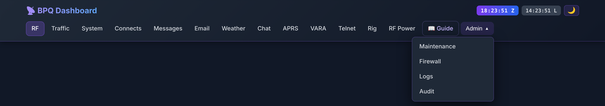

# BPQ Dashboard

**Version 1.5.14**
**User Guide**
*How to use every page of the dashboard*

| | |
|---|---|
| Companion document | See *User Manual & Installation Guide* (`USER-MANUAL.md`) for setup and troubleshooting |
| Audience | Sysops, operators, visitors |
| Updated | October 2026 |
| Repository | https://github.com/bpq-dashboard/bpq-dashboard |

---

## About this guide

This guide is for **using** the dashboard. Installing and repairing it are in the *User Manual & Installation Guide*. Each page gets a section: what you see, how to use it, where its data comes from, and what to check when it looks wrong. Part 6 collects the things a sysop needs across pages: which background services each page depends on, where settings are kept, what the common messages mean, and the known limitations of this release.

### Who this is for

Callouts mark content for specific readers:

> 👤 **For visitors** — someone looking at a public dashboard (maps, logs, weather, propagation: the read-only views).

> 📡 **For sysops** — the operator running the station (RF data, the BBS, VARA HF).

> 🔧 **For admins** — whoever maintains the server (Maintenance, Firewall Status, audits — all behind the admin login).

Most sysops are all three. Read everything that applies to you.

---

## Table of Contents

**Part 1 — Getting Started**
1. What the dashboard does for you
2. The navigation bar
3. Day/night theme
4. Clocks: UTC and local time

**Part 2 — Communicating with Other Stations**
5. Chat Client
6. Telnet Client
7. VARA HF Terminal
8. APRS Map

**Part 3 — Messages & Files**
9. Email Client
10. YAPP File Transfer
11. Message Monitor

**Part 4 — Operations & Monitoring**
12. RF Connections
13. Traffic Report
14. System Logs
15. Connect Log
16. Rig Status
17. RF Power Monitor
18. NWS Weather Alerts

**Part 5 — Admin (behind the admin login)**
19. Maintenance
20. Firewall Status
21. Log Viewer
22. System Audit
23. Install Check and Health Check

**Part 6 — Sysop Reference**
24. What runs behind the pages
25. Where your settings are kept
26. Common messages and what they mean
27. Known limitations in v1.5.14
28. Keyboard shortcuts
29. Page URL reference
30. Getting help

---

# Part 1 — Getting Started

## 1. What the dashboard does for you

BPQ Dashboard is a web interface for a LinBPQ packet node and BBS. It reads the node's logs, talks to the BBS and chat server over the node's telnet port, and talks to the radio through flrig. From any browser — phone, tablet or desktop — you can read and send BBS mail, chat, open a terminal on the node, make VARA HF keyboard sessions, watch APRS, see what your forwarding partners are doing and check the radio.

### What you can do at a glance

> 👤 **For visitors:** see who connects to the node, RF propagation and forwarding history, the APRS map, NWS weather alerts, traffic and log statistics, and the radio's frequency.

> 📡 **For sysops:** everything above, plus: read and send BBS mail (including NTS), chat as the station, open a node terminal and transfer files by YAPP, make VARA HF connections, send APRS messages and beacon the BBS to APRS-IS, post NWS alerts as bulletins, change TX power and switch the radio's power outlet.

> 🔧 **For admins:** everything above, plus: check the server's health, firewall, logs and installation from the browser.

### Closing the browser

Most pages only display what the node and the background services are doing, so closing a tab changes nothing on the station. Three exceptions: closing the **Telnet Client** ends that telnet session; closing the **VARA HF Terminal** during a session asks the server to restore your scan schedule (Section 7); and the **Chat** page's connection is shared, so closing it doesn't take the station out of chat.

### Which pages ask for a login

Anything that **acts as your station** — sends, posts, transmits, or reads your mail — asks for a login. Everything else is public and read-only.

| You want to… | What it asks for |
|---|---|
| View RF Connections, maps, logs, traffic, weather, rig status | Nothing (public) |
| Use the Email Client (and its NTS Report), Chat, the admin pages, Install Check or Health Check | The **admin login** (your browser's login box) |
| Post an NWS bulletin, send an APRS message, save the BBS station info on the APRS Map, save station locations or forwarding partners on RF Connections, clear the callsign-lookup cache | The **admin login**, when you press the button |
| Open the VARA HF Terminal | The **admin login**, then the page's own login |
| Change frequency in the VARA HF Terminal; change TX power or switch the power outlet on Rig Status | The page's own login: the **BBS password** (`bbs.pass` in `config.php`) |
| Open the Telnet Client, then log in to the node | The **admin login** (installer setup; the two-site template limits it to your home network instead), then your **BPQ user name and password** (BPQ asks) |
| Download a file the Telnet Client received by YAPP | The **admin login** (on a two-site setup: the same access as the Telnet Client) |
| Use the Maintenance page's forwarding-partners editor | The admin login, then the **BBS password** |

The admin login is the one you chose during installation. Your browser remembers it until you close it, so you normally see the box once per visit. If a button that used to work now shows a login box, that's this protection, not a fault. If a page says it "needs the dashboard admin login, and the web server didn't ask for it", your web-server config is older than the dashboard files: re-run the installer or compare it with the templates; Install Check shows which part is missing.

> 🔧 Send the admin login only over HTTPS. The installer sets up plain HTTP on port 80, which is fine on your home network. Before the dashboard is reachable from the internet, add a certificate (*Installation Manual* §11, "HTTPS and the firewall").

---

## 2. The navigation bar

Every page loads the same bar at the top.



- **📡 BPQ Dashboard** — returns to the home page, RF Connections.
- **Page links** — RF, Traffic, System, Connects, Messages, Email, Weather, Chat, APRS, VARA, Telnet, Rig, RF Power. The page you're on is highlighted.
- **📖 Guide** — opens this guide as a PDF in a new tab.
- **Admin ▼** — Maintenance, Firewall, Logs (the Log Viewer), Audit. These ask for the admin login.
- **Clocks** — UTC (purple, "Z") and your browser's local time ("L"), updated every second.
- **Theme button** — 🌙 / ☀️ (Section 3).
- **⚙** — on the admin pages only: *Dashboard Settings* for the forwarding tools (Section 19).

On a phone (narrower than about 770 pixels) the links fold behind the **☰** button; the admin pages are listed under an *Admin* heading at the bottom of that menu.

**Rig** and **RF Power** appear only when flrig was set up during installation. Install Check and Health Check aren't in the menu; open them by address (Section 29).

> 🔧 After an update, press **Ctrl+Shift+R** (⌘+Shift+R on a Mac) once on any page. The menu is cached by the browser and only refreshes when its version number changes.

---

## 3. Day/night theme

The 🌙 / ☀️ button switches between dark and light.

Until you press it, each page follows your device's own light/dark setting. Once you choose, the choice is saved in that browser (each browser and device remembers its own). The Chat and APRS pages keep their own setting, so you may need to set them once separately.

Some areas stay dark in both themes on purpose: the terminal areas of the **Telnet Client** and **VARA HF Terminal** (green-on-black, like a terminal), the **RF Power Monitor** meter, and the navigation bar itself.

---

## 4. Clocks: UTC and local time

The two clocks in the bar show UTC and your browser's local time. Log files, BBS messages, BPQ scan schedules and most charts on the dashboard use **UTC**; the chart titles say "(UTC)". Use the local clock to translate: if the propagation report says 40 m opens at 22:00 UTC and the clocks show 18:23 Z / 14:23 L, that's 6 PM local.

---

# Part 2 — Communicating with Other Stations

## 5. Chat Client

**Page:** `/bpq-chat.html` (menu: **Chat**)

> 📡 **For sysops** — behind the admin login, because everything typed goes out as your station.

The Chat Client is a browser window onto your BPQ chat server. It doesn't log in by itself: the **bpq-chat** service holds one permanent connection to the chat server as the station, and the page sends and receives through it.

### What you see

- **Toolbar** — 🔌 Connect, ⏹ Disconnect, 📢 Join Room, 👥 Users, 📋 Topics, 🔊 (sound on/off), 💾 Export (saves this session's text as a `.txt` file), 👥 Who Panel (show/hide the right-hand panel), and the connection status.
- **🌐 Chat Server pane (top)** — everything the chat server sends: replies to commands, joins and leaves. Type server commands in its input line; the **⌘** button lists them as buttons.
- **💬 Chat Rooms pane (bottom)** — one tab per room (topic) you've joined, each with its own input line. Drag the divider between the panes to resize them.
- **👥 Online panel (right)** — who is in chat, refreshed every 30 seconds; **⟳** refreshes it now.

### How to use it

1. Open the page and give the admin login.
2. A box asks for **Your Callsign**. Type it and press **🔌 Connect**. (The callsign is used for the page only; messages always go out through the station's own chat login.) The box and the status bar show your station's callsign and node from `config.php` `station`; entering the station callsign itself gives the sysop view. *Request access from the sysop* has the server e-mail your request to `station.email` (one request every 10 minutes; the page says if the server couldn't send it).
3. Use **📢 Join Room** or type `/T roomname` to join a topic; a tab opens for it.
4. Type in the room's input line and press Enter.
5. Useful commands: `/U` users, `/T` topics, `/T name` join a topic, `/P` ports and links, `/K` known nodes, `/S CALL text` private message, `/N name` and `/Q qth` set your name and location, `/History nn` recent lines, `/H` help, `/B` leave chat. The ⌘ list has the rest.

**Guest (read-only)** in the opening box shows the chat traffic without letting you send. It is meant for someone you've given the admin login to only to watch.

### Things worth knowing

- **Only what arrives after you connect is shown.** The page doesn't fetch earlier conversation; use `/History` to ask the chat server for recent lines.
- **Use one Chat tab per browser.** Tabs in the same browser share one place in the message stream, so two open tabs split the incoming lines between them.
- **⏹ Disconnect** stops this page receiving; the station stays in chat.
- BPQ drops a chat user that sends no real chat line for 2 hours. The service notices and rejoins chat by itself.

### When it doesn't work

- Red status, or *"Chat daemon not connected"*: `sudo systemctl status bpq-chat`, then `sudo systemctl restart bpq-chat`. The service restarts itself after a crash (every 10 seconds) and starts after LinBPQ.
- The **Online** panel says *"No reply to /U from the chat server"*: the service is connected to the node but not inside the chat server. It usually recovers by itself; if the message stays, restart `bpq-chat`.
- The service logs only to the system journal: `sudo journalctl -u bpq-chat -n 50`.

---

## 6. Telnet Client

**Page:** `/bpq-telnet.html` (menu: **Telnet**)

A terminal on your BPQ node in the browser: connect to the node, BBS or chat, run sysop commands, connect onward to other nodes, and transfer files by YAPP.

### What you see

- **Top bar** — connection status, 🗑 Clear, 📋 Copy (copies the whole session text), ⏹ Disconnect.
- **Left sidebar:**
  - **Local** quick-connect buttons — *BPQ Node*, *BPQ BBS* and *BPQ Chat* (all port 8010 on this server) and *WL2K CMS* (Winlink's server, port 8772).
  - **NetROM Nodes** — the node's current NetROM table, refreshed every 30 seconds (↻ refreshes now).
  - **Custom** — host and port. Only this server and Winlink's CMS servers are allowed, on ports 23, 8008, 8010, 8011 and 8772; the service refuses anything else so it can't be used as a relay.
  - **Session Log** — your recent connections in this browser.
  - **BPQ Commands** — click a command to paste it into the input line (node commands such as `NODES`, `ROUTES`, `PORTS`, `MHEARD`, BBS commands such as `L`, `R #`, `S CALL`, `K #`).
- **Terminal (centre, stays dark)** and, under it, the input line with two buttons: **📁 Files** (YAPP file transfer) and **Send ↵**. Both stay greyed out until you're connected to the node.

### How to use it

> 📡 **For sysops** — the web server controls who may open the connection (your home network and/or the admin login), and the node asks for its own login.

1. Click **BPQ Node** (or *BPQ BBS* / *BPQ Chat*) in the sidebar.
2. Log in at BPQ's `user:` and `password:` prompts with your BPQ user name and password. What you type at `password:` shows as `********`.
3. With *BPQ BBS* or *BPQ Chat*, the page types `BBS` or `CHAT` for you after the login.
4. Type commands and press Enter. ↑ / ↓ recall earlier commands.
5. Click ⏹ Disconnect or type `BYE` when done. Closing the tab also ends the session. Each tab is its own session.

### YAPP file transfer

Section 10. There is no separate YAPP button: **📁 Files**, next to **Send ↵** under the terminal, opens the file-transfer panel once you're connected; one click there switches to file-transfer mode, enters the BBS and lists its files.

### When it doesn't work

- Nothing happens when you click a target, or the status says it can't reach the service: check `sudo systemctl status bpq-telnet`. The page connects through the web server's `/ws/telnet` (over HTTP or HTTPS); a site file from before 2026-10-25 doesn't have it — re-run the installer or add it from the template (*Installation Manual* Part A, Step 9).
- The NetROM Nodes list stays empty or shows an error: `bpq-nodes-api.php` logs in with `bbs.user` / `bbs.pass` from `config.php` and needs `station.node` (your node call-SSID). The error under the list says which part failed.
- The service's log is in the Log Viewer under *Dashboard services → bpq-telnet* (passwords are blanked out).

---

## 7. VARA HF Terminal

**Page:** `/bpq-vara.html` (menu: **VARA**)

> 📡 **For sysops** — the page has its own login (the BBS password from `config.php`), since it changes your radio's frequency. The live VARA connection behind it has no login of its own, so the web server keeps it behind the admin login (the installer's site file does this; *Installation Manual* Part A, Step 9).

Keyboard-to-keyboard HF sessions over your BPQ VARA HF port. Your radio transmits; the browser is the keyboard and screen.

### Before you start

You need:

- VARA HF running and a VARA HF port in `bpq32.cfg`
- flrig running and connected to the radio
- an FLRIG **`RADIO 2`** block in `bpq32.cfg` (Section 27: the dashboard currently retunes only `RADIO 2`)
- the **bpq-vara** service running. It logs in with `bbs.user` / `bbs.pass` from `config.php` and finds your VARA HF port in `bpq32.cfg` by itself; set `vara.bpq_port` if it picks the wrong one (*Installation Manual* §9)

### What you see

- **Login box** — shows your node (`station.node`) and asks for the sysop password. *Request access from sysop* has the server e-mail the request to `station.email` in `config.php`; the address isn't shown on the page. It needs a working mail setup on the server — if sending fails, or no address is set, the page says so — and takes one request per address every 10 minutes.
- **Top bar** — status (IDLE, LOGGING IN, ATTACHED, CONNECTED, BUSY, INCOMING), the remote call, bandwidth, S/N and frequency chips, session timer, Clear, Copy, **Logout**.
- **Quick** frequency buttons — 80 m 3.596, 40 m 7.103, 30 m 10.148, 20 m 14.103 and 20 m 14.106 MHz (fixed in this release; Section 27).
- **Frequency (MHz)**, **Remote Callsign**, **Bandwidth** (BW500 default, BW2300, BW2750), **⚡ Connect**, **⏹ Disconnect**.
- **Terminal (stays dark)** and the input line with **Send ↵**, **D** and **End Session**.

### Making a connection

1. Log in with the sysop password.
2. Choose a frequency: click a **Quick** button (the radio is retuned right away and the page says it will move within about 7 seconds), or type one. The hint under the box shows the band, or warns when the frequency isn't in an ITU Region 2 HF data band; the page refuses those.
3. Type the remote callsign and choose the bandwidth: BW500 for weak signals and busy bands, BW2300 standard, BW2750 for the fastest rate on good paths.
4. Click **⚡ Connect**. The page attaches to the BPQ VARA port, sets the frequency you typed, sends the bandwidth and then `C CALL`.
5. When the status shows **CONNECTED**, type and press Enter; each line goes over the air.
6. **End Session** when you're done.

### Ending a session

- **D** drops the radio link only. The VARA port stays attached, so you can type `C CALL` to try another station.
- **End Session** and **⏹ Disconnect** do the same thing: drop the link, release the BPQ port and **restore your scan schedule** (the `RADIO 2` scan list in `bpq32.cfg` that the session replaced).
- If you close or hide the tab during a session, the page asks the server to restore the schedule as it goes. If that didn't happen (crash, lost network), open the page, log in and click **End Session**.

### Tips

- If the remote doesn't answer, the page says *"Connect failed — … did not respond"* and stays attached; type `C CALL` to retry or End Session.
- *"Channel busy — VARA waiting for clear channel"* means VARA heard activity and is holding off.
- *"VARA HF port is in use"* means another session (often a forwarding connect) has the port. Try again shortly.
- *"BPQ login or VARA attach failed"*: `sudo journalctl -u bpq-vara -n 30` shows the login and the `ATT` reply. The service logs in as `bbs.user`; use a BPQ user whose default application is the BBS (a user that lands straight at the node may not be allowed to `ATT`), or give the VARA terminal its own login in `config.php` (`'vara' => ['user' => …, 'pass' => …]`). When the service starts, it logs which BPQ port it uses for VARA HF and where that number came from. After a BBS login the service waits up to 10 seconds for the BBS prompt (any line ending in `>`, after "Connected to BBS" and the BBS's SID), then sends `NODE`; the log line *BBS login OK* shows the prompt it saw. *ATT failed … Output aborted* means the `ATT` reached the BBS instead of the node.
- You can't change bandwidth during a session; disconnect, change it and reconnect.
- The login lasts an hour and is extended while you use it; after a long break, log in again.
- Once connected to another node, its BBS commands work as usual.

---

## 8. APRS Map

**Page:** `/bpq-aprs.html` (menu: **APRS**)

The APRS Map shows stations heard by the dashboard's APRS-IS connection, around your station, on a live map.


### What you see

- **Toolbar** — station-type buttons (**All**, 🚗 **Mobile**, 🌡 **WX**, 📡 **Fixed**), ⟳ **Refresh**, ⊡ **Reset View**, 🛤 **Tracks** (on by default), ⭕ **PHG** (range circles), **Heard** (show stations heard in the last 1–12 hours, 2 hours by default), a callsign filter, 📋 **Browse**, 🏠 **BBS Info** and ✉ **Message** (with a count of unread messages).
- **Map** — station icons (standard APRS symbols), your BBS as a large orange ✉ marker, and a 50-mile circle around it.
- **📡 Stations** and **💬 APRS Messages** lists on the right; click a station to centre it.
- **Detail panel** (bottom left) — opens when you click a station.

Click a marker for its popup: last heard, comment and position; speed and altitude for moving stations; temperature, wind, humidity and distance/bearing from your BBS for weather stations.

**📋 Browse** opens a station list by category (Mobile, WX, Fixed, Digi, iGate, Object) with search, *Show on map* and *Message* buttons.

The map refreshes every 30 seconds and the tracks every 5 minutes. **Reset View** returns to your station; the map doesn't remember where you last panned.

### Sending an APRS message

> 📡 **For sysops** — needs the admin login.

1. Click ✉ **Message** (or *Message* in a station's detail panel or in Browse).
2. **Compose:** the recipient (`CALL-SSID`) and up to 67 characters.
3. Click 📤 **Send** (the browser asks for the admin login the first time). The message goes to APRS-IS under your APRS login callsign.
4. Replies to your callsign appear under 📥 **Inbox**.

Sending uses the APRS-IS login in `config.php` (`'aprs' => ['callsign' => …, 'passcode' => …]`), the same one the `bpq-aprs` service uses. If the callsign is missing, or the passcode is `-1` (receive-only) or doesn't belong to that callsign, Send is greyed out and the compose box says why. APRS delivery isn't guaranteed: if no reply arrives within a few minutes, assume it didn't get through.

> 👤 **For visitors:** the map and station details are open to everyone. Sending is limited to the sysop because every message goes out under the station's callsign.

### Your BBS on the map — station info

The large orange ✉ marker is your BBS. Click it (or **🏠 BBS Info**) for its station info: a short popup on the marker and the full details in the panel at the bottom left.

**Adding or changing the info** (📡 sysops — needs the admin login):
1. Click **🏠 BBS Info**, then **✏ Edit station info** (or **✏ Edit** in the marker's popup).
2. Fill in what visitors should see — every field is optional:
   - **Name** (default: *callsign* BBS), **BBS callsign** (e.g. the node or BBS SSID people connect to)
   - **Location**, **Sysop**, **Hours**, **Website** (full `https://…` address)
   - **Ports / frequencies** — one per line, e.g. `VARA HF 7.101 MHz` or `1200 bd 145.010 MHz`
   - **Services** — e.g. `BBS · Chat · NTS · Winlink RMS`
   - **Notes** — how to connect, who may use it, net times
   - **Marker position** — leave empty to use the centre of your grid square (`station.grid` in `config.php`), type a latitude/longitude, or press **📍 Pick on map** and click the spot (`Esc` cancels). **↺ Grid centre** clears it.
3. Click **💾 Save** (the browser asks for the admin login the first time).

The map, the 50-mile circle and the distances shown for weather stations are measured from the marker position.

> ⚠️ Everything you enter is **public** — anyone who opens the APRS Map sees it, including the exact position if you set one. Leave a field empty to hide it.

**Putting your BBS on aprs.fi** (📡 sysops):

At the bottom of the same form, tick **📡 Beacon this BBS to APRS-IS**. The `bpq-aprs` service then sends your BBS to the APRS-IS network, so it appears on aprs.fi and other APRS maps. You don't need BPQ32's own APRS settings for this.

- **Send as** — *Object* puts a pin with its own name (up to 9 characters, e.g. `TPRFN BBS`); *This station's position* puts the pin under the APRS login callsign (`'aprs' => 'callsign'` in `config.php`, e.g. YOURCALL-1).
- **Beacon comment** — the text aprs.fi shows next to the pin, up to 43 plain characters (no accents or symbols such as the middle dot). **↧ From info** fills it from your first port/frequency, BBS callsign and hours.
- **Every** — 10 to 60 minutes; 30 minutes is normal for a fixed station.
- The beacon uses the **Marker position** above, so one has to be set, with the APRS BBS icon.
- **Packet preview** shows exactly what will be sent; the line under it shows whether the service is beaconing (last sent, next one), or why not.

After **💾 Save** the first beacon goes out within about 2 minutes, and aprs.fi shows it a minute or so later — the **APRS** line in the BBS panel links straight to it. Untick the box (or rename the object) and the dashboard sends one "delete" packet so the old pin disappears from aprs.fi.

Beaconing needs a real APRS-IS passcode in `config.php` (`-1` is receive-only) and the `bpq-aprs` service running.

On a two-site setup (public site + sysop site) saving works only on the sysop site; the public site shows the info but refuses changes, and the editor says so. The info is stored on the server in `data/stations/bbs-info.json`.

### Map tiles

The map uses CARTO's tiles, which now need a free key: `'map' => ['carto_key' => '…']` in `config.php` (*Installation Manual* Step 10). Without one the map still works but CARTO stamps "API KEY REQUIRED" across it, and the attribution line says what to set.

### What's happening under the hood

The `bpq-aprs` service keeps a connection to APRS-IS, filtered to your area (`aprs.filter` in `config.php`; by default 80 km around your station), and stores what it hears where the map reads it. Outgoing messages are sent by the dashboard when you press Send. The BBS beacon goes out over the service's own connection; it checks the BBS info every 30 seconds. Its log is in the system journal: `sudo journalctl -u bpq-aprs -n 50` (add `| grep -i beacon` for beacons).

---

# Part 3 — Messages & Files

## 9. Email Client

**Page:** `/bbs-messages.html` (menu: **Email**)

> 📡 **For sysops** — behind the admin login; visitors can't open it.

A webmail-style client for your BBS: Personal mail, NTS traffic and bulletins, with folders, rules, an address book and a database copy of everything.


### What you see

**Top bar:** 📨 **Get Mail**, the auto-fetch chip (shows the countdown; click it to change the interval), the search box, ✏ **Compose**, 📄 **NTS Report**, 📻 **PKTNET Forms**, ✅ **Quick Check-In**.

**Folder list (left):**

- **Mail**
  - **Personal** — messages to you
  - **NTS** — National Traffic System messages
  - **Bulletins** — every bulletin. Under it (▾ shows/hides them), one **Bulletins - GROUP** folder per distribution group (NEWS, WX, SITREP, …), filled automatically as bulletins arrive. Each group row has 🔔 (mute) and 📌 (keep) icons.
- **Other** — **Archived** (messages you archived in this browser), **Sent**
- **My Folders** — folders you create (**+ New Folder…**) or that a rule creates. A folder named **Trash** works as a real wastebasket (see *Deleting messages*).
- **Contacts** — **Address Book…**, **BBSes Seen…** (BBS callsigns found in the routing of incoming mail, busiest first), **Forwarding Activity…** (what this BBS forwarded to whom, from the BPQ log, for the last 1 hour to 7 days)
- **Settings** — **Rules…**, **Preferences…**, **Statistics…**

**Message list (centre)** — subject, from, date, size. The **Select all** box selects everything visible (respects the search).

**Messages open in a pop-up window** by default; Preferences can switch to a reading pane on the right.

### Getting mail

- **📨 Get Mail** asks the BBS for the newest Personal, NTS and bulletin listings (50 of each by default; Preferences → *Max messages per list*, up to 200).
- **Auto-fetch** repeats this **every 5 minutes** by default. Change it, or turn it off, in Preferences → *Auto-fetch interval*.
- With *Body fetching* on **Eager** (default), the page also reads every new message's text during Get Mail, so clicks open instantly. **Lazy** reads a message's text only when you open it, which makes Get Mail faster.
- Separately, the server saves the text of new messages to the database every 5 minutes (`message-bodies.timer`), even when no browser is open. Which bulletins it saves is set by `messages.bulletin_text` in `config.php`: `all` (default), `pinned` (only 📌 groups) or `none`.

Only one session with the BBS runs at a time across the whole dashboard. If the BBS is busy (Get Mail in another browser, the text-saving job, the forwarding-queue check), the request waits; after 40 seconds it gives up with "BBS busy". Try again a moment later.

### Reading

1. Click a folder, then a message. It opens in the pop-up window.

The pop-up has:

- **Top row:** **Compose**, **NTS Report**, **PKTNET Forms** and **Quick Check-In** — so you can answer a net or file a report without closing the message
- **‹ Prev / Next ›** (or `←` / `→`) — step through the list in the order shown
- **A− / A+** — smaller or larger text; remembered
- **⤢** — fill the browser window; again to go back
- **Drag the bottom-right corner** to resize; it opens at that size next time
- **▣ Dock** — switch to the reading pane on the right (⧉ **Pop out** in the pane switches back)
- Below the header: ↩ **Reply**, → **Forward**, **Unread**, 🗂 **Archive**, **Move**, ℹ **Properties**, 🗑 **Kill**
- **Close** with ✕, `Esc`, or a click on the dimmed page around it

Opening a message marks it read **in the dashboard only**. BPQ itself marks a message read when its addressee reads it with `R`; the dashboard doesn't change BPQ's flag.

### Resizing the columns

Drag the thin divider between two columns (the pointer changes to ↔) to widen or narrow the folder list, the message list or the reading pane. Double-click a divider to reset it. The widths are remembered in this browser. On tablets and phones the columns stack and there are no dividers.

### Searching

The search box filters the **folder you're in** by from, to, subject and message text. To search bulletins, open **Bulletins** first.

### Composing

1. Click **✏ Compose** (or Reply / Forward).
2. **To:** a callsign, or a full address such as `CALL@BBS.STATE.USA.NOAM` for forwarded delivery. Matching Address Book entries are suggested as you type (↑ ↓ to pick, Enter to accept).
3. **Type:** **Private (P)**, **Bulletin (B)** — the To field is then the distribution group, e.g. `WX@USA` — or **Traffic (T)** for NTS.
4. **Subject** (BPQ keeps 60 characters) and **Body** (plain text).
5. Click **Send**. The BBS stores the message and forwards it on its normal schedule.

**Send via SMTP** sends to an internet e-mail address through BPQ's own Internet (ISP) Gateway; the dashboard adds the `smtp:` prefix. Use it only after the gateway is set up and tested in BPQ — on an unconfigured gateway BPQ has hung the whole node on a single message.

### Selecting several messages

- **Select all**, or **Shift**-click a range, or **Ctrl**-click (⌘ on a Mac) to add or remove one without opening it.
- The selection bar then offers **Move**, **Read**, 🗂 **Archive** and 🗑 **Kill**.

### Deleting messages

- **Kill** deletes the message on the BBS. **Bulletins can be killed only after BPQ has forwarded them** (status `BF`). Killing one earlier could take it out of the outbound queue before other BBSes receive it, so the dashboard refuses and says why; a bulk kill skips them and tells you how many.
- **In a 📌 pinned folder, Kill keeps the database copy** — see *Keeping messages after you kill them*.
- **Trash:** create a folder named **Trash** under My Folders and move messages there. *Empty folder* on Trash really deletes (kills on the BBS and removes from the database), with the same `BF` rule for bulletins. *Empty folder* on any other folder only returns its messages to their inbox, unfiled — nothing is destroyed.
- **Archive** only hides a message in this browser (it moves to *Archived*); it doesn't touch the BBS or the database.

### Bulletin retention

Personal mail and NTS traffic are kept **indefinitely**. Bulletins are permanently deleted from the database **14 days** after they arrive, unless:

- their group is **pinned 📌** in the sidebar (see below), or
- you've moved them into **one of your own folders** under My Folders.

This runs automatically once a day (`bulletin-retention.timer`). **Preferences → Run retention cleanup now** runs it on demand. Deleted bulletins can't be recovered, so pin a group *before* its older bulletins age out. Pinned groups are kept for ever, so busy groups such as NEWS or WX keep growing; unpin them when you no longer need the history.

### Keeping messages after you kill them (📌)

Every message is saved in the dashboard's database, text included, so it stays readable after BPQ removes it. A message that arrived and left BPQ before its text was saved shows only its listing, with a note saying so. Killing a message normally removes it from the database too. To keep copies from some folders even after you kill them on the BBS, pin those folders.

Each folder row — the bulletin groups under **Bulletins** and your own **My Folders** — has a 📌 icon: faint means off, bright means on. Click it to toggle. In a pinned folder, **Kill** removes the message from the BBS but keeps the database copy in the folder, marked "no longer on BBS". For example, pin **TODAY** to keep every TODAY bulletin, and leave **WX** unpinned so killed WX bulletins go away as usual.

- Only messages that are *in* a pinned folder when you kill them are kept. Pinning a folder doesn't bring back messages killed earlier.
- A kept message is already gone from the BBS, so **Kill** is disabled on it. To delete the kept copy, move it to **Trash** and empty Trash.
- Trash can't be pinned. Everything in a pinned group is also kept past the 14-day bulletin retention, whether or not it has been killed.
- Muted groups don't appear in the sidebar. To pin one, unmute it first; you can re-mute it afterwards and the pin stays.

### Muting bulletin groups

If you only follow some groups, or the list under **Bulletins** is too long, click the 🔔 next to a group to mute it. Its row **disappears from the list**, and its messages drop out of the umbrella **Bulletins** view and its unread count. Muting is instant and deletes nothing.

To unmute, open **Preferences → Muted bulletin groups**: each muted group is a chip — click ✕ to unmute it, or the group's name to open its folder without unmuting.

**Important:** muting only changes what the dashboard *shows*. BPQ still receives, stores and forwards those bulletins; which groups your BBS accepts is set in BPQ32's own forwarding configuration. Muted groups follow the same 14-day retention as every other unpinned group.

### Rules

**Rules…** files incoming messages automatically: *From / To / Subject contains* text → folder (the folder is created if needed). Rules are checked in order and the first match wins; they run on every Get Mail and are stored on the server, so every browser uses them. Bulletins are filed into their group folders without any rule.

### NTS folder and NTS Report

NTS traffic is filed into **NTS** automatically, with an unread count. **📄 NTS Report** opens a print-ready report of your NTS traffic and the station(s) each message was forwarded to, taken from your BBS's forwarding log, for 7 days to a year. *Save as PDF* uses your browser's print-to-PDF. The report asks for the admin login (it lists who your NTS traffic went to).

### Net check-ins and forms

- **✅ Quick Check-In** — a short form (name, callsign, location, band/mode, net address — `PKTNET@USA` by default) that builds a check-in message and opens it in Compose.
- **📻 PKTNET Forms** — opens the TPRFN HTML Forms by N3MEL (ICS, weather, radiogram, check-in and bulletin forms that produce packet-ready text). The installer downloads them into `pktnet-forms/`; if the button shows "not found", run `sudo bash scripts/fetch-forms.sh` in the dashboard folder.

### Address book

**Contacts → Address Book…** stores callsigns with notes; ✉ next to a contact starts a message to them. It is stored on the server.

### Preferences

**Settings → Preferences…** holds the auto-fetch interval, *Max messages per list*, *Open messages in*, *Body fetching*, **Forget killed list** (the dashboard remembers what you killed so BPQ's listing doesn't bring it back until BPQ's housekeeping removes it), **Muted bulletin groups**, **Clean up Bulletin folders** (repairs group folders with damaged names from an old bug) and **Run retention cleanup now**. Preferences are kept in this browser.

### Forwarding details

Open a message and look at the forward-events panel to see which BBSes it was forwarded to and when.

---

## 10. YAPP File Transfer

**Page:** Telnet Client (`/bpq-telnet.html`) → the **📁 Files** button next to **Send ↵** (active once you're connected to the node)

> 📡 **For sysops** — needs a BPQ login with BBS access.

YAPP (Yet Another Packet Protocol) moves binary files — documents, pictures, software — between stations and BBSes over packet.

### What you can do

- **Download** a file from a BBS to your computer
- **Upload** a file from your computer to a BBS
- **Browse** the files a BBS offers

### File-transfer mode

YAPP is a binary protocol, and normal telnet (port 8010) changes certain bytes, which breaks it. Files therefore go over BPQ's **FBB port (8011)**, which passes bytes through untouched. The panel calls this **file-transfer mode**.

You don't have to set it up yourself. Log in on the Telnet Client as usual, then open **📁 Files** and click **⚡ Switch to file-transfer mode**. The dashboard:

1. reconnects to your node on port 8011, using the user name and password you typed at BPQ's prompts in this tab;
2. types `BBS` for you;
3. lists the BBS's files as soon as its prompt appears.

The login is kept only in that browser tab's memory, never saved. If you haven't logged in yet, or want a different login, the panel asks for the user name and password instead. If BPQ refuses the login, the panel says so and asks again.

Switching closes your current terminal session. A connection you made from the node to another station (`C CALL`) is not carried over.

### How to download a file

1. Open **📁 Files** and switch to file-transfer mode (above). The **⬇ Download from BBS** tab shows the BBS's files with their sizes. Type in the filter box to narrow a long list.
2. **Click a file.** The dashboard gets ready to receive and types `YAPP filename` for you.
3. Watch the progress bar, speed and **time left**.
4. When it finishes, click **⬇ Save filename**. The file also stays under **Received recently** in the panel, so you can save it again later from the same browser.

If the BBS answers *"File … not found"*, or you're at the node prompt instead of the BBS, the panel shows that message at once instead of waiting.

**Other BBS software:** if the file list doesn't work there, open *Other BBS software (manual receive)*, click **🛰 Arm Receiver**, then type that BBS's own download command in the terminal.

### How to upload a file

1. In file-transfer mode, at the BBS prompt, open the **⬆ Upload to BBS** tab.
2. **Drop a file** on the box, or click it to choose one (10 MB limit). The panel shows the name the BBS will store it under: anything except letters, digits, `.`, `_` and `-` becomes `_`. It also gives a rough time on air.
3. Click **⬆ Send to BBS**.

There's **no command to type first**. A BPQ BBS recognises an incoming YAPP upload by itself and saves it in its `Files` folder. Other BBS software may need its own upload command typed first.

Before sending, the panel checks the BBS's file list. BPQ refuses to overwrite a file that already exists, so if the name is taken, the panel warns you and won't send until you rename the file. If the BBS still refuses (for example because the file is over its size limit), the panel shows BPQ's own message, such as *"YAPP File x size 150000 larger than limit 100000"*.

**Why an upload keeps going after the bar fills:** YAPP sends the whole file without per-block replies. Your node takes the whole file at once, then sends it on over the link. During that stage the panel shows a moving bar and *"Sending to the BBS…"* with the time waited, and the BBS confirms only when it has every byte. That takes seconds on a local BBS and can take minutes over a radio or AXIP link. If the BBS answers with text instead (it has dropped out of YAPP), the panel shows that text and stops.

### Where files end up

**Received files** land in the `yapp-files/` folder of the dashboard's web root (`/var/www/bpq-dashboard/yapp-files/` with the installer's defaults). They keep the **real filename from the YAPP header**, with a timestamp prefix to avoid collisions: `20260524-191234-update-bpq.zip`.

Because these files come from another station, the dashboard treats them as untrusted. The folder asks for the login, and the **Save** link always downloads the file rather than opening it in the browser. A file whose name could be run by the web server or opened as a page (for example `.php`, `.html`, `.svg`, `.js`) is stored with its dots replaced and `.bin` added (`report.html` → `report_html.bin`). The Save link still saves it under its original name.

**Uploaded files** go into the BBS's own `Files` folder (under your BPQ directory).

> 🔧 **For admins** — clean up old received files now and then (adjust the path if your web root differs):
> ```bash
> find /var/www/bpq-dashboard/yapp-files/ -mtime +30 -type f -delete
> ```

### Tips

- **Packet is slow** — a 50 KB file can take 1–2 minutes over RF; 1 MB, 20–40 minutes. The speed and time-left readout tells you how it's going.
- **Long transfers are fine** — a transfer stops only if nothing at all arrives for 2 minutes (a dropped link). When uploading, it also allows for the file's time on air while it waits for the BBS to confirm.
- **Filenames with spaces work** for downloads.
- **You can close the panel during a transfer** — it keeps going; reopen 📁 Files to check on it.
- **Abort Transfer** stops cleanly: before a download has started nothing is sent to the BBS; during a download the dashboard ignores the blocks the BBS had already queued until it confirms the stop, then shows *Stopped*; during an upload it stops handing data to the node at the next block. If the node already had the whole file (the bar said *waiting for the BBS to confirm*), the BBS may still save it — the panel says so and refreshes the list. Wait for *Stopped* before starting another transfer.
- **Remote BBSes** — once in file-transfer mode you can `C` to another BBS from the node prompt in the terminal; the file list and downloads then work on that BBS.

---

## 11. Message Monitor

**Page:** `/bpq-email-monitor.html` (menu: **Messages**)

A read-only summary of what your BBS and BPQ's mail server have been doing, worked out from BPQ's daily log files.

### What you see

- **Mode buttons:**
  - 📬 **BBS Mode** — from the BBS logs (`log_YYMMDD_BBS.txt`): cards for messages **Received**, **Forwarded**, **Bulletins**, forwarding **Partners**, **Total Msgs** and **Rejected** (duplicates refused by BID); an **Hourly Activity** chart; **Forwarding Partners**; **Recent Message IDs**; and **Bulletin Groups**.
  - 📧 **SMTP/POP Server** — from the TCP logs (`log_YYMMDD_TCP.txt`): POP3, SMTP and NNTP sessions, users, messages and authentication failures.
- **Range** — 7D, 4W (default) or 30D, and 🔄 to reload.
- **Tabs** — 📊 **Monitor**, and 🔒 **Security** (SMTP/POP mode only: authentication failures, suspicious activity, relay attempts and a security event log).

The page refreshes every 15 minutes.

### How to use it

- "Is mail moving?" — BBS mode, check Received/Forwarded and the hourly chart.
- "Who am I forwarding with?" — the Forwarding Partners list.
- "Is someone trying passwords on BPQ's mail server?" — SMTP/POP mode, Security tab.
- Click a group under **Bulletin Groups** to list its recent bulletins and read them. That reads from the BBS, so it asks for the admin login (and is refused on a public site).

For per-message detail use the Email Client (reading) or the Forwarded Messages panel on RF Connections (who received what, and how).

---

# Part 4 — Operations & Monitoring

## 12. RF Connections

**Page:** `/bpq-rf-connections.html` (menu: **RF** — also the home page)

The main page: your VARA HF sessions, forwarding partners, forwarded messages and propagation, in one place.

### At the top

- **Today / 7 Days / 30 Days / 90 Days** — the range for everything below. Today is the default.
- 🔄 **Refresh**, and 📄 **Station Report** — a PDF of one station's sessions: base callsign (all SSIDs), last 24 hours to a year, all/outgoing/incoming. It lists remote stations only, so your own callsign gives an empty report.
- The status line shows how many connections were loaded; **"(DB)"** at the end means the fast database path is in use (Section 26).

### Cards

- **RF Connections Status** — successful sessions, success rate, average bitrate.
- **RF Connections Failures** — every failed VARA session in the range, split into Timeout (no prop), Channel Busy, No Data, Port in Use and Incoming Failed (plus Other when a failure had no recognised reason); the rows add up to the total. This is the complete RF failure count; System Logs' **Port in Use** counter is only one of these kinds.
- **RF Connections Avg S/N**.
- **RF Connected Stations** — click for a table of every station, sortable, with its sessions and messages.

### 🌐 RF Forwarding Partners

One tile per forwarding partner: when it last connected and on which band, how many messages are waiting for it in your BBS's forwarding queue (📨, from the sysop `FWD QUEUE` command), and how many messages went each way over RF.

- **🔄 Refresh Queue**, **+ Add** and **Manage** (edit/remove). Adding and removing partners asks for the admin login. This list is stored on the server in `data/stations/partners.json`; it is separate from the propagation scheduler's list (Section 19).
- The server asks the BBS for the queue at most once a minute and shares the answer with every visitor, so a refresh within the minute shows the same numbers.
- The sent/received counts are RF (VARA HF) messages only. A message to the same base callsign over NET/ROM, AXIP, AX.25 or Telnet doesn't count here; see Forwarded Messages for those.

### 📨 Forwarded Messages (click ▶ to open)

Every message your BBS forwarded to or received from a partner, one row per partner (a bulletin sent to three hubs shows three times).

- **Filters** — partner, type (bulletin, personal, traffic), **Via** and **Status**.
- **Via** — how it travelled: 📡 RF (VARA), 🔗 NET/ROM, 🛰 AXIP, 🌐 Telnet, 📻 AX.25 or "Port N". *RF only* is the default. Outbound messages are matched to the connect script in `bpq32.cfg`, so the column is right in both directions.
- **Status** — ✅ delivered (default), ⛔ rejected (the partner already had it), ⏸ deferred, or all offers. Most rejections are normal: partners refuse duplicates they've already received from someone else.
- **Received** — when the transfer finished (UTC) and how long after the offer.
- Counts everywhere on the page (partner tiles, cards, charts) are **delivered** messages, not offers.
- After upgrading from an older version, older messages can show no Via or Status until the one-time re-scan in the Installation Manual's "Updating to a newer version" has been run.

### 📊 HUB Station Propagation Report

**📈 Generate Report** builds a 7-day analysis of your forwarding partners in a pop-up you can print: failure analysis, an hourly performance heatmap, daily performance, a station × band matrix, band efficiency, time-of-day analysis and recommendations.

### 🌍 Geomagnetic Conditions

From NOAA SWPC: the K-index now, the daily A-index, solar flux and sunspot number; a storm banner when conditions are disturbed; the K-index for the last 3 days and the A-index for the last 30 days, colour-coded from quiet to major storm. Refreshed every 15 minutes.

### 🎯 Best Band Recommendations

The best band for each 4-hour UTC slot (00–04Z, 04–08Z, …), from your own success history over the last 30 days blended with current conditions and day/night patterns. It doesn't change with the range buttons.

### 📍 Station Map

Every station you've connected with, coloured by success rate, plus your own station (🏠). Click a dot for its details; 🛤️ **Best Paths** draws your best paths.

- Locations come from QRZ.com (when `qrz` is set in `config.php`) or callook.info for US calls. Stations without a location are listed as **Unmapped**; click one, or **+ Add Location**, to place it by hand. Saving or removing locations asks for the admin login.
- Your own marker comes from the `station` section of `config.php` (callsign and grid square); public pages show the centre of the grid square, never your exact position. Check after installing that it isn't still a placeholder.

### Charts and tables

- **Hourly RF Connections & Messages (UTC)** and **Hourly Band Activity (UTC)**.
- **Band Summary** — sessions, success and failures per band.
- **📡 VARA Channel Quality** — per band: average, median and best bitrate, the modulation tier that bitrate implies (BFSK/BPSK up to 32QAM), average S/N, and whether S/N and bitrate are rising or falling compared with earlier in the range.
- **Recent Connections** — time, callsign, type, frequency, band, status, S/N, bitrate and TX/RX time, with a callsign search and pages.

### How to use it

> 👤 **For visitors:** a live picture of HF propagation and of one station's forwarding network.

> 📡 **For sysops:** check it before a VARA session — current conditions, the best band for the hour, how a partner has been doing — then open the VARA HF Terminal. Use the partner tiles and Forwarded Messages to spot a partner that has gone quiet or a queue that is building up.

### Where the data comes from

Sessions come from the VARA log (written by `vara-logger`, read every 5 minutes by `parse-vara-log.py` into the database); messages and frequencies from BPQ's BBS logs; the queue live from the BBS. Without the database the page falls back to reading the log files in your browser, which is much slower — see "(DB)" in Section 26. The page reloads its data every 15 minutes.

---

## 13. Traffic Report

**Page:** `/bpq-traffic.html` (menu: **Traffic**)

> 📡 **For sysops**

Per-station traffic from BPQ's own traffic reports: who connects, how many messages and bytes go each way, and how much is rejected. Unlike RF Connections it covers every kind of connection (RF, NET/ROM, AXIP, Telnet).

### What you see

- **Range** — 7D, 4W (default) or 12W, and 🔄 Refresh.
- **Cards** — Connections (in/out), Messages (received/sent), Data, Rejected (in/out), Active stations, BBS partners, Users, Efficiency (success rate), messages per connection, KB per message.
- **Charts** — Top Stations by Connections, Message Distribution, Data Transfer by Station, Traffic Type Breakdown (BBS partners versus users).
- **Station Details** — a sortable table (connections in/out, messages received/sent, data, efficiency, rejections) with filters: All, Active only, BBS partners, Active BBS partners, Users only.

### Tips

- It reads BPQ's `Traffic_YYMMDD.txt` reports. Many BBSes write one per week (named after the week's start date); then the newest days appear only after BPQ writes the next report.
- The **Messages** card and the Message Distribution chart count Personal and bulletin messages only; NTS traffic (T) is in the per-station table but not in those two.
- "(DB)" in the status line means the database copy is in use (`parse-traffic-report.py`, every 5 minutes).
- A sudden drop for one partner usually means its link or schedule has stopped; check RF Connections and the System Logs for that call.

---

## 14. System Logs

**Page:** `/bpq-system-logs.html` (menu: **System**)

Statistics and a searchable viewer for BPQ's daily logs, plus BPQ's live MHeard and routing tables.

### What you see

- **Range** — 1D, 7D (default) or 30D, and 🔄 Refresh.
- **Cards:**
  - **Connections** and **Active Stations** (click for the full list)
  - **Messages** — forwarded, received, rejected (BID)
  - **Errors** — Port in Use, Node Lost, Protocol, Other (click for the **Error Breakdown**)
  - **RMS Services** — Winlink CMS connections, bytes, login failures (from `CMSAccess` logs)
  - **BPQ Email Server** — POP3, SMTP, NNTP sessions and authentication failures (TCP logs)
- **🌐 Internet Connected Stations**.
- **Hourly Activity (UTC)**, **Event Distribution** and **Recent Errors (Last 10)** with *View All in Log*.
- **Live Log Viewer** — the BBS log lines themselves: callsign search, event type (connections, disconnects, messages, errors), date range (today to 30 days), and 📄 **PDF Report**.
- **Most Active Stations**.
- **📻 Latest MHeard Stations** — stations BPQ has heard, one tab per BPQ port 1–5, with last heard and bytes (grid and frequency on tabs 3 and 4). See Section 27 about the tab names.
- **🗺️ Known Stations Routing Table** — BPQ's known stations, searchable, filtered by age (24 hours, 7 days, 30 days, stale).

### How to use it

> 📡 **For sysops** investigating issues:

- "Did K0XYZ connect today?" — Live Log Viewer, callsign `K0XYZ`, Today.
- "Why did forwarding to GB7BED fail?" — search `GB7BED` for that date.
- "What errors have we had?" — the Errors card, then *View All in Log*.
- "Who has the node heard recently?" — MHeard.

### Tips

- **Port in Use** counts BBS log lines reading "Error - Port in use" (the radio port was busy with another session). It is one kind of RF failure only; the full count is on RF Connections. The two pages also default to different ranges (System Logs 7 days, RF Connections today), so set both to the same range when comparing.
- The cards, charts, error breakdown, Most Active Stations, RMS/TCP panels and the MHeard/routing tables come from the database (`parse-system-logs.py`, every 5 minutes); "(DB)" in their status lines confirms it. The Live Log Viewer always reads the log files directly.
- Big date ranges take a moment to load in the Live Log Viewer.

---

## 15. Connect Log

**Page:** `/bpq-connect-log.html` (menu: **Connects**)

> 📡 **For sysops**

Who connected to your node, and how, from BPQ's `ConnectLog_YYMMDD.log` files. BPQ records **incoming** connects only; your own outgoing forwarding connects aren't in these logs (see RF Connections and System Logs for those).

### What you see

- **Range** — Today, 3 Days, 7 Days, 30 Days.
- **Counts** by mode: NETROM, VARA, AX.25, TELNET. Click a mode to show or hide it everywhere on the page.
- **🗺️ Station Locations** — connecting stations on a map, coloured by mode (or "Multiple").
- **Connection Mode Distribution**, **Hourly Activity (UTC)** and **Daily Connection Trend** charts.
- **🏆 Top Stations by Connection Count** — per mode, the modes used and last seen.
- **📋 Connection Log** — time, date, from, node, to and mode, sortable, with a callsign search.

### Tips

- Many short connects from one station usually mean a poor link or a script retrying.
- A station showing **Multiple** reaches you by more than one route (e.g. VARA and NET/ROM).

---

## 16. Rig Status

**Page:** `/rig-status.html` (menu: **Rig**)

Your radio as flrig sees it, updated every 3 seconds.

> Rig Status and the RF Power Monitor are installed only when flrig was set up during installation. If they're missing from the menu, flrig was skipped.

### What you see

- **Radio** — the make and model flrig reports.
- **Frequency** — large display in MHz, with band and the Hz digits; **mode** (USB, LSB, DATA-U, …).
- **📶 S-Meter**.
- **🔆 TX Power** — the radio's current power setting. After unlocking (the 🔒 button in Radio Control) you can change it with the slider, number box or presets and **Set**. The range is the radio's own (from flrig), capped by `radio.max_power` and `radio.min_power` in `config.php` if set. Each change is logged with the address it came from.
- **📡 Scan Frequencies** — the channels LinBPQ scans, read from the FLRIG `RADIO` block in `bpq32.cfg` (`radio.bpq_radio` chooses the block). With several time bands, the one running now (UTC) is highlighted; during a VARA keyboard session the card says the scan is paused.
- **⚡ Radio Control** — the PTT indicator (RX / TX), and, if you have a network power switch, the outlet state with ⏻ **Power ON**, ⏻ **Power OFF** and ↺ **Reboot**. The 🔒 button unlocks these with the BBS password. Off and Reboot are refused while the radio is transmitting.

The power switch is set in `config.php` under `smartplug` (`host`, `user`, `pass`, `outlet`) — written for a Synaccess NP-05B-style switch (*Installation Manual* §10.7). Without one (`host` empty, as in `config.php.example`) the outlet shows **Not set up**, nothing is contacted, and the power buttons answer *No power switch is set up*. "Unknown" means a switch is set but didn't answer.

### How to use it

- Before keying up, confirm the radio is on the expected frequency and mode.
- **Stuck PTT:** if PTT shows TX with no transmission scheduled, look at the radio and the cabling.
- **Scan check:** on a scanning station the frequency should follow the highlighted time band.

### When flrig is offline

The page shows the actual error. Common causes:
- flrig not running (on this machine, or on the computer in `radio.flrig_host`)
- flrig not connected to the radio (its title bar must show the radio model, and it must be reading frequency)
- a firewall blocking flrig's port (12345/tcp) between the server and the flrig computer
- wrong `radio.flrig_host` / `radio.flrig_port` in `config.php`

> 🔧 **For admins** — test the connection from the server:
> ```bash
> nc -zv YOUR_FLRIG_HOST 12345
> ```

---

## 17. RF Power Monitor

**Page:** `/rf-power-monitor.html` (menu: **RF Power**)

> 📡 **For sysops** with flrig connected to a radio

Transmit power and SWR over time, read from the radio through flrig — the same source as Rig Status. No separate wattmeter is needed.

### What you see

- **Range** — Today, 2 Days, or any of the last 7 days from the calendar (the server keeps 30 days of history).
- **Live meter (stays dark)** — forward power with its peak, average, reflected power and SWR, and IDLE/TX state.
- **Summary** — the day's peak, number of TX events, average TX power and duty cycle.
- **Tabs:**
  - 📊 **Power History** — peak, average or reflected power over time, with SWR as an amber line on the right-hand scale. SWR is shown only while transmitting, so the line breaks during receive.
  - 🕐 **Hourly Stats** — TX events and peak power per hour.
  - 🔥 **Activity Heatmap** — when you transmit, by hour and day.
- **Playback** — ▶️ replays the day at 1× to 500× speed. If nothing moves, step back or drag the slider first; playback starts at the end of the data.

### Worth knowing

- The history is written by the **rig-history-poller** service, so it fills in even when no browser is open. It samples about once a minute when idle and every 3 seconds while transmitting — fine for normal transmissions, coarser than a dedicated meter.
- **Reflected power isn't measured** — flrig reports only SWR, so reflected watts are calculated from SWR and forward power.
- The **Watt-hours** figures in Hourly Stats and the heatmap always read 0: flrig doesn't report energy (Section 27).
- An SWR jump during transmit means an antenna or feedline problem; high SWR on one band only means a mismatch on that band.

When the page shows nothing, use §16's "When flrig is offline" — both pages depend on the same connection — and check `sudo systemctl status rig-history-poller`.

---

## 18. NWS Weather Alerts

**Page:** `/nws-dashboard.html` (menu: **Weather**)

National Weather Service alerts from api.weather.gov, with a one-click way to post them to your BBS as bulletins.

### What you see

- ⟳ **Fetch Alerts**, 📡 **Post All to BBS**, 💾 **Export**.
- **Counts** — active alerts, warnings, watches, alerts posted to the BBS.
- **⚙️ Configuration** — *Your Callsign*, *BBS Destination* and *Auto-Refresh* (30 seconds to 15 minutes, or off; 1 minute by default). *Your Callsign* starts as `station.callsign` and *BBS Destination* as the server's default (below); once you change them, this browser remembers your values. A note under the destination says how it will be posted.
- **🗺️ NWS Regions** — ALL, or the NWS regions SR, CR, ER, WR, AK and PAC.
- **⚡ Alert Types** — tornado, severe thunderstorm, flood, hurricane/tropical, winter storm.
- **🌪️ Severe Weather** — *View Severe Weather* opens every active tornado, severe thunderstorm and flash-flood watch and warning in the country (all NWS offices plus SPC). Click an alert to expand its full description and instructions.
- **📋 Activity Log** — what the page has fetched and posted.
- **🚨 Active Alerts** — the list; click one for its headline, issuer, expiry, severity, urgency, affected areas, description, protective actions and a **📻 BBS Message Preview** with 📡 **Post to BBS** and 📋 **Copy Message**.

Alerts are colour-coded by type and severity.

### Posting alerts to your BBS (📡 sysops)

- **Post to BBS** sends the selected alert to the **BBS Destination**. The default is `'nws' => ['post_destination' => …]` in `config.php`; if that's empty, `WX@` plus your automatic-posting state (`nws.auto_post.area`, e.g. `WX@GA`); otherwise `WX@ALLUS`. An address like `WX@GA` or `WX@ALLUS` is sent as a **bulletin (`SB`)** and floods to the BBSs that carry it; an address that starts with a callsign (`K1ABC`, `K1ABC@K1ABC.#GA.USA.NOAM`) gets a **private message (`SP`)**. The answer says which (*Posted as bulletin #…*). It posts with the BBS login from `config.php` `bbs`, as `station.callsign`, and is refused when `features.nws_post` is off or the dashboard is in public mode. The subject is built from the event and first area. It asks for the admin login.
- **Post All to BBS** posts every alert that matches your region and type filters and hasn't been posted yet. The first time, it asks you to choose a "Post All" password. That password is only a safety catch against an accidental click, kept in this browser; the admin login is what actually protects posting. *Reset password* clears it.
- Separately, the sysop can turn on **automatic posting** (the installer asks for your state; `nws-auto-post.timer`, *Installation Manual* §10.4): the first issue of each new Warning or Watch for one state goes out as a bulletin (e.g. to `WX@GA`) within about 5 minutes, without anyone pressing a button. Alerts it has posted are not marked on this page, so don't also post them by hand. (`storm-monitor.py` is a different tool: it reacts to geomagnetic storms by moving HF forwarding to 80 m — *Installation Manual* §10.3.)

> 👤 **For visitors:** viewing needs no login; only posting does.

---

# Part 5 — Admin (behind the admin login)

> 🔧 **Everything in Part 5 sits behind the admin login** you chose during installation (the pages live in `/admin/`, plus `install-check.php` and `health-check.php`). Your browser asks once per visit. Limiting these pages to your home network as well is optional; see the *Installation Manual* §11.

## 19. Maintenance

**Page:** `/admin/bpq-maintenance.html` (Admin → Maintenance)

A reference page for the person who looks after the server. Most of it is ready-to-copy commands, each with a line saying what it tells you and what to do about it. The page doesn't run commands on the server; you paste them into an SSH session.

### Protection check

A box at the top tests, every time the page opens, whether this page, the Partners API, `install-check.php` and `health-check.php` can be opened **without** your login. Green means the server refused them. Red means anyone who finds the address can open the page; fix the web-server config before anything else (the *Admin login* section shows how, with curl tests you can run from any machine). The check covers only the address you opened the page on. If several site names share the same web root, test each one with the curl commands.

### Your install

Commands use the installer's defaults (`/var/www/bpq-dashboard`, database `bpqdash`, LinBPQ in `/opt/linbpq`). Open **Your install** and enter your own web root, LinBPQ folder, database name and user, and every command on the page changes to match. The **Copy** buttons copy what you see. The values are remembered in that browser only.

### What's on the page

- **Health check** — one command that shows every dashboard service (nginx, PHP, MariaDB, LinBPQ, the helper daemons, vara-logger, rig-history-poller), what breaks when each is down, the bulletin clean-up timer, the parser schedule and listening ports.
- **Admin login** — tests that the login is required, how to change or add admin users, and a check that private files (`config.php`, `db-config.php`, `scripts/`, `data/`, backups, the journal) never download.
- **Database & credentials** — test the database login exactly the way the pages and the parsers use it, file permissions for `db-config.php`, backups (kept outside the web root) and changing the database password.
- **Log parsers** — dry runs and rebuilds for the RF Connections, Traffic and System Logs parsers, and how to tell whether they're keeping up.
- **Email Client database** — the schema check that 📌 pinned folders need, counts of saved message text and kept-after-kill copies, folder sizes, what the "⚠ killed on BBS" label really means, and the NTS and bulletin-folder diagnostics.
- **Bulletin retention** — preview, run or review the daily 14-day clean-up.
- **NTS forwarding report, RF forwarding queue, Rig Status & RF Power Monitor (flrig), VARA HF Terminal, VARA callsign validator, White Pages clean-up, YAPP, LinBPQ sysop commands** — troubleshooting for each feature.
- **Propagation scheduler & storm monitor** — only if you run them.
- **Forwarding partners editor** — edits `data/partners.json`, which the propagation scheduler and storm monitor read. Enter the BBS password from `config.php` and load; every save keeps the previous file in `data/backups/`. Five wrong passwords in 15 minutes lock it for the rest of the 15 minutes. (The partner tiles on the RF Connections page are a separate list, saved by that page in `data/stations/partners.json`.)
- **Firewall & Audit sudo rules, Chat, APRS map & beacon, callsign lookups** — installing and testing the read-only sudo rules, the chat daemon's status, APRS-IS / beacon status and the CARTO key, and the QRZ login test.
- **Web server & PHP, Permissions, updates & backups, disk** — including which nginx file is really live and why `set-permissions.sh` is for first installs only.

### ⚙ Dashboard Settings

On every admin page the menu bar has a **⚙** button. It opens *Dashboard Settings* for the optional forwarding tools, after the BBS password: tabs **Station**, **Partners**, **Prop Sched** (propagation scheduler weights and limits), **Storm Mon** (K-index thresholds) and **Paths** (linmail.cfg, LinBPQ stop/start commands, log and backup folders).

- It saves `data/settings.json`, which **overrides** the partners editor's `data/partners.json` (when it lists partners) and the scripts' own settings. Use one or the other for partners, not both.
- **💾 Save All** writes every tab. Fill in Station and BBS before saving the first time; otherwise the defaults (`N0CALL`) are saved and the scheduler's BBS report can't log in. The Maintenance page has a check command that shows what `settings.json` overrides.
- It changes nothing in the Email Client or the other pages; only `prop-scheduler.py` and `storm-monitor.py` read it.

---

## 20. Firewall Status

**Page:** `/admin/firewall-status.html` (Admin → Firewall)

Shows which ports on the server can be reached, and from where.

### What you see

- **Policy banners** — the IPv4 firewall's default (DROP is what you want), and the IPv6 one. If the server has no public IPv6 address the IPv6 banner says so; if it has one, its firewall matters as much as the IPv4 one.
- **Summary cards** — number of Public, LAN-only, Blocked and Localhost-only ports, and how many addresses fail2ban is banning right now (all jails).
- **Port cards** — every port a program listens on (with the program's name) plus every port a firewall rule opens:
  - **Public** — reachable from the internet over IPv4 or IPv6 (the badge says which).
  - **LAN only** — allowed only from private addresses (10.x, 172.16–31.x, 192.168.x, 100.64.x, IPv6 local).
  - **IP restricted** — allowed only from the addresses listed.
  - **Blocked** — no rule lets the internet in.
  - **Localhost** — the program listens on 127.0.0.1 only, so nothing outside the server can reach it whatever the firewall says.
  - "nothing listening" = a rule opens a port that no program uses.
- **Fail2ban** — one card per jail (banned now, banned since fail2ban started) and the banned addresses.
- **Rules table** — the INPUT rules, plus ufw's own "allow" rules when ufw manages the firewall.

### Tips

- **Needs the read-only sudo rules** (`www-data-tools.sudoers`; `install.sh` offers to install them, or see the Installation Manual §11). Without them the page says what it couldn't read instead of showing zeros.
- **Station ports** — BPQ telnet / FBB (8010 / 8011 by default) send passwords unencrypted, and MariaDB, flrig and the dashboard's WebSockets should never be public. If one shows Public, close it or allow it only from your LAN.
- Reachability is worked out from the rules (including ufw and fail2ban chains); a port forward on your router is still needed for anything to arrive from outside.

---

## 21. Log Viewer

**Page:** `/admin/log-viewer.html` (Admin → Logs)

Reads the server's logs from the browser, no SSH needed.

### What you see

- **Log list**, by group:
  - **Dashboard services** — bpq-telnet (Telnet Client and YAPP; passwords are redacted), bpq-vara, the message-text job, the Email Client's BBS sessions, NWS posting.
  - **Log parsers** — RF Connections, Traffic and System Logs parsers (every 5 minutes).
  - **Forwarding tools** — prop-scheduler, storm monitor, connect watchdog and its state, White Pages auto-clean (only if you run them).
  - **VARA** — the VARA session log (config.php `logs.vara_file`) and the callsign validator.
  - **BPQ Node** — today's BBS, TCP, Connect and CMS logs, and earlier BBS logs by date.
  - **System** — the web-server error log (PHP errors land here too) and the auth log.
  Each entry shows its size and last change; hover for what it is and where it lives. Logs for features you don't use say **not used here**.
- **Viewer** — the last 100, 200 (default), 500 or 1000 lines, colour-coded (errors red, warnings amber), with ⟳ Refresh.
- **Search** — every line in the file containing the text (at least 2 characters), with two lines of context either side (up to 100 matches).

### Tips

- bpq-chat and bpq-aprs log only to the system journal: `sudo journalctl -u bpq-chat -n 50` (the Maintenance page has these commands).
- The auth log is usually readable by root only, so it shows "no read permission"; use `sudo tail /var/log/auth.log`.

---

## 22. System Audit

**Page:** `/admin/system-audit.html` (Admin → Audit)

Runs dozens of checks on this install and reports each one with what it found and, for problems, the command that fixes it.


### What's checked

**Security:** the admin login reaches PHP; admin pages and private files refused without the login (asked of the server itself); config files not world-readable; CORS; IPv4 and IPv6 firewall policy; BPQ, MariaDB, flrig and dashboard ports open to the internet; fail2ban and SSH.

**Resources:** memory, swap, CPU load, free disk space (root and the web root's disk).

**Web server & PHP:** which server is running; `nginx -t`; recent nginx errors (known harmless lines ignored); the PHP version serving the dashboard, extra PHP-FPM versions running, missing PHP extensions; unused files in sites-available.

**Database:** connection exactly as the pages make it; the Email Client, RF Connections, Traffic and System Logs tables; the 2026-09/10 updates (📌 keep, Forwarded Messages "Via" and delivery status); data size against the InnoDB buffer pool; whether MariaDB listens on the network.

**Logs & updates:** security updates waiting; /var/log size; log rotation for the dashboard's own logs; each log parser scheduled, running and error-free.

**Application:** LinBPQ running; each dashboard service (bpq-telnet, bpq-chat, bpq-aprs, bpq-vara, vara-logger, vara-validator, rig-history-poller) installed, running and writing its status; APRS-IS login and BBS beacon; the message-text and bulletin clean-up timers and their last run; flrig answering; recent callsign-lookup failures; web root owner and writable cache/data folders; YAPP files; every page loading the current menu loader; SSL certificate expiry.

### Reading the results

- ✅ **OK**, ⚠️ **Warn** (worth a look), 🔴 **Critical** (fix soon).
- ℹ️ **Info** — something that isn't installed (an optional service) or that the page couldn't check (for example the sudo rules are missing). Info rows don't count towards the score.
- Click a row for the detail and the **recommended action**. Run it over SSH, then **⟳ Re-run Audit**.

### Tips

- The firewall, fail2ban, listening-port and `nginx -t` rows need the read-only sudo rules (`www-data-tools.sudoers`).
- **Multi-domain SSL** — list your certificates in config.php `ssl_domains`; otherwise the address you opened the page on is checked.
- Run it after an upgrade and once a month.

---

## 23. Install Check and Health Check

**Pages:** `/install-check.php` and `/health-check.php` (behind the admin login; not in the menu)

> 🔧 **For admins** — during setup, after an upgrade, and when something breaks

**Install Check** verifies the installation itself:

- every dashboard page, API and script is in place
- `config.php` values are filled in (no placeholders left), including the APRS, CARTO, CORS and radio settings
- folders are readable/writable as needed (logs, cache, data, YAPP files)
- services and daemons are running, PHP and the database work, the log parsers are scheduled
- the web server's site file serves this folder, the admin folder and the station-acting pages are behind the login, and the login reaches PHP
- LinBPQ is reachable, with mail and chat enabled, and the FLRIG `RADIO` block is readable

It shows a score and a fix for each failure; work down the red items first. Some checks can't see root-only things (such as root's crontab) and say so.

**Health Check** is a shorter diagnostic: PHP version and extensions, file permissions and folders, the config file, API endpoints, log files and a test login to the BBS. It also runs from the server's command line without the login: `sudo -u www-data php /var/www/bpq-dashboard/health-check.php`.

Include the Install Check result (score and red items) when you ask for help (Section 30).

---

# Part 6 — Sysop Reference

## 24. What runs behind the pages

The pages are only the front. These parts on the server do the work; when a page looks empty or stale, find it here.

### Services (systemd)

| Service | What it does | Pages that need it |
|---|---|---|
| `bpq` / `linbpq` (your LinBPQ service) | The node, BBS and chat server | Everything |
| `bpq-telnet` | Terminal and YAPP bridge (WebSocket, port 8765 on 127.0.0.1) | Telnet Client, YAPP |
| `bpq-chat` | The station's permanent chat connection | Chat Client |
| `bpq-aprs` | APRS-IS connection, station cache, BBS beacon | APRS Map |
| `bpq-vara` | VARA HF session bridge (WebSocket, port 8767 on 127.0.0.1) | VARA HF Terminal |
| `vara-logger` | Writes the VARA log the RF parser reads | RF Connections |
| `vara-validator` (optional) | Checks callsigns of VARA connections | — (log in the Log Viewer) |
| `rig-history-poller` (flrig installs) | Records power/SWR every minute (3 s during TX) | RF Power Monitor |

Check any of them with `sudo systemctl status NAME` and its recent log with `sudo journalctl -u NAME -n 50`.

### Timers

| Timer | When | What |
|---|---|---|
| `message-bodies.timer` | every 5 minutes | Saves the text of new BBS messages to the database |
| `bulletin-retention.timer` | daily | Deletes unpinned bulletins older than 14 days |
| `nws-auto-post.timer` (optional) | every 5 minutes | Posts new NWS Warnings/Watches for your state as bulletins |

### Log parsers (`/etc/cron.d/bpq-dashboard`, every 5 minutes)

| Parser | Fills | Used by |
|---|---|---|
| `parse-vara-log.py` | VARA sessions, forwarded messages | RF Connections |
| `parse-traffic-report.py` | Traffic per station | Traffic Report |
| `parse-system-logs.py` | Events, errors, RMS/TCP, MHeard, routing | System Logs |

Their logs are in `/var/log/bpq-dashboard/` and in the Log Viewer under *Log parsers*.

### Read straight from BPQ's files

Connect Log (`ConnectLog_*.log`), Message Monitor (`log_*_BBS.txt`, `log_*_TCP.txt`), the System Logs viewer and fallbacks read BPQ's log folder directly, through the `logs` link in the web root.

### Outside services

APRS-IS (APRS Map), api.weather.gov (NWS), NOAA SWPC and HamQSL (geomagnetic data), QRZ.com and callook.info (station locations), CARTO and OpenStreetMap (map tiles), and the CDNs that serve the page libraries. If the server or the browser can't reach them, those parts of the pages stay empty.

---

## 25. Where your settings are kept

Some choices follow you to every browser; others stay in the browser where you made them.

| Kept on the server (shared by every browser) | Kept in this browser only |
|---|---|
| Email Client folders, rules, address book, 📌 pins, read state of filed messages, all saved messages | Email Client preferences (auto-fetch, list size, pop-up/pane, body fetching), muted groups, column widths, Archived flags, the killed list |
| APRS BBS station info and beacon settings | Theme (and the Chat and APRS pages' own theme) |
| RF Connections forwarding partners and saved station locations | NWS callsign, destination, auto-refresh and the Post All password |
| The propagation scheduler's partners (`data/partners.json`) and ⚙ Dashboard Settings (`data/settings.json`) | Telnet session log, YAPP *Received recently*, Chat callsign |
| Everything in `config.php`, including automatic NWS bulletins (`nws.auto_post`: state, address, alert types) | Maintenance page *Your install* values |
| Which NWS alerts were already posted automatically (`cache/nws-auto-post-state.json`) | |

Clearing a browser's site data resets the right-hand column for that browser only; nothing on the server is lost.

---

## 26. Common messages and what they mean

| You see | Meaning | What to do |
|---|---|---|
| The browser's login box | A station-acting or admin page (Section 1) | Give the admin login |
| *"needs the dashboard admin login, and the web server didn't ask for it"* | The web-server config is older than the dashboard files | Re-run `install.sh` or update the site file; Install Check shows what's missing |
| *"No power switch is set up"* (Rig Status) | `config.php` has no `smartplug` host | Add the section (*Installation Manual* §10.7) if you have a switch; otherwise ignore |
| *"Could not send the e-mail …"* / *"No sysop e-mail is set …"* (Chat or VARA access request) | The server has no working mail setup, or `station.email` is empty or an example address | Set `station.email`; set up mail on the server (e.g. a sendmail-compatible relay), or contact the sysop another way |
| **(DB)** missing from a status line | The page couldn't use the database and is reading log files in your browser (slower, less history) | Check the parsers (Section 24) and the database (System Audit) |
| *"BBS busy"* (Email Client) | Another BBS session is running; the dashboard allows one at a time | Wait a moment and retry |
| **429 Too Many Requests** | The web server's rate limit: too many requests in a burst | Wait a few seconds; repeated 429s are in *Installation Manual* §12 |
| **503 Service Temporarily Unavailable** | Usually an older config's rate limit, or PHP down | *Installation Manual* §12 |
| A note that the browser's storage is full (Email Client) | The browser's space for this site is used up; the dashboard keeps less in the browser and reads the rest from the database | Nothing; your mail is in the database |
| *"Chat daemon not connected"* | `bpq-chat` isn't connected to BPQ | `sudo systemctl restart bpq-chat` |
| *"WebSocket error — check: sudo systemctl status bpq-vara"* | The VARA page can't reach its service | Section 7. If the service stopped, `sudo journalctl -u bpq-vara -n 20` says why (e.g. no VARA port found, `bbs` login not set) |
| *"flrig offline"* | The server can't reach flrig | Section 16 |
| *"No VARA Log File Found"* (RF Connections) | No VARA log yet, and no database data | Check `vara-logger` and `logs.vara_file` in `config.php` |
| "API KEY REQUIRED" across the APRS map | No CARTO key | Section 8, *Map tiles* |
| A page looks old or its menu is missing an item after an update | Browser cache | Ctrl+Shift+R |
| *"nws-auto-post: disabled …"* (journal) | Automatic NWS bulletins are off | Nothing, or turn them on (*Installation Manual* §10.4) |
| *"Set config.php nws.auto_post.area to your 2-letter state code"* | Turned on, but no state chosen | Set `'area'` in `config.php` `nws` → `auto_post` |
| *"FAILED (BBS not reachable; will retry next run)"* (NWS auto-post log) | BPQ wasn't answering on its telnet port | Nothing if BPQ is back; the alert goes out on the next run while it's still in force |
| *"api.weather.gov fetch failed"* (NWS auto-post log) | The server couldn't reach NWS | Retried every 5 minutes; check the server's internet connection |

---

## 27. Known limitations in v1.5.14

These affect what you see in this release. Each says what to do meanwhile.

- **VARA retunes only `RADIO 2`.** Frequency changes and the End Session restore rewrite the `RADIO 2` block in `bpq32.cfg`; a station whose FLRIG radio has another number can't QSY from the page yet.
- **VARA quick frequencies are fixed** (3.596, 7.103, 10.148, 14.103, 14.106 MHz). Type any other frequency in the box.
- **System Logs MHeard tabs** are BPQ ports 1–5 with fixed names (Telnet Server, Internet, VARA HF, ARDOP, VHF 1200); read them by port number if your ports differ.
- **The connect watchdog's settings** are in the script itself (*Installation Manual* §10.1); the propagation scheduler and storm monitor use ⚙ Dashboard Settings or the partners editor (Section 19).
- **RF Power Monitor watt-hours** always read 0 (flrig has no energy reading).
- **Traffic Report's Messages card** leaves out NTS traffic (Section 13).
- **The NWS page doesn't know which alerts were posted automatically**, so it can't stop you posting one again by hand.

---

## 28. Keyboard shortcuts

| Page | Shortcut | Action |
|---|---|---|
| Telnet Client, VARA HF Terminal | `Enter` | Send the line |
| Telnet Client, VARA HF Terminal | `↑` / `↓` | Previous / next command |
| Chat Client | `Enter` | Send (server command or room message) |
| Chat Client | `Ctrl+K` | Clear the Chat Server pane |
| Chat Client | `Esc` | Close open dialogs |
| Email Client (Compose) | `↑` / `↓`, `Enter` | Pick a contact from the To: suggestions |
| Email Client | Shift-click / Ctrl-click (⌘-click) | Select a range / add to selection |
| Email Client (message window) | `←` / `→` | Previous / next message |
| Email Client (message window) | `Esc` | Close the message window |
| APRS Map | `Esc` | Cancel *Pick on map* / close the station-info editor |
| Any page | `Ctrl+Shift+R` | Hard refresh (bypass cache) — do this after an update |
| Any page | `F11` | Full screen |

## 29. Page URL reference

Replace `YOUR_SERVER` with your server's address. Use `https://` once the server has a certificate — the admin login should only be sent over HTTPS.

| Page | URL | Login |
|---|---|---|
| RF Connections (home) | `http://YOUR_SERVER/` or `/bpq-rf-connections.html` | None (saving partners/locations: admin) |
| Traffic Report | `http://YOUR_SERVER/bpq-traffic.html` | None |
| System Logs | `http://YOUR_SERVER/bpq-system-logs.html` | None |
| Connect Log | `http://YOUR_SERVER/bpq-connect-log.html` | None |
| Message Monitor | `http://YOUR_SERVER/bpq-email-monitor.html` | None (reading bulletins: admin) |
| Email Client | `http://YOUR_SERVER/bbs-messages.html` | Admin |
| NWS Weather Alerts | `http://YOUR_SERVER/nws-dashboard.html` | None (posting: admin) |
| Chat Client | `http://YOUR_SERVER/bpq-chat.html` | Admin |
| APRS Map | `http://YOUR_SERVER/bpq-aprs.html` | None (sending, BBS info: admin) |
| VARA HF Terminal | `http://YOUR_SERVER/bpq-vara.html` | Admin + BBS password |
| Telnet Client | `http://YOUR_SERVER/bpq-telnet.html` | Admin + your BPQ login |
| Rig Status | `http://YOUR_SERVER/rig-status.html` | None (controls: BBS password) |
| RF Power Monitor | `http://YOUR_SERVER/rf-power-monitor.html` | None |
| Maintenance | `http://YOUR_SERVER/admin/bpq-maintenance.html` | Admin |
| Firewall Status | `http://YOUR_SERVER/admin/firewall-status.html` | Admin |
| Log Viewer | `http://YOUR_SERVER/admin/log-viewer.html` | Admin |
| System Audit | `http://YOUR_SERVER/admin/system-audit.html` | Admin |
| Install Check | `http://YOUR_SERVER/install-check.php` | Admin |
| Health Check | `http://YOUR_SERVER/health-check.php` | Admin |
| NTS Report | `http://YOUR_SERVER/nts-forwarding-report.php` (also from the Email Client) | Admin login |
| PKTNET Forms | `http://YOUR_SERVER/pktnet-forms/` | None |
| This guide (PDF) | `http://YOUR_SERVER/BPQ-Dashboard-v1.5.14-User-Guide.pdf` | None |

## 30. Getting help

### Documentation

- **This guide** — `USER-GUIDE.md` (also the 📖 Guide PDF in the menu) — using the pages
- **User Manual & Installation Guide** — `USER-MANUAL.md` — installation, configuration and troubleshooting
- **SECURITY.md** — safe deployment and how to report a security problem privately
- **CHANGELOG.md** — what changed in each version
- **README.md** — project overview
- **CREDITS.md** — the software and people the dashboard is built on

### Community

- **GitHub** — https://github.com/bpq-dashboard/bpq-dashboard
- **Issues** — report bugs and request features via GitHub Issues (security problems: see SECURITY.md instead)

### When asking for help

Include:
1. Dashboard version (e.g. 1.5.14 — on the title page of this guide and on each page's badge)
2. Your platform (Debian 12, Ubuntu 24.04, Raspberry Pi OS, etc.) and web server
3. The Install Check result (score and any red items)
4. PHP version (`php --version`)
5. The exact error message (a screenshot is best)
6. What you tried before asking

Never paste passwords, `config.php` or log files into a public issue without checking them first — BPQ's own logs can contain login passwords.

### Credits

BPQ Dashboard is a front end for other people's work: **LinBPQ / BPQ32** by John Wiseman **G8BPQ**, **flrig** and the fldigi suite by Dave Freese **W1HKJ**, and the **PKTNET / TPRFN HTML Forms** by Glenn Allison **N3MEL**. `CREDITS.md` lists everything else the dashboard uses.

---

**73 — BPQ Dashboard v1.5.14 — User Guide**

*Open source · https://github.com/bpq-dashboard/bpq-dashboard*
