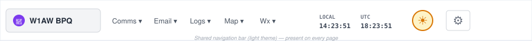
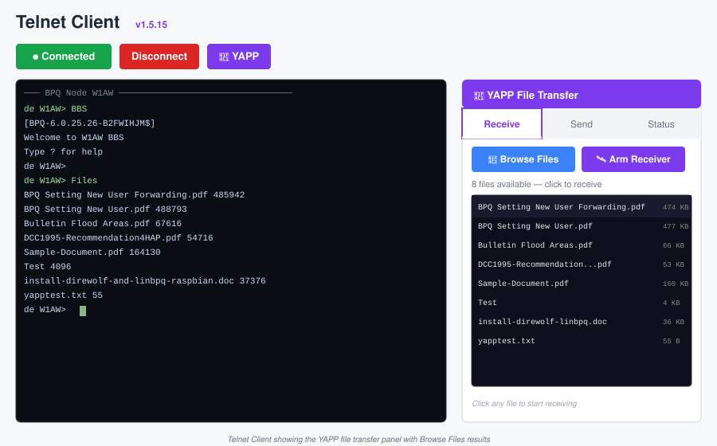
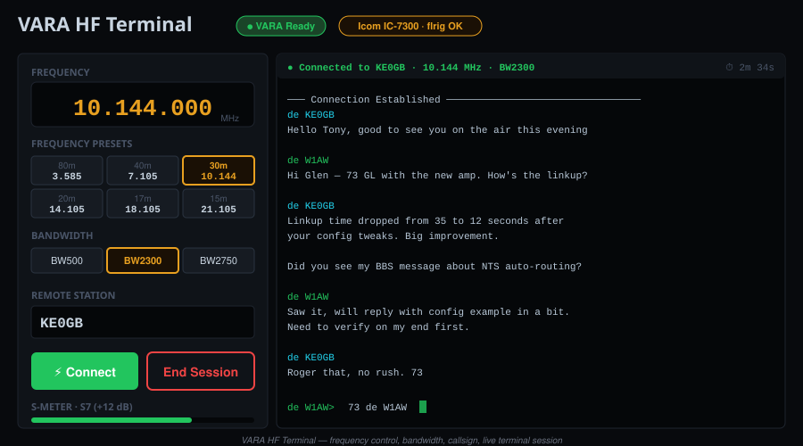
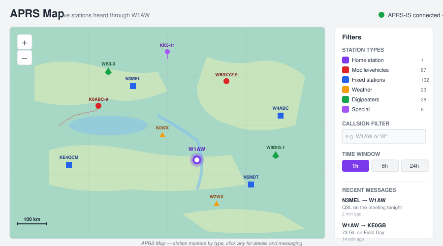
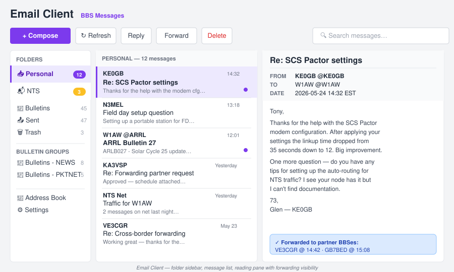
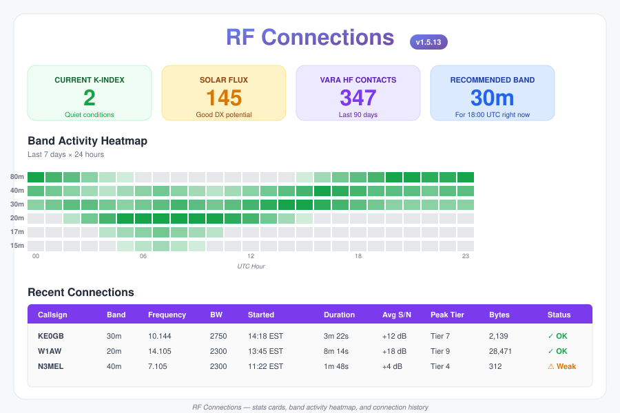
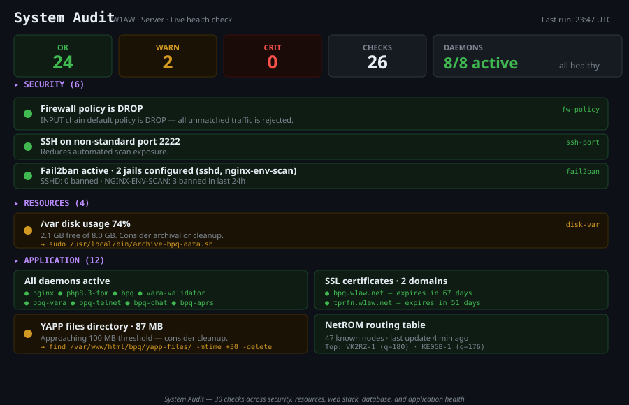

# BPQ Dashboard

**Version 1.5.13**
**User Guide**
*How to use every feature of the dashboard*

| | |
|---|---|
| Companion document | See *User Manual & Installation Guide* for setup/troubleshooting |
| Audience | Sysops, operators, visitors |
| Updated | September 2026 |
| Repository | https://github.com/bpq-dashboard/bpq-dashboard |

---

## About this guide

This guide is for **using** the dashboard, not installing or troubleshooting it (those have their own document). It walks through every page, explains what you're looking at, and shows the workflows that get common things done.

### Who this is for

You'll see callouts throughout marking content for specific audiences:

> 👤 **For visitors** — content for someone with a callsign visiting a public dashboard (read-only features, looking up info, sending APRS messages, joining chat).

> 📡 **For sysops** — content for the operator running this dashboard at their station (interpreting RF data, managing the BBS, using VARA HF).

> 🔧 **For admins** — content for the person maintaining the system (Maintenance page, Firewall Status, audits — all LAN-only by default).

If you fit multiple roles, read everything. Each callout marks content **especially relevant** to that audience, but nothing's strictly off-limits to anyone.

### How to read this

The guide is organized by what you want to **do**, not by page order. Pages are grouped by purpose: communicating, messages & files, monitoring, admin. The Quick Reference at the back has every page URL alphabetically.

---

## Table of Contents

**Part 1 — Getting Started**
1. What the dashboard does for you
2. The shared navigation bar
3. Day/night theme toggle
4. Time zone awareness (local + UTC)

**Part 2 — Communicating with Other Stations**
5. Chat Client — real-time conversations
6. Telnet Client — full BBS access in your browser
7. VARA HF Terminal — keyboard-to-keyboard HF sessions
8. APRS Map — live stations, messaging, weather

**Part 3 — Messages & Files**
9. Email Client — reading and sending BBS messages
10. YAPP File Transfer — binary files over packet radio
11. Message Monitor — activity audit

**Part 4 — Operations & Monitoring**
12. RF Connections — your VARA HF history & propagation
13. Traffic Stats — what your BBS is doing
14. System Logs — daily BPQ log files
15. Connect Log — recent connection history
16. Rig Status — live radio readouts
17. RF Power Monitor — live telemetry from flrig
18. NWS Weather — alerts and severe weather

**Part 5 — Admin (LAN-only)**
19. Maintenance — health checks, sysop tools, partners
20. Firewall Status — iptables and fail2ban view
21. Log Viewer — real-time daemon logs
22. System Audit — automated health audit
23. Install Check — verifying the install

**Part 6 — Appendix**
24. Keyboard shortcuts
25. Page URL reference
26. Getting help

---

# Part 1 — Getting Started

## 1. What the dashboard does for you

BPQ Dashboard is a web interface for an amateur radio packet node. Think of it as the "remote control panel" for everything the node does: messages, chat sessions, file transfers, RF monitoring, weather alerts, station maps, and propagation analysis.

You access it through any web browser — phone, tablet, laptop, desktop. No software to install on your side.

### What you can do at a glance

> 👤 **For visitors:** Chat with operators in real-time, see what stations are connecting, check NWS weather alerts, view the APRS map, send APRS messages, read public BBS bulletins.

> 📡 **For sysops:** Everything above PLUS — make HF connections to other stations, read and send BBS email-style messages (including NTS), transfer files via YAPP, run the system from your browser, watch your radio's frequency/power in real-time.

> 🔧 **For admins:** Everything above PLUS — monitor system health, view firewall rules, audit security, review logs, run system diagnostics.

### The dashboard is read-mostly

Most pages are observational — they show you what's happening on your packet node. The pages where you make things happen (Chat, Telnet, VARA, Email Client, APRS, YAPP) all live in your browser and just shuttle commands to the node.

This matters because: **closing your browser doesn't disconnect anything**. Your node continues running. You're peeking through a window.

---

## 2. The shared navigation bar

Every page loads the same navigation bar at the top. Get to know it — it's how you move around.



From left to right:

- **Station identifier** (📡 W1AW BPQ or similar) — clicking returns to the home page
- **Comms** — dropdown to Chat, VARA HF Terminal, Telnet Client
- **Email** — dropdown to Email Client, Message Monitor
- **Logs** — dropdown to System Logs, Traffic Stats, Connect Log
- **Map** — dropdown to RF Connections, APRS Map
- **Wx** — dropdown to NWS Weather
- **Clocks** — local time AND UTC, both updating live
- **Theme toggle** — 🌙 when in light mode (click for dark), ☀️ when in dark mode (click for light)
- **Admin (⚙)** — dropdown to Maintenance, Firewall Status, Log Viewer, System Audit (typically LAN-restricted)

The nav stays consistent regardless of which page you're on, so you can hop sideways without losing your bearings.

---

## 3. Day/night theme toggle

The 🌙 (or ☀️) button in the nav switches the dashboard between dark mode and light mode.

**Dark mode** (default): white-on-dark, easier on the eyes in dim environments, looks great on OLED displays.

**Light mode**: dark-on-white, easier in bright daylight, prints better.

Your choice is remembered in your browser's local storage — switch once and it stays that way for that browser. Each device remembers separately.

Every page on the dashboard responds to the toggle. **Three deliberate exceptions stay dark in both modes**:

- The terminal display areas in the **Telnet Client** and **VARA HF Terminal** — green-on-black is the conventional terminal aesthetic
- The **RF Power Monitor**'s meter card — instrument-LED readouts work better dark

This is intentional, not a bug. Surrounding UI flips light; the "instrument" area stays dark.

---

## 4. Time zone awareness (local + UTC)

The nav bar shows two clocks:

- **Local time** — your browser's clock, in your time zone
- **UTC** — Coordinated Universal Time, the ham radio standard

Both update every second. Why both? Because:

- Logs, BBS messages, and packet timestamps are universally in UTC
- But you live in local time and that's what matters for "when am I going to do this thing?"
- When you note that a propagation report says "best opening 18:00–22:00 UTC" you can glance at the local clock to know "that's 2–6 PM here"

You don't need to convert in your head. The dashboard does it for you.

---

# Part 2 — Communicating with Other Stations

## 5. Chat Client — real-time conversations

**Page:** `/bpq-chat.html` (Comms → Chat)

The Chat Client is a live, browser-based terminal connected to your BPQ chat server. It's where operators hang out and have real-time text conversations.

### What you see

The page is split into three areas:

- **Rooms list (left)** — chat rooms available on your node, showing how many users are in each
- **User list (right)** — who's connected to the current room
- **Conversation pane (center)** — the messages scrolling, newest at the bottom

A status indicator at the top shows whether the connection to the chat daemon is healthy (green) or down (red).

### How to use it

> 👤 **For visitors and sysops alike**

1. The page connects automatically when you visit it
2. Pick a room from the left sidebar (click its name)
3. Watch the conversation
4. Type your message at the bottom and press Enter to send
5. Use `/who` to see all users across all rooms
6. Use `/j roomname` to join another room
7. Use `/q` or close the tab to leave (your conversation history stays on the server)

### Tips

- **Your callsign appears on every message you send** — automatically picked up from your authenticated session
- **Past conversations are visible** — chat is persistent on the BPQ chat server; messages from before you connected appear in the scrollback
- **Multiple browser tabs work** — though confusing, the server treats each tab as one session
- **Slow typing is fine** — packet radio chat is patient; no one's in a rush

### What's happening under the hood

The chat daemon (`bpq-chat`) holds a persistent connection to your BPQ chat server. Your browser talks to the daemon over WebSocket. When you press Enter, the message goes browser → daemon → BPQ chat → out to RF (or other connected nodes).

### Troubleshooting

If the connection indicator is red and won't go green:

```bash
sudo systemctl status bpq-chat
sudo systemctl restart bpq-chat
```

That's a sysop-side fix — visitors should refresh the page or check back later.

---

## 6. Telnet Client — full BBS access in your browser

**Page:** `/bpq-telnet.html` (Comms → Telnet)

The Telnet Client gives you a full browser-based packet terminal connected to your BPQ node. Anything you can do via a traditional telnet client — connect to BBSes, read messages, run sysop commands, browse files — you can do here.



### What you see

- **Terminal pane (center, stays dark)** — green-on-black classic terminal display
- **Live NetROM nodes sidebar (right)** — currently-known nodes with hops/quality, auto-refreshing
- **Top toolbar** — Connect/Disconnect buttons, YAPP button (📁), Send line input

### How to use it: basic terminal

> 📡 **For sysops** (visitors typically don't have node passwords)

1. Click **Connect** at top — opens a connection to the node telnet port
2. Authenticate (it auto-logs in using your configured credentials)
3. Type BPQ Node commands at the prompt:
   - `BBS` — enter your BBS
   - `CHAT` — enter chat
   - `NODES` — list known NetROM nodes
   - `MHEARD` — list recently-heard stations
   - `LINKS` — show active connections
   - `BYE` — disconnect
4. The NetROM sidebar updates in real-time as the node's routing table changes

### How to use it: YAPP file transfer

This is the major new feature in v1.5.12. Detailed in Section 10. The 📁 button opens the YAPP panel; you click "Switch to FBB Mode" to enable the binary protocol, then receive or send files.

### Tips

- **Up arrow recalls previous commands** — same as a normal terminal
- **The terminal stays dark even in light mode** — by design (Section 3)
- **Closing the tab disconnects the telnet session** — unlike chat where conversation persists
- **You can have multiple sessions** in different tabs (but each is independent)

### Common gotcha

If you connect, get to the `de YOURCALL>` prompt, and YAPP transfers fail, you may be in the standard telnet mode which escapes certain bytes. YAPP needs **FBB Mode** (port 8011, raw binary). The YAPP panel has a "Switch to FBB Mode" button that handles this for you.

---

## 7. VARA HF Terminal — keyboard-to-keyboard HF sessions

**Page:** `/bpq-vara.html` (Comms → VARA)

> 📡 **For sysops** — VARA terminal is sysop-password-protected since it controls your radio

The VARA HF Terminal lets you make HF radio connections to other stations from your browser. Your radio physically transmits and receives — the browser is just the keyboard and screen.



### Before you start

You need:
- A radio connected to your computer
- VARA HF modem software running
- flrig running and reading your radio's frequency
- BPQ configured with a VARA HF port
- The bpq-vara daemon active

If any of these are missing, you'll see "VARA modem offline" or similar at the top of the page. Check Section 6 (VARA HF Terminal Setup) of the *Installation Manual* for setup details.

### What you see

- **Frequency presets** — quick-pick buttons for common HF bands (typically 20m, 30m, 40m, 80m at various sub-bands)
- **Manual frequency input** — type any frequency in MHz
- **Bandwidth selector** — BW500, BW2300, BW2750 (more on these below)
- **Callsign input** — who you want to call
- **Connect / Disconnect** buttons
- **Terminal pane (dark)** — keyboard-to-keyboard chat once connected
- **End Session** button — disconnects AND restores your frequency scan schedule

### How to use it: making a connection

1. Pick a frequency:
   - Click a preset → your radio QSYs (changes frequency) within ~7 seconds
   - Or type a frequency manually (e.g., 14.105) and click GO
2. Choose bandwidth:
   - **BW500** — narrowest, best for weak signals and crowded bands
   - **BW2300** — standard, good balance of speed and robustness
   - **BW2750** — widest, fastest data rate, needs clean propagation
3. Type the remote callsign
4. Click **Connect**
5. Wait — typically 5–30 seconds for the link to establish
6. Once "Connected", type messages and press Enter — they go over the air
7. When done, click **End Session**

### Why "End Session" matters

When you click Connect, the dashboard takes over your radio for the VARA session. Your normal scan schedule is **paused**. Clicking End Session:
1. Disconnects from the remote
2. Releases the BPQ port
3. **Automatically restores your scan schedule**

If you just close the browser tab without clicking End Session, the scan won't restore — you'll need to run `restore-radio2.sh` manually or restart BPQ.

### Tips

- **Call CQ by connecting to "CQ"** on a calling frequency where stations listen
- **A poor connection auto-disconnects after ~30 seconds** of no progress
- **The terminal supports BPQ messages over VARA** — you can run BBS commands once connected to another node
- **Bandwidth changes mid-session aren't possible** — disconnect first, change BW, reconnect

---

## 8. APRS Map — live stations, messaging, weather

**Page:** `/bpq-aprs.html` (Map → APRS)

The APRS Map shows all amateur radio stations heard through your node's APRS-IS feed, plotted live on a real map.



### What you see

- **Map (center)** — Leaflet-based map with station markers
- **Marker types:**
  - Moving vehicles (cars, mobiles)
  - Fixed stations (homes, base stations)
  - Weather stations
  - Satellites and HF stations
  - Digipeaters
  - Special: balloons, marine, special-event icons
- **Filter panel** — show/hide by type, by callsign substring
- **Station details** — click any marker for popup with last-heard time, position, speed, course
- **Weather popup** — for weather stations: temp, humidity, wind, rainfall

### How to use it

> 👤 **For visitors and sysops**

**Just looking around:**
1. Pan and zoom like Google Maps
2. Click any station for details
3. Use the filter panel to declutter (e.g., hide vehicles to focus on weather stations)
4. Click your own callsign to see your last-heard position

**Sending an APRS message:**
1. Click another station's marker
2. In the popup, find the "Message" button
3. Type your message (limit: ~67 characters)
4. Click Send
5. The message goes via APRS-IS to the target
6. Replies come back to your station and appear in the messages panel

> 👤 **For visitors:** You can send messages too if you have a valid callsign in the dashboard's session. Casual conversation, traffic updates, signal reports — APRS messaging is fine for short, low-priority notes.

### Tips

- **The map remembers your last view** (zoom + center) — convenient if you focus on one area
- **Weather data is live** — temp updates as the station reports new readings
- **Older stations fade out** — stations not heard in 24+ hours dim toward gray
- **APRS messaging is not guaranteed** — RF paths fail; if you don't get a reply in 5 minutes, assume the message didn't land

### What's happening under the hood

The `bpq-aprs` daemon maintains a connection to APRS-IS (the global internet backbone for APRS) filtered to your region. Every packet it receives gets stored in a cache the map reads. Outgoing messages get injected into APRS-IS via the same daemon.

---

# Part 3 — Messages & Files

## 9. Email Client — reading and sending BBS messages

**Page:** `/bbs-messages.html` (Email → Email Client)

> 📡 **For sysops** — password-protected on first use; visitors can't access this

The Email Client is a full email-style browser for your BBS messages. It looks and feels like a webmail client (Gmail, Outlook) but the underlying transport is amateur radio packet.



### First visit

You'll be prompted to set a password. This is **separate** from your BBS sysop password — it protects the browser-side message storage from casual access. Choose something memorable but not your BPQ password.

### What you see

- **Folder list (left sidebar):**
  - **Personal** — messages addressed to you
  - **NTS** — National Traffic System messages (first-class folder)
  - **Bulletins** — an umbrella view of every bulletin, whether or not it's also filed into a group subfolder below it
    - **Bulletins - GROUP** — bulletins auto-file into a subfolder per distribution group (NEWS, PKTNET, ARNR, SITREP, etc.) as they arrive, based on the group they're addressed to. Click the 🔔 next to any group to mute it — see *Muting bulletin groups* below
  - **Sent** — messages you've sent
  - **Trash** — emptying this one is a real, permanent delete (kills the message on the BBS and removes it from the database). Emptying any *other* folder just returns its contents to their original inbox, unfiled — nothing is destroyed
  - **Custom folders** — create your own, or let a filing Rule create one automatically
- **Message list (center)** — subject, from, date, size. A "Select all" checkbox at the top selects everything currently visible (respects any active search)
- **Reading pane (right)** — message body, with Reply/Forward/Archive/Move/Kill actions
- **Toolbar** — Get Mail, Compose, NTS Report, Net Check-In, search

### How to use it: reading

1. Click a folder
2. Click a message in the list
3. Body appears in reading pane
4. Use arrow keys (↑↓) to move between messages

### How to use it: composing

1. Click **Compose**
2. Fill in:
   - **To:** callsign (or callsign@BBS for forwarded delivery)
   - **Subject:** keep it short — BPQ truncates
   - **Body:** plain text only (HTML doesn't work over packet)
3. Click **Send**
4. The message is queued in your BBS for forwarding

### How to use it: multi-select & bulk operations

- Click the **Select all** checkbox at the top of the list to select everything currently visible, or:
- Hold **Shift** and click two messages to select a range
- Hold **Ctrl** and click to add/remove from selection
- Then use the selection toolbar: Move to Folder, Mark Read, Archive, or Kill

### Deleting messages

- **Kill** (single message or bulk) permanently deletes a message from the BBS. **Bulletins can only be killed once they've actually been forwarded** (status shows as forwarded, not still pending) — killing one too early could pull it out of the outbound queue before other BBSes ever receive it. The dashboard enforces this automatically and will block the attempt with an explanation if a bulletin isn't eligible yet.
- **In a 📌 pinned folder, Kill keeps the database copy** — see *Keeping messages after you kill them* below.
- **Empty Trash** is the one place "empty folder" means real, permanent deletion — same forwarded-status rule applies to any bulletins inside it. Emptying any other folder is fully recoverable: everything just goes back to its original inbox, unfiled.

### Bulletin retention

Personal mail and NTS traffic are kept **indefinitely**. Bulletins are permanently deleted **14 days** after they arrive, unless:

- their group is **pinned 📌** in the sidebar (see below), or
- you've moved them into **one of your own folders** under My Folders.

This runs automatically once a day. **Settings → Run retention cleanup now** runs it on demand. Anything you haven't pinned or moved into your own folder is gone after 14 days, and deleted bulletins can't be recovered, so pin a group *before* its older bulletins age out.

### Keeping messages after you kill them (📌)

Every message you read is saved in the dashboard's database, body included, so it stays readable after BPQ ages it off. Killing a message normally removes it from the database too. To keep copies from some folders even after you kill them on the BBS, pin those folders.

Each folder row in the sidebar, both the bulletin groups under **Bulletins** and your own **My Folders**, has a 📌 icon: faint means off, bright means on. Click it to toggle. In a pinned folder, **Kill** removes the message from the BBS but keeps the database copy in the folder, marked "no longer on BBS". Folders without the pin work exactly as before. For example, pin **TODAY** to keep every TODAY bulletin, and leave **WX** unpinned so killed WX bulletins go away as usual.

- Only messages that are *in* a pinned folder when you kill them are kept. Pinning a folder doesn't bring back messages killed earlier.
- A kept message is already gone from the BBS, so **Kill** is disabled on it. To delete the kept copy, move it to **Trash** and empty Trash.
- Trash can't be pinned. Everything in a pinned group is also kept past the 14-day bulletin retention, whether or not it has been killed.
- Muted groups don't appear in the sidebar. To pin one, unmute it first; you can re-mute it afterwards and the pin stays.

### Muting bulletin groups

If you're only interested in some distribution groups (say, WX and SITREP, not the daily NEWS/PKTNET volume) — or the list under **Bulletins** has gotten too long to scan — click the 🔔 next to any group in the sidebar to mute it. Its row **disappears from the Bulletins list entirely**, and its messages drop out of the umbrella **Bulletins** view and its unread badge. Muting is instant, needs no Save, and doesn't delete anything.

Since a muted group's row is gone from the sidebar, unmuting happens from **Settings → Muted bulletin groups** instead: every muted group is listed there as a chip — click the ✕ to unmute it (its sidebar row comes back), or click the group's name to open its folder directly without unmuting, if you just want to check what's in it.

**Important:** this only changes what the dashboard *shows* you. It doesn't stop BPQ from receiving, storing, or forwarding any bulletin — that's controlled entirely by your BPQ32 mailbox's own forwarding/distribution-area configuration, which this dashboard has no access to. If you want to actually stop *receiving* a distribution group rather than just hide it here, that change has to be made in BPQ32 itself. Muted groups follow the same 14-day retention as every other unpinned group, so they don't pile up in storage.

### NTS folder

National Traffic System messages get filed to the NTS folder automatically. The folder shows a count badge for unread NTS traffic. Click any NTS message to see the standard NTS header structure (precedence, handling instructions, etc.).

### NTS Traffic Forwarding Report

Click **NTS Report** in the toolbar for a print-ready report of your NTS traffic and which station(s) each message was forwarded to (cross-referenced against your BBS's own forwarding log). Adjustable range from 7 days to a year. "Save as PDF" uses your browser's own print-to-PDF — no extra software needed.

### Net Check-In

Two buttons in the toolbar for net check-ins:
- **Quick Check-In** — a short built-in form (name, callsign, location, band/mode) that generates a formatted bulletin and hands it straight to Compose
- **PKTNET Forms** — opens the TPRFN HTML Forms by N3MEL (ICS, weather, radiogram, check-in and bulletin forms that produce packet-ready text). The installer downloads it into `pktnet-forms/`; if the button shows "not found", run `sudo bash scripts/fetch-forms.sh` in the dashboard folder

### Address book

The Address Book (gear icon → Contacts) stores frequently-used callsigns with notes. Click any contact name to start a new message addressed to them.

### Tips

- **Everything is stored in the database by default** — the page loads from it on open, and every message Get Mail fetches gets archived there permanently regardless of which folder it ends up in. This is what makes the retention policy and forwarding report possible, and means your message history isn't tied to one browser.
- **Forwarding visibility** — open any message and check the forward-events panel to see which BBSes have relayed it onward and when.
- **Search** — the search box across the top searches across ALL folders by subject, from, or body
- **Get Mail is manual** — click 📨 Get Mail to pull new messages from the BBS. The dashboard doesn't poll automatically to avoid loading the node, though an optional auto-fetch interval is available in Settings.

---

## 10. YAPP File Transfer — binary files over packet radio

**Page:** Accessed via Telnet Client (`/bpq-telnet.html`) → 📁 YAPP button

> 📡 **For sysops** — file transfers require BBS-level access

YAPP (Yet Another Packet Protocol) transfers binary files over packet radio. It's the standard way to move documents, photos, software, or data files between BBSes.

### What you can do

- **Receive** a file from a BBS to your computer
- **Send** a file from your computer to a BBS
- **Browse** files available on a BBS

### The FBB mode quirk

YAPP is a binary protocol. Standard telnet escapes certain bytes — that breaks YAPP. The dashboard handles this by switching to **FBB mode** (port 8011, raw passthrough).

When you click the 📁 YAPP button for the first time in a session, the panel offers "Switch to FBB Mode" — click it. The connection reconnects automatically with FBB credentials.

### How to receive a file

1. Click the 📁 YAPP button at the top of the Telnet Client
2. If not in FBB mode, click "Switch to FBB Mode" — it auto-logs in
3. In the terminal, type `BBS` and Enter — enters the BBS
4. In the YAPP panel, click **📂 Browse Files**
5. Wait a moment — the dashboard asks the BBS "what files do you have?"
6. A list appears with filename and size
7. **Click any file** in the list
8. Two things happen automatically:
   - The YAPP receiver arms
   - The command `YAPP filename` gets sent to the BBS
9. Progress bar fills as the file transfers
10. When complete, a **Download** link appears — click to save to your computer

### How to send a file

1. From the YAPP panel, click the **Send** tab
2. Click **Choose File** — pick a file from your computer (10 MB limit)
3. Tell the remote BBS to expect the file:
   - At the BBS prompt, type: `YUPLOAD filename`
   - (or whatever command your BBS uses to receive)
4. Click **Send File** in the YAPP panel
5. Watch the progress bar fill
6. When complete, the BBS confirms receipt

### Where files end up

**Received files** land in `/var/www/bpq-dashboard/yapp-files/` on your server with the **real filename from the YAPP header** (BBSes send the original filename in the protocol). A timestamp prefix gets added to avoid collisions: `20260524-191234-update-bpq.zip`.

> 🔧 **For admins** — Periodically clean up old files:
> ```bash
> find /var/www/bpq-dashboard/yapp-files/ -mtime +30 -type f -delete
> ```

### Tips

- **Packet is slow** — a 50 KB file can take 1–2 minutes over RF. A 1 MB file is 20–40 minutes. Be patient.
- **Filenames with spaces work** — the YAPP parser handles them correctly (this is verified across implementations)
- **You can browse files on remote BBSes too** — connect to them through your node first, then Browse Files works on their file list
- **Empty browse result?** — You're at the BPQ Node prompt, not the BBS. Type `BBS` first.
- **The 120-second no-progress timeout** is a feature, not a bug — if RF conditions are too poor for a transfer to make any progress in 2 minutes, the dashboard cuts losses

### What's new in v1.5.12

The Browse Files button is new. Before v1.5.12 you had to know the filename in advance. Now you can pick from a list — significantly easier for casual use.

---

## 11. Message Monitor — activity audit

**Page:** `/bpq-email-monitor.html` (Email → Message Monitor)

> 📡 **For sysops**

The Message Monitor is a read-only audit view of BBS message activity. It's where you go to answer questions like "who's been sending bulletins to All?" or "did that NTS traffic from W1AW get through yesterday?"

### What you see

- **Activity table** — every message logged with from, to, subject, size, date, status
- **Filter panel** — by callsign (from or to), by date range, by subject substring, by status
- **Chart strip** — message counts by hour over the last day, week, or month
- **Status indicators** — Pending forward / Delivered / Killed / etc.

### How to use it

1. Want to find all messages from W1AW in the last week?
   - Set **From callsign** = `W1AW`
   - Set **Date range** = last 7 days
   - Click Apply
2. Want to see what's queued for forwarding?
   - Set **Status** = `Pending forward`
3. Want subject keyword search?
   - Set **Subject contains** = `NTS`

### Tips

- **It's a view of TCP log files** — what the BBS itself recorded. Doesn't include messages still in transit on RF.
- **The cache refreshes when you change filters** — first apply may take a few seconds for large date ranges
- **Use this with the Email Client** — Monitor for "is this thing on?" investigations; Email Client for actual reading

---

# Part 4 — Operations & Monitoring

## 12. RF Connections — your VARA HF history & propagation

**Page:** `/bpq-rf-connections.html` (Map → RF Connections)

This is the **flagship page** of the dashboard — a deep visualization of everything your VARA HF activity has captured.



### What you see (scrolling down the page)

**Top section: Live status**
- Currently-connected stations (if any)
- Current band conditions
- Latest geomagnetic indices (K-index, SFI)

**Connection history table**
- Every VARA HF connection your node has made or received
- Timestamps, callsigns, durations, BW used, average S/N ratio, peak modulation tier
- Sortable by any column

**Band activity heatmap**
- 24-hour × 7-day grid showing which bands had activity when
- Color intensity = number of connections in that hour
- Reveals propagation patterns ("80m heats up after sunset on Tuesdays")

**Channel quality analysis**
- For each connection, the dashboard computes:
  - **Modulation tier** — which VARA modulation level the link sustained
  - **S/N trend** — did it improve, degrade, or stay flat during the session?
  - **Effective bitrate** — actual throughput achieved
- Plotted as time-series so you can see propagation evolving

**Seasonal best-band recommendations**
- The dashboard reads your historical success rate by band, time-of-day, season
- Recommends "for 18:00 UTC right now, your best band is 30m based on N successful connections"
- Propagation scoring uses K-index, SFI, A-index from NOAA

**30-day geomagnetic chart**
- K-index over 30 days
- Vertical bars indicate disturbance levels (green=quiet, yellow=unsettled, red=storm)

**Propagation report**
- Auto-generated narrative summary of current conditions
- "K-index is 2 (quiet). Solar flux 145 supports DX. MUF at your latitude is approximately 21 MHz. Best openings for the next 6 hours: 20m and 30m to the east, 40m to the south after 22:00 UTC."

**Station map**
- All callsigns you've worked, plotted geographically
- Click any marker for connection history with that station
- Your own station's marker uses the callsign/grid square configured at the top of the page's script — worth double-checking this is actually your real QTH after install, not a leftover placeholder

**Hub Station Forwarding Partners**
- The RF-connected hubs your BBS forwards traffic through
- Add/remove partners here — this same list drives the forwarding queue card below it
- Each tile's sent/received message counts are RF (VARA HF) traffic
  only — a message that happens to reach the same base callsign over
  NET/ROM, AX.25, or Telnet (e.g. a station with both a `-2` VARA HF
  SSID and a `-7` packet SSID) doesn't count here, even though older
  versions of this page couldn't tell the difference. If a partner's
  count looks lower than the total messages the BBS log shows for that
  callsign, that's why — check the Forwarded Messages panel below for
  the full breakdown per message.

**Messages To Be Forwarded by RF**
- Live view of your BBS's outbound forwarding queue (from the sysop `FWD QUEUE` command), filtered to just the RF hub partners above
- Shows each hub with a pending-message count — amber "waiting" if there's mail queued for it, gray "clear" if not
- Refreshes automatically when you add/remove a partner, plus a manual Refresh button

### How to use it

> 👤 **For visitors:** Scroll, look, learn. It's a fascinating view of HF propagation in action.

> 📡 **For sysops:** Use this BEFORE making a VARA HF connection. Check current band conditions, see your seasonal best-band, scan recent successful contacts. Then click into the VARA HF Terminal armed with good intelligence.

### Tips

- **All data comes from your VARA log files** — see *Installation Manual* §3.5 for how those get to the dashboard
- **Look for the "(DB)" suffix** in the status pill — it confirms the page is using the optimized database fast-path (see *Installation Manual* §10.8). Without it, the page falls back to parsing log files in your browser, which is several times slower.
- **Time-range filter is fast** — clicking 7 Days or 30 Days loads only what's needed, so initial pageload stays snappy
- **Heatmap shows YOUR activity, not the world's** — to gauge global activity, also check WSJT-X PSK Reporter or similar

---

## 13. Traffic Stats — what your BBS is doing

**Page:** `/bpq-traffic.html` (Logs → Traffic Stats)

> 📡 **For sysops**

Traffic Stats shows BBS message volume over time, broken down by port (i.e., which RF interface).

### What you see

- **Message count chart** — messages sent, received, forwarded, killed per day/week/month
- **Port breakdown** — same data split by BPQ port (e.g., port 1 = VHF, port 2 = HF, port 3 = VARA)
- **Time range selector** — last 7 days / 30 days / 90 days / custom
- **Totals row** — at-a-glance summary numbers

### How to use it

- Quick health check — is the BBS even doing anything?
- Detect anomalies — sudden drop in forwarding traffic = likely a partner went silent
- Plan upgrades — which port is busiest? Maybe expand that interface

### Tips

- **Reads `Traffic_YYMMDD.txt` files from your BPQ logs directory** — your BBS must be logging traffic for data to appear
- **"Forwarded" counts messages relayed through, not originated** — separate from "sent" which is messages your node composed

---

## 14. System Logs — daily BPQ log files

**Page:** `/bpq-system-logs.html` (Logs → System Logs)

The System Logs page is a search-and-browse view of BPQ's daily log files (those `log_YYMMDD_BBS.txt` files in your LinBPQ directory).

### What you see

- **Date selector** — pick which day's log to view
- **Search box** — find specific strings (callsigns, message IDs, errors)
- **Log content pane** — paginated for large files
- **MHeard list (sidebar)** — stations heard recently
- **Routing table (sidebar)** — current NetROM nodes table

### How to use it

> 📡 **For sysops** investigating issues:

- "Did K0XYZ connect today?" — pick today's date, search for `K0XYZ`
- "Why did forwarding to GB7BED fail?" — pick the date, search for `GB7BED`
- "Show me all errors today" — search for `ERROR` or `failed`
- "Which stations have I heard recently?" — check the MHeard sidebar

### Tips

- **The whole BPQ log line is shown** — including the format BPQ chose (timestamp, port, direction)
- **Big logs take a moment to load** — 24 hours of busy traffic = lots of lines
- **The MHeard sidebar is live** — refreshes automatically
- **Stats cards, charts, error breakdown, Top Stations, and the RMS/TCP/
  NodesRTT panels are DB-backed** (2026-09-21) — a `(DB)` suffix in
  their status line confirms the fast path is active, same convention
  as the RF Connections and Traffic pages. The log search/browse pane
  above is unaffected either way — it always reads the log files
  directly, live.

---

## 15. Connect Log — recent connection history

**Page:** `/bpq-connect-log.html` (Logs → Connect Log)

> 📡 **For sysops**

Connect Log is a focused view of just connect/disconnect events — useful for "who's connecting to my node right now?" or "what's the activity pattern?"

### What you see

- **Recent connections table** — callsign, port, direction (incoming/outgoing), time, duration
- **Filter by callsign** — narrow to specific stations
- **Filter by port** — narrow to specific RF interfaces
- **Time-of-day chart** — connections per hour

### Tips

- **Useful for spotting odd patterns** — repeated short connections from the same station = could be link quality issue
- **Outgoing connections appear too** — your scheduled forwarding shows up here

---

## 16. Rig Status — live radio readouts

**Page:** `/rig-status.html` (Logs → Rig Status)

Rig Status shows your radio's current state in real-time, pulled from flrig.

### What you see (when flrig is running)

- **Frequency** — large numeric display, current operating frequency in MHz
- **Mode** — USB / LSB / CW / AM / FM / DATA
- **Bandwidth** — selected IF filter width
- **S-meter** — current signal strength on the band
- **Power output** — TX power level
- **PTT state** — receiving (RX) or transmitting (TX)
- **Radio model** — what flrig has detected

### How to use it

- **Glance at it during operation** to confirm your radio is on the right frequency before keying up
- **Spot stuck PTT** — if PTT shows TX but you're not transmitting, something is wrong (cable, software, RF feedback)
- **Verify scan schedule** — frequency should be changing if your radio is scanning bands

### When flrig is offline

The page shows the actual error message from flrig (v1.5.12 improvement — previously hardcoded text). Common causes:
- flrig not running on the Windows shack PC
- flrig not connected to your radio
- Firewall blocking 12345/tcp between Linux server and Windows
- Wrong host in config.php `radio.flrig_host`

> 🔧 **For admins** — Test connectivity:
> ```bash
> nc -zv YOUR_FLRIG_HOST 12345
> ```

---

## 17. RF Power Monitor — live telemetry from flrig

**Page:** `/rf-power-monitor.html` (Logs → RF Power Monitor)

> 📡 **For sysops** with flrig running and connected to a radio

The RF Power Monitor displays live RF power and SWR readings read from your radio via flrig — the same source Rig Status (§16) uses. No separate wattmeter hardware needed; if flrig is running and connected, this page works.

### What you see

- **Meter card (stays dark)** — large LED-style readouts for:
  - Forward power (watts)
  - Reflected power (watts, back-calculated from flrig's SWR reading — see note below)
  - SWR
  - Frequency and band
- **Bar charts** — instantaneous, peak, and historical
- **Time-series strip** — last hour of activity

### How to use it

- Check before and during transmissions to catch antenna problems early
- An SWR spike during transmit = antenna issue, possibly burning your finals
- High reflected power on certain bands = mismatch on those bands specifically

### Two things worth knowing

- **History is sampled less often than a dedicated meter would be** — roughly once/minute while idle, every 3 seconds during active TX. Fine for typical transmissions, just not the same sub-second resolution a dedicated always-on wattmeter gives.
- **Reflected power isn't directly measured** — flrig only reports SWR, so the Reflected-watts figure is calculated from SWR + forward power using the standard formula, not read off hardware.

This page is meaningless without flrig running and connected to your radio. See §16's "When flrig is offline" for the same troubleshooting steps — both pages depend on the same connection.

---

## 18. NWS Weather — alerts and severe weather

**Page:** `/nws-dashboard.html` (Wx → NWS Weather)

The NWS Weather page shows National Weather Service alerts. It has TWO modes:

### Mode 1: Your local alerts (configured regions)

- **Active alert cards** — color-coded by severity (red=warning, yellow=watch, orange=advisory)
- **Each card** shows headline, area, validity period, full description, recommended actions
- **Auto-refresh** — page polls NWS every few minutes

> 👤 **For visitors:** Useful to see what's happening near the sysop's station. Travelers can check before driving through.

### Mode 2: Nationwide severe weather (new in v1.5.12)

- **Convective panel** showing ALL active:
  - Tornado Watches and Warnings
  - Severe Thunderstorm Watches and Warnings
  - Flash Flood Watches and Warnings
  - SPC nationwide watches
- **Map view** — every active alert plotted geographically across the US
- **Updates every few minutes**
- **Click any alert to expand it** — shows the full description and recommended actions inline, not just the headline

> 👤 **For visitors and sysops:** Look at this during active weather days. It's one of the cleanest views of nationwide severe weather available on the web.

### Tips

- **The page can post alerts automatically to your BBS as bulletins** — sysop configures this via the `storm-monitor.py` cron job
- **Severity colors match NWS conventions** — so they look familiar to anyone who's seen NWS alerts elsewhere
- **No login required** — anyone can view weather

### What's happening under the hood

The page calls api.weather.gov for active alerts in your configured zones. The nationwide severe panel hits the same API with no zone filter and pulls everything currently active. Both responses are cached briefly to reduce API load.

---

# Part 5 — Admin (LAN-only)

> 🔧 **All pages in Part 5 are typically restricted to LAN access only.** If you're trying to reach these from outside the local network and getting 403 errors, that's deliberate security — see the *Installation Manual* §8 for the restrict-to-LAN nginx config.

## 19. Maintenance — health checks, sysop tools, partners

**Page:** `/bpq-maintenance.html` (⚙ → Maintenance)

Maintenance is the admin hub for the dashboard. It bundles:

### Daemon health checks

A grid showing all 8 daemons:
- ✅ nginx (web server)
- ✅ php8.x-fpm (PHP processor)
- ✅ bpq (LinBPQ packet node)
- ✅ vara-validator (callsign allowlist)
- ✅ bpq-vara (VARA HF terminal bridge)
- ✅ bpq-telnet (Telnet WebSocket + YAPP) — new in v1.5.12
- ✅ bpq-chat (Chat bridge)
- ✅ bpq-aprs (APRS bridge)

Green = active. Red = stopped. Yellow = degraded. Click any daemon for full status and recent log lines.

### Quick log viewer

Tail recent log lines from any daemon or system log without leaving the page. Like a mini SSH terminal for log inspection.

### VARA callsign validator

If you run VARA HF with an allowlist (recommended for FCC-licensed-stations-only access):
- Add callsigns to the allowed list
- Remove callsigns
- See last-seen timestamp per callsign
- Validate a callsign against FCC ULS in real-time

### Forwarding partners editor

For sysops running automated forwarding:
- Edit your partners list (callsigns + connection schedules)
- See last-connect status per partner
- Trigger immediate test connections

### BPQ sysop command reference

A cheatsheet of useful BPQ Node and BBS commands. Click any command to copy it to your clipboard.

### Bulletin retention policy

Status and manual controls for the automated bulletin cleanup (14-day purge of bulletins not in a 📌 pinned group or your own folder; Personal and NTS traffic are never touched) — check the daily timer's status, dry-run a purge to preview it, or trigger one manually.

### RF forwarding queue troubleshooting

Diagnostic commands for the RF Connections page's "Messages To Be Forwarded" card, including a CLI test that bypasses the network entirely if browser/curl testing is impractical on your setup.

### Permissions — two scripts, different jobs

- `set-permissions.sh` — initial setup, also installs the nginx security config
- `fix-permissions.sh` — the one for routine use after manually deploying files; safe to re-run any time, supports `--dry-run`

### YAPP file management

(Coming in a future update — for now, files in `/var/www/bpq-dashboard/yapp-files/` need manual cleanup as described in §10.)

---

## 20. Firewall Status — iptables and fail2ban view

**Page:** `/firewall-status.html` (⚙ → Firewall)

A live, color-coded view of your iptables firewall and fail2ban jails.

### What you see

**Summary cards (top):**
- Total rules
- Public (open to internet)
- LAN Only (restricted to 10.x or 192.168.x)
- IP Restricted (specific IPs allowed)
- Blocked (explicit drops)
- Localhost (127.0.0.0/8 only)

**Rules table:**
- Every INPUT chain rule with port, protocol, source, target, hit count

**Fail2ban jail cards:**
- Per-jail (sshd, nginx-env-scan, etc.) showing currently-banned IP count and recent bans

### How to use it

- **Quick sanity check** — does each open port belong open?
- **Investigating an attack** — fail2ban jail recently banned IPs let you spot brute-force attempts
- **Audit for misconfigurations** — accidentally exposed something? Spot it here.

### Tips

- **Requires sudoers entries** for `iptables -L` and `fail2ban-client status` (see *Installation Manual* §8 — both `status` AND `status *` rules required!)
- **Real source IPs are shown** — v1.5.12 fixed a bug where every rule showed `*` instead of the actual source

---

## 21. Log Viewer — real-time daemon logs

**Page:** `/log-viewer.html` (⚙ → Log Viewer)

Real-time tail of system and daemon logs from the browser. No SSH needed.

### What you see

- **Log selector** — pick from nginx access/error, PHP-FPM, all the bpq-* daemons, system logs
- **Tail pane** — auto-scrolling stream of recent log lines
- **Filter box** — regex filter to highlight or hide lines
- **Pause/Resume** button — stop auto-scroll to read something specific

### How to use it

- **Investigating a 502 error** — open nginx error log, refresh the bad page, watch the error appear
- **YAPP transfer failing** — open bpq-telnet daemon log, retry the transfer, see what happens
- **Brute force attempts** — open nginx access log, filter for `404`, see scrapers in action

### Tips

- **Don't leave this open all day** — auto-scroll uses some browser resources
- **The Pause button is your friend** — when an error scrolls by quickly, Pause and scroll back

---

## 22. System Audit — automated health audit

**Page:** `/system-audit.html` (⚙ → Audit)

The System Audit page runs ~30 health checks across your system and reports findings.



### What's checked

**Security:**
- Firewall policy (INPUT default = DROP)
- SSH port (non-standard recommended)
- fail2ban active
- Webmin (if installed) bound to LAN only
- PHP version not EOL
- Telnet daemon status

**Resources:**
- CPU load
- Memory pressure
- Disk space (each filesystem)
- Disk I/O wait

**Web stack:**
- nginx configuration test
- nginx stale configs in sites-available
- PHP-FPM status

**Database:**
- MariaDB running
- Database accessible
- Required tables present

**Logs & updates:**
- BPQ log directory readable
- Available system updates pending
- Reboot pending after kernel upgrade

**Application:**
- All 8 daemons active
- YAPP files directory healthy (alerts at 100 MB / 500 MB)
- Cache writable
- Shared nav file present
- SSL certificates per-domain expiry (multi-domain in v1.5.12)
- Admin auth file permissions

### How to use it

1. Visit the page
2. Scroll through findings
3. Each is color-coded:
   - 🟢 OK — green
   - 🟡 Warn — yellow (caution worthy)
   - 🔴 Crit — red (fix soon)
4. Each finding has:
   - **Description** of the issue
   - **Recommendation** — the exact command to fix it
5. Copy-paste the command, run it via SSH, refresh the audit

### Tips

- **Run this monthly** — catches drift before it bites
- **Run before any major change** — baseline for "was it broken before I touched it?"
- **Multi-domain SSL** — if you have certificates for multiple domains, configure `ssl_domains` in config.php; each is checked separately

---

## 23. Install Check — verifying the install

**Page:** `/install-check.php` (default password `bpqcheck`)

> 🔧 **For admins** during initial setup

Different from System Audit — this is specifically for **installation verification**. After an install (or reinstall, or restore), this page checks every file is in place.

### What's checked

- All 17 dashboard HTML pages exist
- All PHP API files exist
- All Python daemon scripts installed
- Logs directory readable
- Cache directory writable
- Data directory writable
- YAPP files directory exists
- LinBPQ reachable on configured port

### How to use it

- After install — should be all green
- After upgrade — verify nothing was missed
- During troubleshooting — quickly identify "is the file even there?"

### Tips

- **Password is `bpqcheck` by default** — change it in install-check.php for production
- **The recommendations are specific** — if a file is missing, the page tells you exactly which file and where it should be

---

# Part 6 — Appendix

## 24. Keyboard shortcuts

Mostly browser-standard shortcuts work. Page-specific:

| Page | Shortcut | Action |
|---|---|---|
| Email Client | `↓ ↑` | Next / previous message |
| Email Client | `r` | Reply |
| Email Client | `f` | Forward |
| Email Client | `Del` | Delete selected |
| Email Client | `Ctrl+N` | Compose new |
| Telnet Client | `↑` | Recall previous command |
| Telnet Client | `Ctrl+D` | Disconnect |
| Any page | `Ctrl+Shift+R` | Hard refresh (bypass cache) |
| Any page | `F11` | Full screen |

## 25. Page URL reference

Replace `YOUR_SERVER` with your actual server IP or hostname.

| Page | URL | Audience |
|---|---|---|
| Home / Index | `http://YOUR_SERVER/` | All |
| RF Connections | `http://YOUR_SERVER/bpq-rf-connections.html` | All |
| Chat Client | `http://YOUR_SERVER/bpq-chat.html` | All |
| VARA HF Terminal | `http://YOUR_SERVER/bpq-vara.html` | Sysop |
| Telnet Client | `http://YOUR_SERVER/bpq-telnet.html` | Sysop |
| Email Client | `http://YOUR_SERVER/bbs-messages.html` | Sysop |
| Message Monitor | `http://YOUR_SERVER/bpq-email-monitor.html` | Sysop |
| System Logs | `http://YOUR_SERVER/bpq-system-logs.html` | Sysop |
| Traffic Stats | `http://YOUR_SERVER/bpq-traffic.html` | Sysop |
| Connect Log | `http://YOUR_SERVER/bpq-connect-log.html` | Sysop |
| Rig Status | `http://YOUR_SERVER/rig-status.html` | All |
| RF Power Monitor | `http://YOUR_SERVER/rf-power-monitor.html` | Sysop |
| APRS Map | `http://YOUR_SERVER/bpq-aprs.html` | All |
| NWS Weather | `http://YOUR_SERVER/nws-dashboard.html` | All |
| Maintenance | `http://YOUR_SERVER/bpq-maintenance.html` | Admin (LAN) |
| Firewall Status | `http://YOUR_SERVER/firewall-status.html` | Admin (LAN) |
| Log Viewer | `http://YOUR_SERVER/log-viewer.html` | Admin (LAN) |
| System Audit | `http://YOUR_SERVER/system-audit.html` | Admin (LAN) |
| Install Check | `http://YOUR_SERVER/install-check.php` | Admin |

## 26. Getting help

### Documentation

- **This guide** — `USER-GUIDE.md` (you are here) — feature usage
- **User Manual & Installation Guide** — `USER-MANUAL.md` — installation and troubleshooting
- **CHANGELOG.md** — what's new in each version
- **README.md** — project overview

### Community

- **GitHub** — https://github.com/bpq-dashboard/bpq-dashboard
- **Issues** — report bugs and request features via GitHub Issues
- **Discussions** — questions and tips via GitHub Discussions
- **BPQ Dashboard support group** — for real-time help from other operators

### When asking for help

Include:
1. Dashboard version (visible bottom of every page)
2. Your platform (Debian 12, Ubuntu 22.04, Raspberry Pi OS, etc.)
3. PHP version (`php --version`)
4. The exact error message (screenshot is best)
5. What you tried before asking

The more context you give, the faster someone can help.

---

**73 — BPQ Dashboard v1.5.13 — User Guide**

*Open source · https://github.com/bpq-dashboard/bpq-dashboard*
